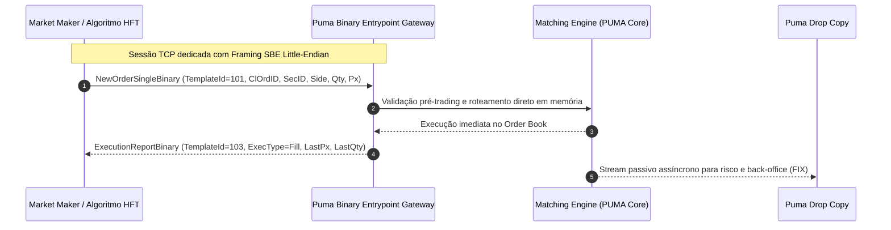

# Especificação Técnica do Protocolo Binário de Negociação — B3 Puma Binary Entrypoint (SBE)

## 1. Visão Geral e Arquitetura do Protocolo

O **PUMA Trading System** da B3 disponibiliza canais de conectividade de ultra-baixa latência destinados a participantes que exigem tempos de resposta determinísticos e processamento de ordens em escala de microssegundos, com foco em participantes **HFT (*High-Frequency Trading*)**, **Formadores de Mercado (*Market Makers*)** e algoritmos proprietários de execução.

Enquanto a interface padrão baseia-se no protocolo textual **FIX (Financial Information eXchange - versões 4.4 e 5.0 SP2)**, a interface de alta performance adota a mensageria binária **SBE (*Simple Binary Encoding*)**, padronizada pela *FIX Trading Community*.

### 1.1 Comparativo: FIX Textual vs. PUMA Binary (SBE)

| Dimensão | FIX Textual (Tag=Value) | PUMA Binary (SBE) | Benefício HFT / Market Making |
|---|---|---|---|
| **Formato de Dados** | Texto ASCII delimitado por SOH (`\x01`) | Binário puro (*byte-level*, tipagem estrita) | Redução de até 70% no overhead de banda de rede |
| **Parsing & Parsing Overhead** | Busca iterativa de delimitadores, conversão string→número | Mapeamento direto de structs em memória (*direct offset*) | Eliminação de alocações de string e parses dinâmicos |
| **Endianness** | Dependente de string parsing | Little-Endian padrão (`<`), alinhado a arquiteturas x86_64 | Acesso direto a registradores de CPU sem conversão |
| **Custo de CPU** | Elevado (tokenização, parsing de ponto flutuante) | Mínimo (*zero-overhead* / cópia zero de structs) | Menor jitter P99 e previsibilidade de execução |
| **Ponto Flutuante** | Strings decimais (`34.50`) | Inteiro de 64 bits em escala fixa (`10^8`) | Imunidade a erros de aproximação de ponto flutuante |

### 1.2 Diagrama do Ciclo de Vida da Mensagem Binária



---

## 2. Estrutura do Cabeçalho Padrão (*Framing Header / Message Header*)

Toda mensagem trafegada no protocolo binário B3 SBE é prefixada por um cabeçalho canônico fixo de **8 bytes** denominado **Message Header**, empacotado em ordem de bytes **Little-Endian** (`<`).

### 2.1 Especificação dos Campos do Message Header

| Offset (Bytes) | Campo | Tipo C | Tipo Python (`struct`) | Tamanho | Descrição e Regras |
|---|---|---|---|---|---|
| `0..1` | `BlockLength` | `uint16_t` | `H` | 2 bytes | Comprimento em bytes do bloco raiz da mensagem (*root block*), excluindo o próprio cabeçalho e eventuais grupos de repetição. |
| `2..3` | `TemplateId` | `uint16_t` | `H` | 2 bytes | Identificador numérico do modelo de mensagem (Template) do schema B3. Ex.: `101` (Nova Ordem), `102` (Cancelamento), `103` (Execução). |
| `4..5` | `SchemaId` | `uint16_t` | `H` | 2 bytes | Identificador da especificação do schema da B3 (default: `1`). |
| `6..7` | `Version` | `uint16_t` | `H` | 2 bytes | Versão da especificação da mensagem (default: `1`). |

**Formato de desempacotamento struct**: `"<HHHH"` (8 bytes exatos).

```text
 0                   1                   2                   3
 0 1 2 3 4 5 6 7 8 9 0 1 2 3 4 5 6 7 8 9 0 1 2 3 4 5 6 7 8 9 0 1
+-+-+-+-+-+-+-+-+-+-+-+-+-+-+-+-+-+-+-+-+-+-+-+-+-+-+-+-+-+-+-+-+
|          BlockLength          |          TemplateId           |
+-+-+-+-+-+-+-+-+-+-+-+-+-+-+-+-+-+-+-+-+-+-+-+-+-+-+-+-+-+-+-+-+
|           SchemaId            |            Version            |
+-+-+-+-+-+-+-+-+-+-+-+-+-+-+-+-+-+-+-+-+-+-+-+-+-+-+-+-+-+-+-+-+
```

---

## 3. Catálogo de Mensagens Binárias Essenciais

### 3.1 Mensagem `NewOrderSingleBinary` (TemplateId = 101)

Mensagem enviada pelo algoritmo para submissão imediata de uma nova ordem no livro de ofertas do PUMA Trading System.

- **TemplateId**: `101`
- **BlockLength**: `34 bytes`
- **Tamanho Total com Header**: `42 bytes`
- **Struct Format (Payload)**: `"<QQBIqBI"`

#### Tabela de Layout de Memória (`NewOrderSingleBinary`)

| Offset Global | Offset Bloco | Campo | Tipo C | Formato | Tamanho | Regras de Negócio e Domínio de Valores |
|---|---|---|---|---|---|---|
| `8..15` | `0..7` | `ClOrdID` | `uint64_t` | `Q` | 8 bytes | Identificador da ordem definido pelo cliente/algoritmo. Deve ser estritamente positivo (`> 0`). |
| `16..23` | `8..15` | `SecurityID` | `uint64_t` | `Q` | 8 bytes | Código numérico unívoco do instrumento negociado na B3 (ex.: SecurityID cadastrado no SecurityList). |
| `24` | `16` | `Side` | `uint8_t` | `B` | 1 byte | Lado da operação: `1` = Buy (Compra), `2` = Sell (Venda). |
| `25..28` | `17..20` | `OrderQty` | `uint32_t` | `I` | 4 bytes | Quantidade total da ordem em unidades/ações. Deve ser estritamente maior que zero (`> 0`). |
| `29..36` | `21..28` | `Price` | `int64_t` | `q` | 8 bytes | Preço unitário da ordem codificado com **escala fixa de 8 casas decimais** (`Preço * 10^8`). Exemplo: R$ 34,50 é enviado como `3450000000`. Deve ser maior que zero (`> 0`). |
| `37` | `29` | `TimeInForce` | `uint8_t` | `B` | 1 byte | Validade da ordem: `0` = Day, `1` = Good Till Cancel (GTC), `3` = Immediate or Cancel (IOC), `4` = Fill or Kill (FOK). |
| `38..41` | `30..33` | `Account` | `uint32_t` | `I` | 4 bytes | Número da conta do investidor/comitente na corretora executante. Deve ser maior que zero (`> 0`). |

---

### 3.2 Mensagem `OrderCancelBinary` (TemplateId = 102)

Mensagem de ultra-baixa latência para cancelamento imediato de uma ordem pendente no livro.

- **TemplateId**: `102`
- **BlockLength**: `28 bytes`
- **Tamanho Total com Header**: `36 bytes`
- **Struct Format (Payload)**: `"<QQQI"`

#### Tabela de Layout de Memória (`OrderCancelBinary`)

| Offset Global | Offset Bloco | Campo | Tipo C | Formato | Tamanho | Regras de Negócio e Domínio de Valores |
|---|---|---|---|---|---|---|
| `8..15` | `0..7` | `ClOrdID` | `uint64_t` | `Q` | 8 bytes | Novo identificador do pedido de cancelamento gerado pelo cliente. |
| `16..23` | `8..15` | `OrigClOrdID` | `uint64_t` | `Q` | 8 bytes | Identificador da ordem original que se deseja cancelar (`ClOrdID` anterior). |
| `24..31` | `16..23` | `SecurityID` | `uint64_t` | `Q` | 8 bytes | Código numérico unívoco do instrumento. Deve coincidir com a ordem original. |
| `32..35` | `24..27` | `Account` | `uint32_t` | `I` | 4 bytes | Conta do investidor vinculada à ordem original. |

---

### 3.3 Mensagem `ExecutionReportBinary` (TemplateId = 103)

Mensagem retornada pela câmara / motor de negociação PUMA confirmando o estado da ordem (inclusão, execução parcial, execução total, cancelamento ou rejeição).

- **TemplateId**: `103`
- **BlockLength**: `54 bytes`
- **Tamanho Total com Header**: `62 bytes`
- **Struct Format (Payload)**: `"<QQQBBQIIqI"`

#### Tabela de Layout de Memória (`ExecutionReportBinary`)

| Offset Global | Offset Bloco | Campo | Tipo C | Formato | Tamanho | Regras de Negócio e Domínio de Valores |
|---|---|---|---|---|---|---|
| `8..15` | `0..7` | `OrderID` | `uint64_t` | `Q` | 8 bytes | Identificador unívoco e sequencial atribuído pelo motor PUMA à ordem. |
| `16..23` | `8..15` | `ClOrdID` | `uint64_t` | `Q` | 8 bytes | Identificador informado pelo cliente no envio da ordem. |
| `24..31` | `16..23` | `ExecID` | `uint64_t` | `Q` | 8 bytes | Identificador unívoco do evento de execução/report emitido pelo PUMA. |
| `32` | `24` | `ExecType` | `uint8_t` | `B` | 1 byte | Tipo de evento: `0` = New, `1` = Partial Fill, `2` = Fill, `4` = Cancelled, `8` = Rejected. |
| `33` | `25` | `OrdStatus` | `uint8_t` | `B` | 1 byte | Estado atual da ordem: `0` = New, `1` = Partially Filled, `2` = Filled, `4` = Cancelled, `8` = Rejected. |
| `34..41` | `26..33` | `SecurityID` | `uint64_t` | `Q` | 8 bytes | Código numérico unívoco do instrumento negociado. |
| `42..45` | `34..37` | `CumQty` | `uint32_t` | `I` | 4 bytes | Quantidade cumulativa já executada desta ordem até o presente momento. |
| `46..49` | `38..41` | `LeavesQty` | `uint32_t` | `I` | 4 bytes | Quantidade remanescente aberta no livro de ofertas (`LeavesQty = OrderQty - CumQty`). |
| `50..57` | `42..49` | `LastPx` | `int64_t` | `q` | 8 bytes | Preço da última execução parcial/total com escala de 8 decimais (`LastPx * 10^8`). Zero em reports de inserção/cancelamento simples. |
| `58..61` | `50..53` | `LastQty` | `uint32_t` | `I` | 4 bytes | Quantidade negociada nesta fatia específica de execução. Zero em reports de status simples. |

---

## 4. Representação Numérica e Escala de Decimais

O protocolo SBE elimina o ponto flutuante binário padrão IEEE-754 (`float`/`double`), que introduz imprecisões de arredondamento inaceitáveis no mercado financeiro e sobrecarga de decodificação.

### 4.1 Fator de Escala de Preço: $10^8$
Todos os preços em ordens e execuções utilizam inteiros com sinal de 64 bits (`int64_t`) e expoente implícito de $-8$:

$$\text{Preço Inteiro Armazenado} = \text{round}(\text{Preço Flutuante} \times 10^8)$$

$$\text{Preço Real (BRL)} = \frac{\text{Preço Inteiro Armazenado}}{10^8}$$

#### Exemplos de Codificação de Preço:
- **R$ 34,50** $\rightarrow$ `34.50 * 100_000_000` = `3450000000` (`0x00000000CD7D3080`)
- **R$ 102,15** $\rightarrow$ `102.15 * 100_000_000` = `10215000000` (`0x0000000260E663C0`)
- **R$ 0,01** (ativo de centavos) $\rightarrow$ `0.01 * 100_000_000` = `1000000` (`0x00000000000F4240`)

---

## 5. Regras de Validação e Integridade Estrita

O módulo de decodificação e processamento deve aplicar verificações rígidas antes de repassar o payload para a estratégia de negociação:

1. **Integridade de Tamanho Físico**:
   - Payloads com menos de 8 bytes são imediatamente rejeitados com erro `SbeTruncatedPayloadError` (cabeçalho incompleto).
   - O tamanho total do pacote deve ser exatamente igual a `8 + BlockLength`. Se o buffer contiver menos bytes do que o esperado, rejeita com `SbeTruncatedPayloadError`.
2. **Validação de Template ID**:
   - O campo `TemplateId` deve pertencer ao catálogo suportado: `101`, `102` ou `103`. Templates desconhecidos disparam `SbeUnknownTemplateError`.
3. **Validação Semântica de Domínio**:
   - `OrderQty > 0`: Quantidade de ordem menor ou igual a zero é rejeitada com `SbeValidationError`.
   - `Price > 0`: Preço em ordem de compra/venda menor ou igual a zero é rejeitado com `SbeValidationError`.
   - `Side in (1, 2)`: Lado diferente de 1 (Compra) ou 2 (Venda) é rejeitado com `SbeValidationError`.
   - `Account > 0`: Código de comitente zerado é rejeitado com `SbeValidationError`.
   - `LeavesQty + CumQty = Total`: Em execuções integrais, `LeavesQty == 0` e `LastQty > 0`.

---

## 6. Considerações de Engenharia de Baixa Latência

1. **Little-Endian Nativo**: Como a grande maioria dos servidores x86-64 em colocation opera em little-endian, a serialização `<` preserva o alinhamento de registradores de CPU sem penalidade de troca de bytes (`bswap`).
2. **Zero-Copy & Zero-Overhead**: Em ambientes de produção C++/Rust ou Python com buffers pré-alocados (`memoryview` ou `struct.pack_into`), o payload pode ser construído sem alocar novos objetos na memória heap do sistema operacional.
3. **Prevenção de GC Trashing**: A reutilização de instâncias fixas ou buffers circulares minimiza pausas de *Garbage Collection* no runtime de execução.
