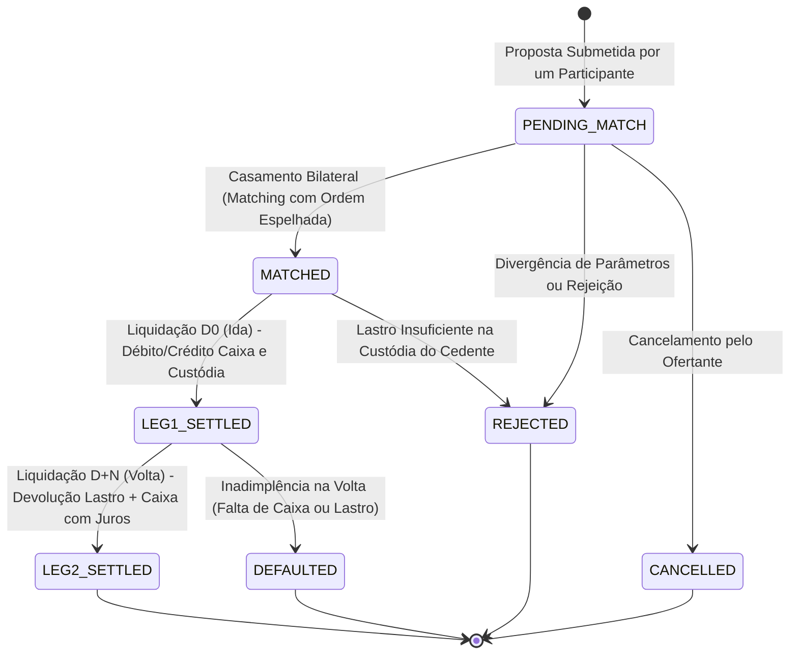

# Plataforma B3 — Operações Compromissadas (Repo / Reverse Repo) de Renda Fixa Pública e Privada (FL-023)

## 1. Visão Geral e Contexto de Mercado

As **Operações Compromissadas** (*Sale and Repurchase Agreements* ou *Repos*) constituem a principal ferramenta de gestão de liquidez diária do Sistema Financeiro Nacional (SFN) e o alicerce para a execução da política monetária do Banco Central do Brasil (Bacen). Juridicamente reguladas pelo Conselho Monetário Nacional (CMN) e fiscalizadas pelo Bacen e CVM, caracterizam-se pela **venda/compra de títulos de renda fixa com o compromisso irrevogável de recompra/revenda** dos mesmos ativos (ou de ativos fungíveis equivalentes) em data futura acordada, a um preço ou taxa prefixada ou pós-fixada.

Na infraestrutura de mercado da B3 e do Selic:
- As compromissadas lastreadas em **Títulos Públicos Federais (TPF)** são registradas e liquidadas primordialmente via **Selic** e câmara Cetip/B3.
- As compromissadas lastreadas em **Títulos de Renda Fixa Privada Bancária e Corporativa** são registradas, casadas bilateralmente e liquidadas na plataforma **NoMe (Novo Mercado de Balcão B3)**.

Este documento formaliza as especificações técnicas, modelos de ciclo de vida, regras de batimento bilateral, direitos de movimentação sobre o lastro e equações determinísticas de liquidação sob a convenção DU/252 para a frente **`FL-023`**.

---

## 2. Modalidades e Classificação de Operações Compromissadas

### 2.1. Pontas da Operação (Sides)

Toda operação compromissada é bilateral e envolve duas posições simétricas:

1. **Venda com Compromisso de Recompra (Repo / Tomador de Recursos / Doador de Lastro / Cedente)**:
   - **Perna de Ida ($D_0$)**: Vende os títulos e recebe os recursos financeiros (caixa).
   - **Vigência ($D_0 \to D_N$)**: Fica passivo na operação financeira e doador do ativo de lastro.
   - **Perna de Volta ($D_N$)**: Devolve o caixa acrescido dos juros da operação e recompra o lastro.
2. **Compra com Compromisso de Revenda (Reverse Repo / Doador de Recursos / Tomador de Lastro / Cessionário)**:
   - **Perna de Ida ($D_0$)**: Compra os títulos e entrega os recursos financeiros.
   - **Vigência ($D_0 \to D_N$)**: Fica ativo na operação financeira e detentor temporário do lastro.
   - **Perna de Volta ($D_N$)**: Revende os títulos recebendo o caixa principal acrescido da remuneração pactuada.

### 2.2. Modalidades de Lastro Elegíveis

| Código da Modalidade | Categoria de Ativo | Títulos Típicos | Ambiente de Custódia / Registro | Características do Lastro |
|---|---|---|---|---|
| `PUBLIC_OVERNIGHT` | Título Público Federal | LFT, LTN, NTN-F, NTN-B | Selic / Cetip B3 | Risco soberano; liquidação em 1 dia útil para nivelamento de reservas bancárias. |
| `PUBLIC_TERM` | Título Público Federal | LFT, LTN, NTN-F, NTN-B | Selic / Cetip B3 | Prazo predeterminado ($D+N$ dias úteis); lastro em papéis pós ou indexados à inflação. |
| `PRIVATE_OVERNIGHT` | Título Privado | CDB, Debêntures, LF | Balcão NoMe B3 | Emissão bancária ou corporativa de alta liquidez para funding diário. |
| `PRIVATE_TERM` | Título Privado | CDB, Debêntures, CRI, CRA, LCI, LCA | Balcão NoMe B3 | Financiamento a termo de carteira de crédito ou balcão corporativo. |

#### Características dos Títulos de Lastro:
- **LFT (Letra Financeira do Tesouro)**: Título pós-fixado indexado à Taxa Selic diária.
- **LTN (Letra do Tesouro Nacional)**: Título com remuneração pré-fixada e valor de face no vencimento de R$ 1.000,00.
- **NTN-F (Nota do Tesouro Nacional Série F)**: Título pré-fixado com cupons de juros semestrais (10% a.a.).
- **NTN-B (Nota do Tesouro Nacional Série B)**: Título indexado à variação do IPCA com cupons semestrais de 6% a.a.
- **CDB (Certificado de Depósito Bancário)**: Título emitido por instituições financeiras, usualmente remunerado em percentual do CDI.
- **Debêntures**: Títulos de dívida corporativa com ou sem garantias reais, emitidos por sociedades anônimas.

### 2.3. Direitos sobre o Lastro (Collateral Rights)

A regulamentação brasileira (Resolução CMN nº 3.339/2006 e normas da B3/Selic) distingue duas categorias fundamentais de direito sobre os títulos entregues em garantia:

1. **Com Livre Movimentação (`COM_LIVRE_MOVIMENTACAO` / *Right of Rehypothecation / Free Mobility*)**:
   - O comprador/cessionário adquire a propriedade plena e irrestrita dos títulos durante a vigência do contrato.
   - Pode vender, re-emprestar (*re-repo*) ou caucionar os títulos em câmaras de compensação.
   - Na perna de volta ($D_N$), o cessionário é estritamente obrigado a devolver títulos da mesma espécie, emissor, vencimento e quantidade. Se não tiver os títulos em sua custódia disponível no vencimento, incorre em inadimplência e penalidades contratuais (*default*).
2. **Sem Livre Movimentação (`SEM_LIVRE_MOVIMENTACAO` / *Locked Collateral / Without Reuse*)**:
   - Os títulos de lastro permanecem formalmente na titularidade do cedente, porém imobilizados e bloqueados em subconta de custódia vinculada na depositária B3 (ou Selic) em favor do cessionário.
   - O cessionário possui a garantia real (*collateral lien*), mas **não pode movimentar nem alienar** os ativos a terceiros.
   - Na perna de volta, com o pagamento do montante financeiro devido, a B3 libera o bloqueio de custódia do cedente automaticamente.

---

## 3. Modelo de Ciclo de Vida e Batimento Bilateral

O ciclo de vida da compromissada compreende 4 fases principais: Registro e Matching, Liquidação da Perna de Ida, Vigência / Acompanhamento, e Liquidação da Perna de Volta.

### 3.1. Máquina de Estados da Operação



### 3.2. Batimento Bilateral de Condições Contratuais (*Matching Engine*)

Para que uma operação compromissada a termo ou overnight seja aceita no NoMe B3, ambas as instituições financeiras (ou seus respectivos intermediários de roteamento) devem submeter instruções perfeitamente compatíveis. O motor de matching verifica a coincidência exata dos seguintes atributos:

1. **Código do Ativo de Lastro (`asset_code`)**: Deve ser idêntico em ambas as ordens.
2. **Modalidade da Operação (`modality`)**: Público/Privado, Overnight/A Prazo.
3. **Direito sobre o Lastro (`collateral_right`)**: Ambas as pontas devem concordar expressamente se há ou não livre movimentação.
4. **Quantidade de Títulos (`quantity`)**: Quantidade inteira idêntica ($Q_{venda} = Q_{compra} > 0$).
5. **Preço Unitário de Ida ($PU_{ida}$)**: Preço de negociação unitário do lastro na ida.
6. **Data de Liquidação da Ida (`settlement_date_ida`)**: Data efetiva da perna 1 ($D_0$).
7. **Data de Liquidação da Volta (`settlement_date_volta`)**: Data de vencimento da operação ($D_N \ge D_0$).
8. **Prazo em Dias Úteis (`business_days`)**: Quantidade de dias úteis entre ida e volta ($DU \ge 1$).
9. **Regime de Remuneração e Taxa**:
   - Tipo de taxa (`PRE`, `CDI_PERCENT` ou `CDI_SPREAD`).
   - Valor da taxa ou percentual acordado (ex: 100.00% do CDI, 12.50% a.a.).
10. **Preço Unitário de Volta ($PU_{volta}$)**: Verificado contra a fórmula de remuneração com tolerância de arredondamento ($\le 0,0001$).
11. **Relação de Contrapartes**: O vendedor indica a conta do comprador, e o comprador indica a conta do vendedor (não é permitida mesma conta em ambas as pontas).

### 3.3. Diagrama de Sequência do Ciclo Completo

```mermaid
sequenceDiagram
    autonumber
    participant Cedente as Participante Cedente (Vendedor)
    participant NoMe as Motor NoMe B3 (RepoLifecycleEngine)
    participant Cessionario as Participante Cessionário (Comprador)
    participant Custodia as Depositária / Selic / NoMe Custódia
    participant Financeiro as Sistema de Liquidação (STR / Selic / Multilateral)

    Note over Cedente,Cessionario: Fase 1 — Registro e Matching Bilateral
    Cedente->>NoMe: Submit Proposal (Venda Recompra, Ativo, Qtd, PU Ida, Taxa, D0, DN)
    Cessionario->>NoMe: Submit Proposal (Compra Revenda, Ativo, Qtd, PU Ida, Taxa, D0, DN)
    NoMe->>NoMe: Batimento Bilateral de Parâmetros (Taxas, PU, Datas, Lastro)
    NoMe-->>Cedente: Confirmação de Casamento (Status: MATCHED)
    NoMe-->>Cessionario: Confirmação de Casamento (Status: MATCHED)

    Note over Cedente,Cessionario: Fase 2 — Liquidação da Perna de Ida (D0)
    NoMe->>Custodia: Valida Saldo Disponível de Lastro do Cedente (Saldo >= Qtd)
    alt Saldo Insuficiente
        NoMe-->>Cedente: Rejeição por Saldo Insuficiente (Status: REJECTED)
        NoMe-->>Cessionario: Rejeição da Operação (Status: REJECTED)
    else Saldo Suficiente
        Financeiro->>Financeiro: Débito Fin_Ida no Cessionário e Crédito no Cedente
        alt Com Livre Movimentação
            Custodia->>Custodia: Transfere Títulos da Custódia Cedente para Custódia Cessionário
        else Sem Livre Movimentação
            Custodia->>Custodia: Bloqueia Títulos na Conta Cedente Vinculados ao Cessionário
        end
        NoMe-->>Cedente: Perna de Ida Liquidada (Status: LEG1_SETTLED)
        NoMe-->>Cessionario: Perna de Ida Liquidada (Status: LEG1_SETTLED)
    end

    Note over Cedente,Cessionario: Fase 3 — Vigência da Operação (D0 até DN)
    Note over Cedente,Cessionario: Recursos em posse do Cedente; Títulos sob posse/bloqueio do Cessionário

    Note over Cedente,Cessionario: Fase 4 — Liquidação da Perna de Volta (DN)
    Financeiro->>Financeiro: Débito Fin_Volta no Cedente e Crédito no Cessionário (Capital + Juros)
    alt Com Livre Movimentação
        Custodia->>Custodia: Transfere Títulos da Custódia Cessionário de volta para o Cedente
    else Sem Livre Movimentação
        Custodia->>Custodia: Desbloqueia Títulos na Conta do Cedente
    end
    NoMe-->>Cedente: Operação Concluída com Sucesso (Status: LEG2_SETTLED)
    NoMe-->>Cessionario: Operação Concluída com Sucesso (Status: LEG2_SETTLED)
```

---

## 4. Equações e Matemática Financeira de Liquidação (Convenção DU/252)

A precificação e a liquidação das operações compromissadas no mercado brasileiro seguem o regime de **juros compostos com contagem de dias úteis sobre base anual de 252 dias úteis ($DU/252$)**, conforme as fórmulas oficiais da B3 e da antiga Cetip.

### 4.1. Perna de Ida ($D_0$)

O valor financeiro de ida ($Fin_{ida}$) representa o montante financeiro desembolsado pelo comprador e recebido pelo vendedor:

$$Fin_{ida} = \text{round}\left( Quantidade \times PU_{ida},\, 2 \right)$$

Onde:
- $Quantidade \in \mathbb{N}^*$: número inteiro de títulos dados em lastro.
- $PU_{ida}$: Preço Unitário negociado para o ativo na ida (8 casas decimais).

### 4.2. Perna de Volta ($D_N$) — Modalidade Pré-fixada (`PRE`)

Na compromissada pré-fixada, a taxa anual de remuneração ($Taxa_{aa}$) é contratada na ida. O fator de remuneração acumulado para o período de $n$ dias úteis ($DU$) é dado por:

$$Fator_{pre} = \left( 1 + \frac{Taxa_{aa}}{100} \right)^{\frac{DU}{252}}$$

O Preço Unitário de volta ($PU_{volta}$) e o financeiro de volta ($Fin_{volta}$) são:

$$PU_{volta} = \text{round}\left( PU_{ida} \times Fator_{pre},\, 8 \right)$$

$$Fin_{volta} = \text{round}\left( Quantidade \times PU_{volta},\, 2 \right)$$

O rendimento financeiro bruto ($Rendimento$) recebido pelo comprador é:

$$Rendimento = Fin_{volta} - Fin_{ida}$$

### 4.3. Perna de Volta ($D_N$) — Modalidade Pós-fixada (% do CDI)

Nas operações indexadas a percentual da Taxa DI / CDI (ex.: 100,00% do CDI), a apuração do fator diário segue o padrão Cetip/B3:

1. **Taxa DI Diária ($FDI_k$)**:
   Para cada dia útil $k$ do período, a partir da taxa anual divulgada $TDI_k$ (% a.a.):
   $$FDI_k = \text{round}\left( \left( 1 + \frac{TDI_k}{100} \right)^{\frac{1}{252}},\, 8 \right)$$

2. **Fator Diário Remunerado ($Fator_k$)**:
   Aplica-se o percentual pactuado $p$ (% CDI, ex: 100,00):
   $$Fator_k = \text{round}\left( 1 + (FDI_k - 1) \times \frac{p}{100},\, 8 \right)$$

3. **Fator Acumulado do Período ($Fator_{acum}$)**:
   $$Fator_{acum} = \prod_{k=1}^{DU} Fator_k$$
   Arredondado a 8 ou 16 casas decimais na multiplicação sucessiva e truncado/arredondado a 8 casas para precificação final.

4. **PU e Financeiro de Volta**:
   $$PU_{volta} = \text{round}\left( PU_{ida} \times Fator_{acum},\, 8 \right)$$
   $$Fin_{volta} = \text{round}\left( Quantidade \times PU_{volta},\, 2 \right)$$

#### Caso Particular de Taxa DI Média Projetada:
Quando calculada na data de contratação para efeito de fixação de PU de volta acordado ou projeção com taxa DI constante $TDI$:
$$FDI = \text{round}\left( \left( 1 + \frac{TDI}{100} \right)^{\frac{1}{252}},\, 8 \right)$$
$$Fator_k = \text{round}\left( 1 + (FDI - 1) \times \frac{p}{100},\, 8 \right)$$
$$Fator_{acum} = \text{round}\left( (Fator_k)^{DU},\, 8 \right)$$

### 4.4. Modalidade Pós-fixada com Spread (CDI + Spread % a.a.)

Quando a operação estabelece spread anual sobre o CDI (ex.: CDI + 1,50% a.a.):
$$Fator_{spread} = \text{round}\left( \left( 1 + \frac{Spread_{aa}}{100} \right)^{\frac{DU}{252}},\, 8 \right)$$
$$Fator_{total} = \text{round}\left( Fator_{CDI} \times Fator_{spread},\, 8 \right)$$
$$PU_{volta} = \text{round}\left( PU_{ida} \times Fator_{total},\, 8 \right)$$

---

## 5. Estrutura do Documento JSON de Registro e Confirmação

Exemplo de payload canônico para operação compromissada a prazo lastreada em NTN-B a 100% do CDI com livre movimentação:

```json
{
  "trade_id": "REPO-NTNB-20261103-001",
  "modality": "PUBLIC_TERM",
  "collateral_right": "COM_LIVRE_MOVIMENTACAO",
  "status": "MATCHED",
  "trade_date": "2026-11-03",
  "settlement_date_ida": "2026-11-03",
  "settlement_date_volta": "2026-12-16",
  "business_days": 30,
  "collateral": {
    "asset_code": "NTNB-20350515",
    "asset_type": "NTNB",
    "issuer": "TESOURO NACIONAL",
    "maturity_date": "2035-05-15",
    "is_public": true,
    "description": "Nota do Tesouro Nacional Série B (IPCA + 6.00% a.a.)"
  },
  "quantity": 1000,
  "unit_price_ida": "4125.50000000",
  "financial_amount_ida": "4125500.00",
  "rate": {
    "rate_type": "CDI_PERCENT",
    "rate_value": "100.00",
    "spread": "0.00",
    "benchmark_annual_rate": "11.25"
  },
  "unit_price_volta": "4178.19249495",
  "financial_amount_volta": "4178192.49",
  "seller": {
    "participant_id": "00000033",
    "custody_account": "330001",
    "settlement_account": "00000339911",
    "name": "BANCO CEDENTE S.A."
  },
  "buyer": {
    "participant_id": "00001050",
    "custody_account": "105001",
    "settlement_account": "00010508823",
    "name": "CORRETORA CESSIONARIA S.A."
  }
}
```

---

## 6. Governança e Validações de Integridade

O módulo executor (`src/repo_compromissadas.py`) impõe as seguintes regras estritas em nível de domínio:

1. **Conservação de Lastro**: Em operações `COM_LIVRE_MOVIMENTACAO`, a soma de custódia entre as contas envolvidas permanece estritamente invariante ($Saldo_{cedente} + Saldo_{cessionario} = Constante$).
2. **Batimento de Arredondamentos**: Os valores financeiros de ida e volta devem coincidir ao centavo com $Qtd \times PU$.
3. **Impossibilidade de Taxa Negativa Indevida**: Taxas pré-fixadas e percentuais de CDI devem ser não-negativos.
4. **Coerência Cronológica**: $Data_{ida} \ge Data_{negociacao}$ e $Data_{volta} > Data_{ida}$ (ou no mínimo igual se intra-dia, mas para compromissada a prazo $DU \ge 1$).
5. **Segregação de Contas**: A conta de custódia cedente e cessionária não podem ser idênticas.
