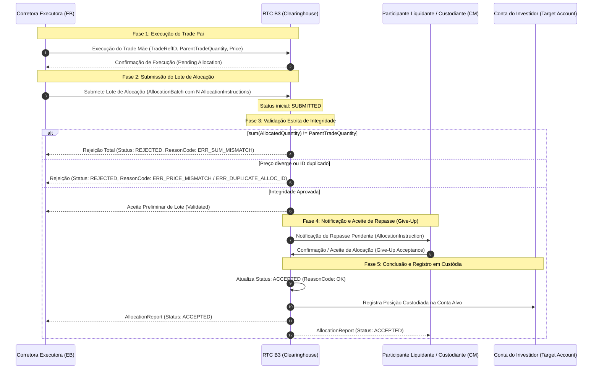
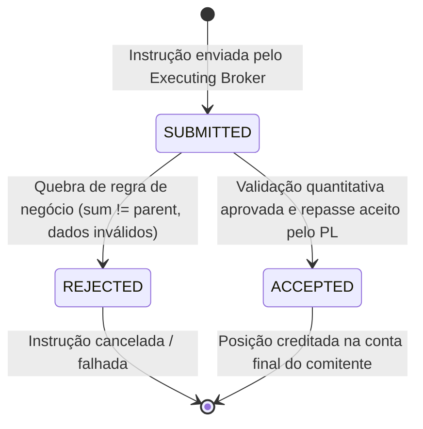

# Especificação Técnica do Fluxo de Alocação e Repasse de Operações (FL-008) — B3 RTC (Real-Time Clearing)

## 1. Visão Geral e Contexto de Mercado

No ecossistema de negociação e pós-negociação da **B3 S.A. – Brasil, Bolsa, Balcão**, o fluxo **FL-008 (Alocar e repassar operações)** é o pilar que conecta a execução de ordens institucionais no **PUMA Trading System** ao registro de custódia e risco em tempo real no **RTC (Real-Time Clearing)**.

Quando uma corretora executora (*Executing Broker*) fecha uma ordem institucional em bloco (*Block Trade* ou *Order Aggregation*) no livro de ofertas ou via direto (cross), a operação é provisoriamente registrada em sua conta executora/transitória (*Master / Omnibus Account*). 

Para que as operações sejam liquidadas e mantidas nas contas segregadas dos investidores finais (fundos de investimento 555, carteiras administradas, clubes de investimento ou investidores não residentes), a instituição deve submeter **instruções de alocação e repasse (*Give-Up*)** no RTC.

```
+------------------------+      Trades Mãe (Executados)     +--------------------+
| PUMA Trading System    | ==============================> |   RTC - B3 S.A.    |
| (Negociação de Ativos) |                                 | (Clearinghouse     |
+------------------------+                                 |  Tempo Real)       |
                                                                     ||
+------------------------+      Instruções de Alocação/Lote         ||
| Corretora Executora    | ----------------------------------------->||
| (Executing Broker)     |                                           ||
+------------------------+                                           ||
                                                                     || Validação Estrita:
                                                                     || sum(AllocQty) == ParentQty
                                                                     \/
                                                        +-----------------------------+
                                                        | Aceite de Repasse (Give-Up) |
                                                        +-----------------------------+
                                                                     ||
                                                                     \/
                                                        +-----------------------------+
                                                        | Participante Liquidante /   |
                                                        | Custodiante (Clearing Member|
                                                        | & Investor Accounts)        |
                                                        +-----------------------------+
```

---

## 2. Ciclo de Vida da Alocação e Repasse

O ciclo de vida da alocação no RTC é governado por uma máquina de estados síncrona e assíncrona, assegurando idempotência, integridade quantitativa e rastreabilidade ponta a ponta.

### 2.1 Atores Envolvidos

1. **Executing Broker (Corretora Executora)**: Instituição autorizada a negociar no PUMA Trading System responsável por executar o negócio-mãe (*Parent Trade*) e originar as instruções de desdobramento.
2. **Clearing Member / Participante Liquidante (PL)**: Instituição responsável perante a Câmara B3 pela liquidação financeira e prestação de garantias das contas finais dos comitentes.
3. **Custodiante / Banco Liquidante**: Entidade responsável pela custódia física/escritural dos ativos alocados nas contas de custódia final (*Investor Accounts*).
4. **Câmara B3 (RTC Core)**: Núcleo de compensação e liquidação que valida as regras de negócio, impõe limites de crédito intra-dia e garante o princípio estrito de equilíbrio quantitativo.

### 2.2 Diagrama de Sequência do Ciclo de Vida



### 2.3 Máquina de Estados da Instrução de Alocação

Cada instrução de alocação transita pelos seguintes estados formais:



- **`SUBMITTED`**: A instrução foi despachada pela corretora executora e ingressou na fila de processamento e validação do RTC.
- **`ACCEPTED`**: A instrução cumpriu todas as regras de validação quantitativa, consistência referencial de preço e foi acatada pelo participante liquidante / custodiante de destino.
- **`REJECTED`**: A instrução (ou o lote inteiro) foi repelida pelo motor do RTC devido a quebra de invariantes matemáticos, dados cadastrais incorretos ou rejeição explícita pelo participante liquidante.

---

## 3. Dicionário de Dados do Fluxo de Alocação RTC

A estrutura de mensageria de alocação do RTC baseia-se em conceitos alinhados aos padrões internacionais FIX Protocol (mensagens `AllocationInstruction [MsgType=J]` e `AllocationReport [MsgType=AS]`) e aos formatos proprietários JSON/XML do RTC B3.

### 3.1 Campos da Instrução de Alocação (`AllocationInstruction`)

| Campo | Tipo | Obrig. | Formato / Domínio | Descrição e Regras | FIX Tag Eq. |
|---|---|---|---|---|---|
| `AllocationID` | String | Sim | `^[A-Z0-9_-]{8,36}$` | Identificador único unívoco da parcela de alocação no lote/dia. | Tag 70 (`AllocID`) |
| `TradeRefID` | String | Sim | `^[A-Z0-9_-]{8,36}$` | Identificador único do negócio-mãe de referência executado no PUMA. | Tag 17 (`ExecID`) / Tag 571 |
| `TargetAccount` | Integer | Sim | `1 .. 999999999` | Número da conta do investidor / fundo na instituição liquidante. | Tag 79 (`AllocAccount`) |
| `TargetClearingMember` | Integer | Sim | `1 .. 9999` | Código de compensação (PN/PL) do participante de liquidação na B3. | Tag 439 (`ClearingFirm`) |
| `AllocatedQuantity` | Decimal | Sim | `Decimal > 0` | Quantidade de títulos ou contratos alocados para a conta alvo. | Tag 80 (`AllocQty`) |
| `AllocationPrice` | Decimal | Sim | `Decimal > 0` (4 dec) | Preço unitário da operação alocada (paritário ao negócio original). | Tag 366 (`AllocAvgPx`) |
| `AllocationRole` | String | Sim | Enum (`GIVE_UP`, `ALLOCATION`, `INVESTOR`) | Papel da alocação no repasse: `GIVE_UP` (repasse a terceiro), `ALLOCATION` (conta da mesma corretora), `INVESTOR` (cliente direto). | Tag 626 (`AllocType`) |
| `Status` | String | Sim | Enum (`SUBMITTED`, `ACCEPTED`, `REJECTED`) | Estado corrente de processamento da parcela no motor RTC. | Tag 87 (`AllocStatus`) |
| `ReasonCode` | String | Não | Enum (`ReasonCode`) | Código padronizado do motivo de rejeição ou confirmação (`OK`). | Tag 776 (`AllocRejectCode`) |
| `InvestorName` | String | Não | Até 60 caracteres | Razão social ou denominação do fundo/investidor comitente. | Tag 453 (`PartyName`) |
| `Timestamp` | DateTime | Não | ISO 8601 UTC | Data e hora do registro ou alteração de estado da instrução. | Tag 60 (`TransactTime`) |

---

## 4. Regras Estritas de Validação de Negócio

O motor do RTC impõe verificações atômicas sobre o lote de alocação (`AllocationBatch`):

### 4.1 Invariante de Equilíbrio Quantitativo (Strict Sum Balance Rule)

A regra máxima do RTC dita que **nenhuma fração de lote pode criar ou destruir ativos**:

$$\sum_{k=1}^{N} \text{AllocatedQuantity}_k = \text{ParentTradeQuantity}$$

- Se $\sum \text{AllocatedQuantity} > \text{ParentTradeQuantity}$: Violação por sobre-alocação (*Over-allocation*). O motor deve emitir `ERR_OVER_ALLOCATION` (ou `ERR_SUM_MISMATCH`) e rejeitar o lote.
- Se $\sum \text{AllocatedQuantity} < \text{ParentTradeQuantity}$: Violação por sub-alocação (*Under-allocation*). Saldo residual não autorizado; o motor deve emitir `ERR_UNDER_ALLOCATION` (ou `ERR_SUM_MISMATCH`) e rejeitar o lote.

### 4.2 Positividade Quantitativa
$$\forall k, \quad \text{AllocatedQuantity}_k > 0$$
Quantidades iguais a zero, fracionárias não permitidas no lote padrão de ações ou negativas geram `ERR_QTY_NON_POSITIVE`.

### 4.3 Consistência Paritária de Preço (Parity Price Rule)
Em desdobramentos de negócios simples com preço fixo:
$$\forall k, \quad \text{AllocationPrice}_k = \text{ParentTradePrice}$$
Qualquer divergência de preço não autorizada acarreta `ERR_PRICE_MISMATCH`.

### 4.4 Unicidade do Identificador de Alocação
$$\forall i \neq j, \quad \text{AllocationID}_i \neq \text{AllocationID}_j$$
A detecção de identificador duplicado dentro do mesmo lote gera `ERR_DUPLICATE_ALLOCATION_ID`.

### 4.5 Integridade de Vínculo do Negócio Pai
$$\forall k, \quad \text{TradeRefID}_k = \text{ParentTrade.TradeRefID}$$
Caso uma instrução aponte para um negócio diferente do trade pai do lote, o motor gera `ERR_TRADE_REF_MISMATCH`.

---

## 5. Tabela Canônica de Códigos de Motivo (Reason Codes)

| ReasonCode | Categoria | Descrição | Ação Corretiva Recomendada |
|---|---|---|---|
| `OK` | Sucesso | Instrução validada, conferida e acolhida com sucesso. | Nenhuma. Registro liquidado em custódia. |
| `ERR_SUM_MISMATCH` | Regra Quantitativa | A soma das parcelas alocadas diverge da quantidade total do trade pai. | Rebalancear as parcelas de modo que $\sum \text{AllocQty} = \text{ParentQty}$. |
| `ERR_OVER_ALLOCATION` | Regra Quantitativa | A quantidade alocada total excede a quantidade executada do trade mãe. | Reduzir as quantidades das contas no lote. |
| `ERR_UNDER_ALLOCATION` | Regra Quantitativa | A quantidade alocada total é inferior à quantidade do trade mãe (sobra residual). | Complementar a alocação de todo o saldo remanescente. |
| `ERR_QTY_NON_POSITIVE` | Validação de Campo | Parcela possui quantidade menor ou igual a zero. | Informar quantidade estritamente positiva. |
| `ERR_PRICE_MISMATCH` | Validação de Negócio | O preço da alocação diverge do preço contratado no trade pai. | Corrigir o preço unitário para igualar o preço de execução. |
| `ERR_TRADE_REF_MISMATCH` | Integridade Referencial | O identificador do trade de referência difere do cabeçalho do lote. | Corrigir a referência do trade mãe (`TradeRefID`). |
| `ERR_DUPLICATE_ALLOCATION_ID` | Integridade Cadastral | O mesmo `AllocationID` foi submetido mais de uma vez no lote. | Gerar identificadores UUID/sequenciais unívocos por parcela. |
| `ERR_INVALID_ACCOUNT` | Validação Cadastral | O campo `TargetAccount` está vazio ou contém valor inválido. | Informar o número de conta de custódia cadastrado no SINACOR/Câmara. |
| `ERR_INVALID_CLEARING_MEMBER` | Validação Cadastral | O participante liquidante (`TargetClearingMember`) não foi especificado. | Indicar código do participante de compensação habilitado. |
| `ERR_EMPTY_BATCH` | Validação Estrutural | O lote não contém nenhuma instrução de alocação. | Submeter pelo menos uma instrução de alocação válida. |

---

## 6. Exemplo de Carga Útil (Payload JSON RTC)

### 6.1 Lote Válido de Alocação Paritária (10.000 ações divididas em 3 fundos)
```json
{
  "batch_id": "BATCH-20261103-0001",
  "parent_trade": {
    "trade_ref_id": "TRD-20261103-008891",
    "symbol": "PETR4",
    "executing_broker": 88,
    "parent_trade_quantity": 10000,
    "parent_trade_price": "38.50",
    "trade_date": "2026-11-03",
    "side": "BUY"
  },
  "instructions": [
    {
      "allocation_id": "ALLOC-20261103-0001-01",
      "trade_ref_id": "TRD-20261103-008891",
      "target_account": 100201,
      "target_clearing_member": 105,
      "allocated_quantity": 5000,
      "allocation_price": "38.50",
      "allocation_role": "GIVE_UP",
      "status": "SUBMITTED",
      "investor_name": "FUNDO ALFA FIA",
      "reason_code": null
    },
    {
      "allocation_id": "ALLOC-20261103-0001-02",
      "trade_ref_id": "TRD-20261103-008891",
      "target_account": 100202,
      "target_clearing_member": 105,
      "allocated_quantity": 3000,
      "allocation_price": "38.50",
      "allocation_role": "GIVE_UP",
      "status": "SUBMITTED",
      "investor_name": "FUNDO BETA MULTIMERCADO FIM",
      "reason_code": null
    },
    {
      "allocation_id": "ALLOC-20261103-0001-03",
      "trade_ref_id": "TRD-20261103-008891",
      "target_account": 100203,
      "target_clearing_member": 105,
      "allocated_quantity": 2000,
      "allocation_price": "38.50",
      "allocation_role": "GIVE_UP",
      "status": "SUBMITTED",
      "investor_name": "FUNDO GAMA PREVIDENCIA FIFE",
      "reason_code": null
    }
  ]
}
```
**Resultado da Validação**: $\text{Total Alocado} = 5.000 + 3.000 + 2.000 = 10.000$. Status atualizado para `ACCEPTED`, `ReasonCode: OK`.

---

## 7. Relação com Outros Fluxos do Atlas B3

O fluxo de alocação em tempo real FL-008 alimenta e antecede outros fluxos essenciais:
- **FL-004 (IMBARQ004)**: Os lançamentos financeiros de débito/crédito refletirão os valores alocados nas contas de liquidação após a aceitação do repasse.
- **FL-002 (IMBARQ006)**: As posições em aberto ao final do pregão coincidirão com as parcelas alocadas por conta e por ativo.
- **FL-005 (IMBARQ014)**: As chamadas de margem e garantias (CORE) serão recalculadas para cada participante liquidante receptor das parcelas alocadas.
