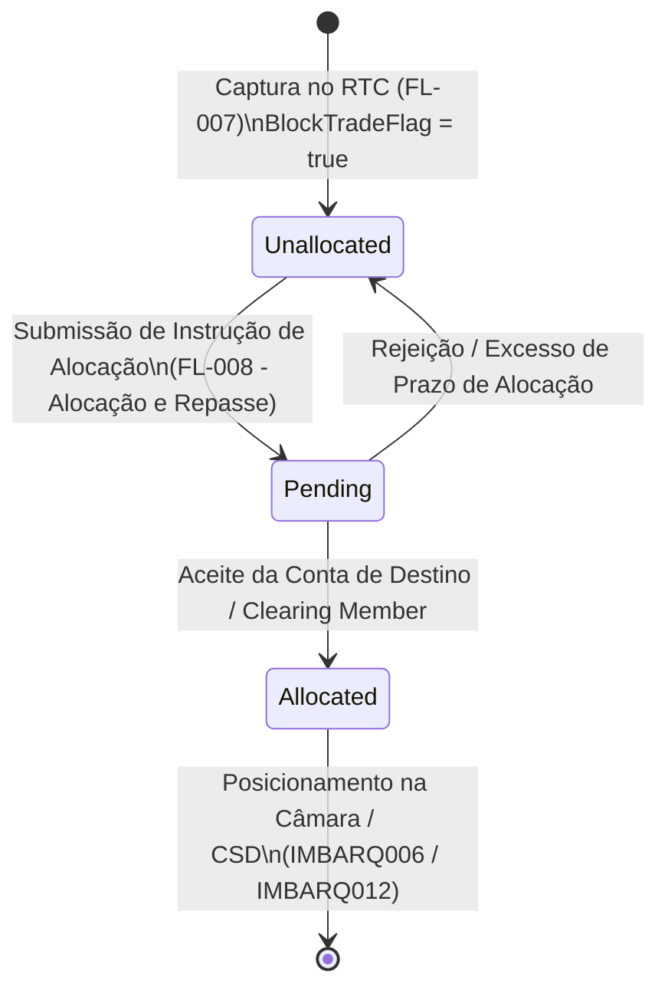

# Especificação Técnica do Modelo de Captura de Operações em Bloco — B3 Real-Time Clearing (RTC)

## 1. Visão Geral e Arquitetura do Protocolo RTC

O **Real-Time Clearing (RTC)** da B3 é a plataforma central de compensação e liquidação em tempo real para ativos negociados nos mercados de renda variável (ações e fundos listados), opções, derivativos e balcão organizado.

Diferentemente dos fluxos em lote via arquivos planos de conciliação do iMercado (como `IMBARQ004`, `IMBARQ006`, `IMBARQ011`, `IMBARQ012` e `IMBARQ014`), o módulo **RTC** atua no modelo *event-driven* (orientado a eventos e mensagens em tempo de execução durante o pregão), capturando os negócios confirmados nos motores de negociação (PUMA Trading System) e provendo a ingestão contínua de operações para mitigação de risco e alocação.

O fluxo **FL-007 (Captura de Operações em Bloco)** é responsável pela captura, recepção, validação sintática e de regras de negócio de trades originados por negociações de grande porte (*block trades* / operações estruturadas / diretos especiais) que demandam validação estrita prévia antes de serem encaminhadas para a esteira de alocação e repasse de custódia (**FL-008**).

### 1.1 Objetivos e Escopo
- **Captura Determinística**: Ingestão de mensagens de confirmação de trade em formato de lotes (*batches*) e eventos únicos.
- **Validação Estrita de Negócio B3**:
  - Rejeição imediata de negócios com preços ou quantidades nulos, zero ou negativos.
  - Conformidade de códigos de ativo (Ticker/Symbol) e identificadores internacionais (ISIN de 12 caracteres).
  - Validação estrita do sentido da operação (`BUY` / `SELL`).
  - Verificação de elegibilidade de blocos (`BlockTradeFlag = true`).
  - Monitoramento do ciclo de vida de alocação (`AllocationStatus`: `Unallocated`, `Pending`, `Allocated`).
- **Rastreabilidade de Participantes**: Identificação e amarração explícita entre Corretora Executante (*Executing Broker*), Membro de Compensação (*Clearing Broker*) e Contraparte (*Counterparty*).

---

## 2. Estrutura do Modelo de Mensagens

A comunicação no RTC opera por mensageria padronizada (JSON e FIX Protocol / Trade Capture Report). Para consumo por serviços de mensageria e microserviços de pós-negociação, o modelo adota um encapsulador de lote (`TradeCaptureBatch`) composto por metadados de transmissão e uma coleção de registros de negócio (`TradeRecord`).

### 2.1 Metadados do Lote (`TradeCaptureBatch`)

| Campo | Tipo | Obrigatório | Descrição / Exemplo |
|---|---|---|---|
| `batch_id` | String | Sim | Identificador universal unívoco do lote de mensagens (UUID ou sequencial alfanumérico). Ex.: `RTC-BATCH-20261103-001`. |
| `source` | String | Sim | Sistema ou participante de origem da mensagem. Ex.: `RTC_PUMA`, `CAPTURA_BLOCO_B3`. |
| `timestamp` | String (ISO-8601) | Sim | Data e hora de criação do lote em UTC ou horário oficial de Brasília (`YYYY-MM-DDTHH:MM:SSZ` ou com offset). Ex.: `2026-11-03T17:30:00Z`. |
| `total_records` | Inteiro | Sim | Quantidade total de negócios contidos no lote. Utilizado para integridade física e contábil. |
| `records` | Array[TradeRecord] | Sim | Lista de registros de trades capturados. |

---

### 2.2 Registro de Trade em Bloco (`TradeRecord`)

A estrutura suporta chaves no formato padrão B3 RTC (*PascalCase*, ex.: `TradeID`) e no formato canônico Python (*snake_case*, ex.: `trade_id`).

| Campo (PascalCase) | Campo (snake_case) | Tipo | Obrigatório | Descrição e Regras de Validação |
|---|---|---|---|---|
| `TradeID` | `trade_id` | String | Sim | Identificador unívoco do trade gerado pelo motor de negociação / câmara B3. Não pode ser vazio. Ex.: `RTC20261103-00000001`. |
| `TradeDate` | `trade_date` | Date / String | Sim | Data de realização do negócio no formato `YYYY-MM-DD` ou `YYYYMMDD`. Ex.: `2026-11-03`. |
| `TradeTime` | `trade_time` | Time / String | Sim | Horário da execução no formato `HH:MM:SS` ou `HH:MM:SS.fff`. Ex.: `14:32:15`. |
| `Symbol` / `Ticker` | `symbol` / `ticker` | String | Sim | Código de negociação do ativo na B3 (ex.: `VALE3`, `PETR4`, `BOVA11`, `PETRL350`). |
| `ISIN` | `isin` | String | Sim | Código ISIN internacional padronizado (ISO 6166), composto por exatamente 12 caracteres alfanuméricos. Ex.: `BRVALEACNOR0`. |
| `MarketType` | `market_type` | String | Sim | Segmento de mercado da B3: `EQUITY` (Mercado à Vista de Ações), `OPTIONS` (Mercado de Opções), `FUTURES` (Mercado Futuro), `FORWARD` (Mercado a Termo). |
| `Side` | `side` | String | Sim | Sentido da operação no trade capture. Valores aceitos: `BUY` (Compra) ou `SELL` (Venda). Aliases aceitos no parsing: `B`/`S`, `1`/`2`. |
| `Quantity` | `quantity` | Decimal / Int | Sim | Quantidade negociada do ativo. **Regra**: Deve ser estritamente maior que zero (`> 0`). Quantidades nulas ou negativas são rejeitadas. |
| `Price` | `price` | Decimal / Float | Sim | Preço unitário da transação. **Regra**: Deve ser estritamente maior que zero (`> 0`). Preços nulos, zerados ou negativos são rejeitados. |
| `Counterparty` | `counterparty` | String | Sim | Código do participante ou câmara atuando como contraparte da operação. Ex.: `00000088`. |
| `ExecutingBroker` | `executing_broker` | String | Sim | Código B3 da corretora executante do negócio. Ex.: `105`. |
| `ClearingBroker` | `clearing_broker` | String | Sim | Código B3 do Membro de Compensação Pleno (PN/PL) responsável pelo risco e liquidação. Ex.: `105`. |
| `BlockTradeFlag` | `block_trade_flag` | Boolean | Sim | Flag indicando se a operação foi executada como Negociação em Bloco. Valores: `true` ou `false`. |
| `AllocationStatus` | `allocation_status` | String | Sim | Status da operação no RTC: `Unallocated` (negócio bruto não alocado), `Pending` (alocação em andamento/pendente de confirmação), `Allocated` (negócio já distribuído para as contas de comitente final). |
| `ExecID` | `exec_id` | String | Não | Identificador secundário de execução no PUMA Trading System. Ex.: `EXEC-987654321`. |

---

## 3. Regras de Validação de Negócio B3

O validador `TradeCaptureParser` aplica de forma determinística as seguintes diretrizes de negócio:

1. **Obrigatoriedade de Campos**:
   - Se qualquer um dos campos essenciais estiver ausente ou vazio (`None`, string vazia), a operação é rejeitada com erro `MissingRequiredFieldError`.
2. **Preço Estritamente Positivo**:
   - `Price <= 0`: Rejeição imediata com `NegativeOrZeroValueError`. O mercado da B3 não admite negociação com preço negativo ou zerado no módulo de captura de listados.
3. **Quantidade Estritamente Positiva**:
   - `Quantity <= 0`: Rejeição imediata com `NegativeOrZeroValueError`. Operações com lote zerado ou negativo são inconsistentes.
4. **Validação do Lado da Operação (Side)**:
   - O valor deve ser mapeável para `BUY` ou `SELL`. Valores desconhecidos disparam `InvalidValueError`.
5. **Validação do Código ISIN**:
   - O código ISIN deve ter rigorosamente 12 caracteres alfanuméricos. Strings com tamanho diferente disparam `InvalidValueError`.
6. **Integridade de Estados de Alocação**:
   - São admitidos apenas os estados oficiais do RTC: `Unallocated`, `Pending` e `Allocated`. Outros estados (ex.: `Cancelled`, `Rejected`) devem seguir esteiras específicas de cancelamento.
7. **Integridade Física do Lote (Batch Integrity)**:
   - Se o campo `total_records` for informado no cabeçalho do lote, ele deve coincidir exatamente com o número de elementos no array `records`. Em caso de divergência, dispara `BatchIntegrityError`.

---

## 4. Ciclo de Vida e Estados de Alocação no RTC

As operações em bloco seguem uma esteira de três estados fundamentais:



1. **Unallocated (Não Alocado)**:
   - A operação foi executada e confirmada na câmara em nome da conta master da corretora executante / membro de compensação.
   - Aguarda instrução de distribuição entre os comitentes finais (fundos, carteiras geridas, institucionais).
2. **Pending (Pendente de Alocação)**:
   - A corretora ou gestora enviou a instrução de rateio/repartição de quantidades e preços, aguardando aceite do custodiante ou membro de compensação da contraparte.
3. **Allocated (Alocado)**:
   - Operação formalmente aceita e direcionada para a conta de custódia final, pronta para liquidação financeira (D+2 no mercado à vista) e geração dos lançamentos no `IMBARQ004` e `IMBARQ006`.

---

## 5. Exemplo de Payload JSON Válido

```json
{
  "batch_id": "RTC-BATCH-20261103-001",
  "source": "RTC_PUMA",
  "timestamp": "2026-11-03T17:30:00Z",
  "total_records": 3,
  "records": [
    {
      "TradeID": "RTC20261103-00000001",
      "TradeDate": "2026-11-03",
      "TradeTime": "14:15:30",
      "Symbol": "VALE3",
      "ISIN": "BRVALEACNOR0",
      "MarketType": "EQUITY",
      "Side": "BUY",
      "Quantity": 50000,
      "Price": "62.50",
      "Counterparty": "00000088",
      "ExecutingBroker": "105",
      "ClearingBroker": "105",
      "BlockTradeFlag": true,
      "AllocationStatus": "Unallocated"
    }
  ]
}
```
