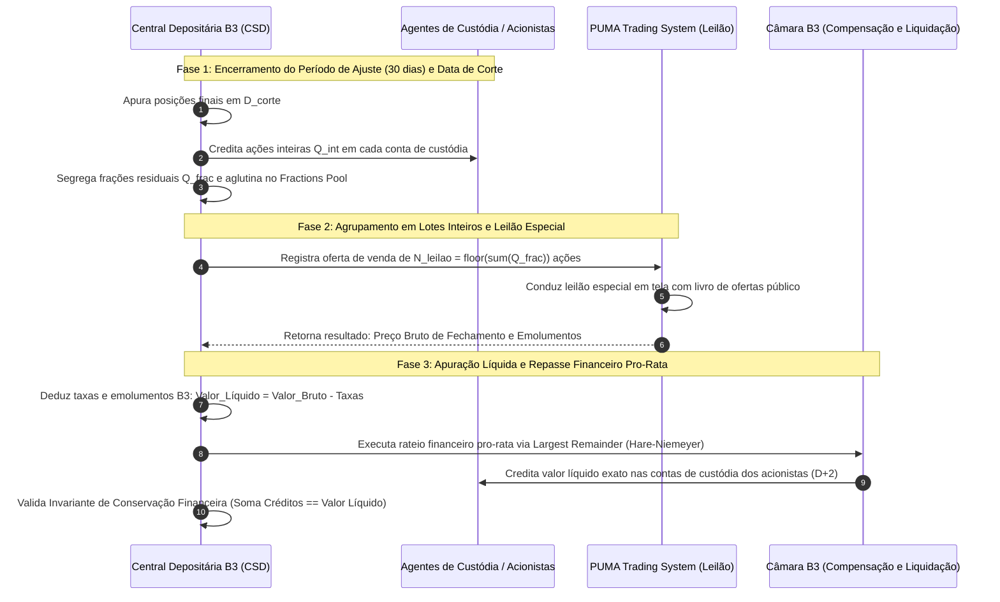
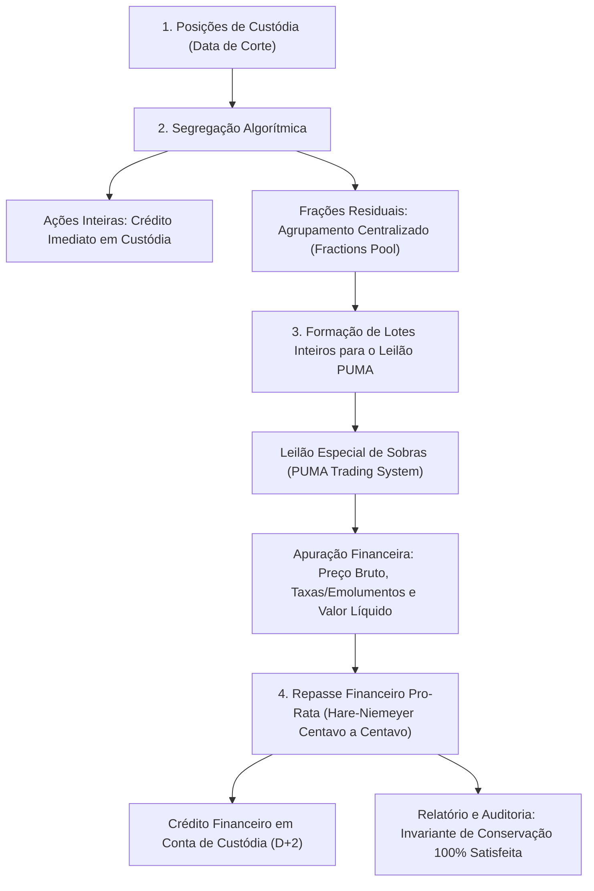

# Especificação Técnica — Tratamento de Frações de Ações Pós-Grupamento e Leilão Especial de Sobras (FL-052)

## 1. Visão Geral e Arcabouço Regulatório

O evento corporativo de **Grupamento de Ações** (*Reverse Stock Split*), bem como reorganizações societárias que envolvam **Incorporação de Ações** ou fusões com relações de troca não unitárias, tem como objetivo principal reduzir o número excessivo de ações em circulação de uma companhia aberta e recompor o valor nominal ou a cotação de negociação de mercado em patamares adequados (eliminando as chamadas *penny stocks* que negociam abaixo de R$ 1,00, conforme exigência do Regulamento de Emissores da B3).

Durante a aplicação do fator de grupamento (por exemplo, `10:1`, `5:2` ou `100:1`), as quantidades de ações detidas pelos investidores em suas respectivas contas de custódia na **Central Depositária da B3 (CSD)** sofrem uma divisão pelo fator estipulado. Salvo nos casos em que a posição original seja um múltiplo exato do denominador do fator, o cálculo matemático resulta em:
1. Uma **quantidade inteira** de novas ações, imediatamente creditada na conta de custódia do investidor; e
2. Uma **fração residual** de ação (sobra fracionária estritamente inferior a 1 ação inteira).

A base legal e regulatória que disciplina o tratamento dessas sobras fracionárias na B3 compreende:
- **Lei Federal nº 6.404/1976 (Lei das Sociedades por Ações)**:
  * **Art. 12**: Veda a existência de frações de ações na circulação normal do mercado acionário brasileiro. O capital social divide-se em ações inteiras.
  * **Art. 175**: Estabelece que nos casos de grupamento ou modificação do valor nominal das ações, deve ser assegurado aos acionistas um prazo decadencial (não inferior a 30 dias) para que ajustem livremente suas posições por meio de negociação no mercado secundário (compra ou venda de frações), formando lotes inteiros múltiplos do fator.
- **Manual de Procedimentos Operacionais da Central Depositária da B3 (MPO-CSD)**:
  * Estabelece o congelamento de posições na data de corte (*Record Date* / Data Ex-Grupamento), apuração automatizada das sobras por conta de custódia e aglutinação centralizada das frações.
- **Regulamento de Operações do PUMA Trading System da B3**:
  * Define as regras do **Leilão Especial de Frações/Sobras**, onde a soma de todas as frações residuais é convertida em lotes inteiros e leiloada publicamente em tela para apuração do preço de mercado.
- **Regras de Compensação e Liquidação da Câmara B3**:
  * Determina o rateio financeiro pro-rata do valor líquido apurado no leilão entre todos os titulares das frações originais, com conservação absoluta de valor contábil em centavos (sem centavos residuais orfãos ou criados).

---

## 2. Ciclo de Vida do Tratamento de Frações

O ciclo de tratamento de sobras fracionárias desdobra-se em quatro fases operacionais estritas:

### 2.1 Fase 1: Apuração de Frações por Conta de Custódia
Seja um evento de grupamento com relação de troca de $R_{\text{from}}$ ações antigas para $R_{\text{to}}$ novas ações (fator de conversão $k = \frac{R_{\text{to}}}{R_{\text{from}}}$).
Para cada conta de custódia $i$ detentora de $Q_{\text{orig}, i}$ ações na data de corte:

1. **Quantidade Bruta Equivalente**:
   $$Q_{\text{raw}, i} = \frac{Q_{\text{orig}, i} \times R_{\text{to}}}{R_{\text{from}}}$$

2. **Quociente Inteiro (Ações Inteiras Mantidas)**:
   $$Q_{\text{int}, i} = \left\lfloor \frac{Q_{\text{orig}, i} \times R_{\text{to}}}{R_{\text{from}}} \right\rfloor = (Q_{\text{orig}, i} \times R_{\text{to}}) // R_{\text{from}}$$

3. **Fração Residual de Sobra**:
   $$Q_{\text{frac}, i} = Q_{\text{raw}, i} - Q_{\text{int}, i} = \frac{(Q_{\text{orig}, i} \times R_{\text{to}}) \pmod{R_{\text{from}}}}{R_{\text{from}}}$$

Propriedades fundamentais:
- $Q_{\text{int}, i} \in \mathbb{N}_0$
- $0 \le Q_{\text{frac}, i} < 1$
- Ações inteiras $Q_{\text{int}, i}$ são creditadas na abertura do primeiro dia útil subsequente à data de corte (`D_ex`).

### 2.2 Fase 2: Agrupamento Centralizado de Frações (*Fractions Pool*)
A Central Depositária da B3 soma as frações residuais de todas as contas participantes:
$$S_{\text{frac}} = \sum_{i=1}^{M} Q_{\text{frac}, i}$$

- **Lotes Inteiros de Leilão**:
  $$N_{\text{auction}} = \lfloor S_{\text{frac}} \rfloor$$
- **Resíduo Residual Não Agrupável**:
  $$R_{\text{unauctioned}} = S_{\text{frac}} - N_{\text{auction}}$$

> [!NOTE]
> Quando o capital social total da companhia antes do grupamento era múltiplo do fator, $S_{\text{frac}}$ é rigorosamente um número inteiro positivo, implicando $R_{\text{unauctioned}} = 0$. Caso haja resíduo microscópico decorrente de frações de terceiros ou acionistas dissidentes, a emissora pode completar a fração necessária para integrar mais 1 ação inteira ou absorver o valor residual conforme deliberado em assembleia.

### 2.3 Fase 3: Leilão Especial de Frações no PUMA
As $N_{\text{auction}}$ ações inteiras consolidadas são ofertadas em lote no PUMA Trading System em leilão especial:
- **Preço Bruto de Venda Unitário**: $P_{\text{gross}}$ (apurado pelo algoritmo de *fixing* do leilão em tela).
- **Receita Bruta Total**:
  $$\text{Gross} = N_{\text{auction}} \times P_{\text{gross}}$$
- **Dedução de Taxas e Emolumentos**:
  $$\text{Fees} = \text{Fee}_{\text{trading}} + \text{Fee}_{\text{clearing}} + \text{Fee}_{\text{brokerage}} + \text{Fee}_{\text{other}}$$
- **Montante Financeiro Líquido Apurado**:
  $$\text{Net} = \text{Gross} - \text{Fees}$$
- **Preço Unitário Líquido Médio por Fração**:
  $$\bar{P}_{\text{net}} = \frac{\text{Net}}{S_{\text{frac}}}$$

---

## 3. Algoritmo de Repasse Financeiro Pro-Rata com Conservação de Centavos

Para garantir que o rateio financeiro respeite integralmente os princípios de liquidação da Câmara B3, veda-se qualquer arredondamento ingênuo que resulte em sobras de centavos não creditadas ou na criação fictícia de moeda.

Utiliza-se o algoritmo determinístico de **Maiores Resíduos** (*Largest Remainder Method* / Método Hare-Niemeyer), aplicado individualmente sobre as parcelas financeiras brutas, taxas e líquidas.

### 3.1 Procedimento de Rateio Pro-Rata
Para cada acionista titular de fração residual $Q_{\text{frac}, i} > 0$:

1. **Peso da Fração no Pool**:
   $$w_i = \frac{Q_{\text{frac}, i}}{S_{\text{frac}}}$$

2. **Cálculo da Parcela em Centavos Inteiros**:
   Seja $V$ o montante total em centavos ($V = \text{round}(\text{Montante} \times 100)$).
   - Centavos exatos teóricos: $E_i = V \times w_i$
   - Centavos inteiros base: $B_i = \lfloor E_i \rfloor$
   - Resíduo fracionário de centavo: $r_i = E_i - B_i$

3. **Apuração do Déficit de Centavos**:
   $$D = V - \sum_{i=1}^{M} B_i, \quad 0 \le D < M$$

4. **Distribuição Determinística de Centavos Residuais**:
   - Ordena-se os beneficiários em ordem decrescente do resíduo $r_i$.
   - Critério de desempate determinístico: maior fração original $Q_{\text{frac}, i}$, seguido pelo identificador unívoco da conta de custódia.
   - Atribui-se $+1$ centavo (R$ 0,01) para os primeiros $D$ beneficiários da lista ordenada.

### 3.2 Conservação Simultânea de Linha e Coluna
Para manter a coerência contábil de cada extrato individual de acionista:
$$\text{Crédito Líquido}_i = \text{Crédito Bruto}_i - \text{Taxas Deduzidas}_i$$

Dessa forma, são simultaneamente satisfeitas as seguintes invariantes contábeis:
$$\sum_{i=1}^{M} \text{Crédito Bruto}_i = \text{Gross}$$
$$\sum_{i=1}^{M} \text{Taxas Deduzidas}_i = \text{Fees}$$
$$\sum_{i=1}^{M} \text{Crédito Líquido}_i = \text{Net}$$

Nenhum centavo é perdido, retido indevidamente ou gerado artificialmente.

---

## 4. Dicionário de Dados e Estruturas de Informação

| Estrutura | Campo | Tipo | Descrição |
|---|---|---|---|
| `GroupingEvent` | `event_id` | `str` | Identificador único do evento societário |
| `GroupingEvent` | `ticker` | `str` | Código de negociação do ativo na B3 (ex: `MGLU3`) |
| `GroupingEvent` | `isin` | `str` | Código ISIN internacional do ativo (ex: `BRMGLUACNOR2`) |
| `GroupingEvent` | `company_name` | `str` | Razão social da companhia emissora |
| `GroupingEvent` | `ratio_from` | `int` | Fator antecedente do grupamento (ex: 10) |
| `GroupingEvent` | `ratio_to` | `int` | Fator consequente do grupamento (ex: 1) |
| `GroupingEvent` | `event_type` | `GroupingEventType` | `REVERSE_SPLIT` (Grupamento) ou `INCORPORATION` |
| `GroupingEvent` | `approval_date` | `date` | Data de aprovação em AGE |
| `GroupingEvent` | `cutoff_date` | `date` | Data de corte (último dia "com-direito") |
| `ShareFractionHolder` | `investor_account`| `str` | Número da conta de custódia na Central Depositária |
| `ShareFractionHolder` | `participant_code`| `str` | Código do Agente de Custódia (PNP / Corretora) |
| `ShareFractionHolder` | `investor_name` | `str` | Nome completo / Razão social do investidor |
| `ShareFractionHolder` | `document_id` | `str` | CPF ou CNPJ cadastrado |
| `ShareFractionHolder` | `original_shares` | `int` | Saldo de custódia antes do grupamento |
| `ShareFractionHolder` | `whole_shares` | `int` | Ações inteiras mantidas em carteira pós-grupamento |
| `ShareFractionHolder` | `fraction_share` | `Decimal` | Sobra fracionária apurada |
| `ShareFractionHolder` | `cash_credit_net` | `Decimal` | Valor financeiro líquido repassado em R$ |
| `FractionsAuctionOutcome` | `auction_id` | `str` | Identificador do leilão no PUMA |
| `FractionsAuctionOutcome` | `shares_auctioned`| `int` | Quantidade total de ações inteiras vendidas |
| `FractionsAuctionOutcome` | `gross_price_per_share` | `Decimal`| Preço unitário de fechamento do leilão |
| `FractionsAuctionOutcome` | `net_total_amount`| `Decimal` | Montante financeiro líquido a ser distribuído |

---

## 5. Casos de Borda e Tratamento de Exceções

1. **Conta sem Sobra Fracionária**:
   Investidores cuja posição original seja múltiplo exato do fator de grupamento (ex: detentor de 500 ações em grupamento 10:1) recebem 50 ações inteiras, $Q_{\text{frac}} = 0$ e não participam do rateio financeiro do leilão.
2. **Posição Inferior ao Fator de Grupamento**:
   Investidores com saldo inferior a $R_{\text{from}}$ (ex: 7 ações em grupamento 10:1) recebem 0 ações inteiras, e a totalidade do saldo é convertida na fração $0.7$ para venda no leilão e repasse financeiro integral.
3. **Leilão Deserto ou Fracionado**:
   Se o lote ofertado no PUMA não encontrar contraparte compradora no primeiro leilão, a Central Depositária pode prorrogar o leilão em sessões subsequentes sem cancelamento do evento, mantendo a custódia bloqueada no pool.
4. **Precisão e Arredondamento Financeiro**:
   Toda aritmética utiliza `Decimal` com quantização monetária estrita a duas casas decimais (`Decimal('0.01')`) e método `ROUND_HALF_UP` nos estágios intermediários, mantendo centavos fechados pelo algoritmo de Hare-Niemeyer.
