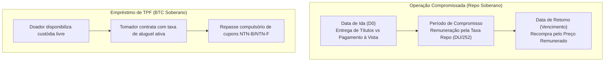

# Especificação Técnica de Empréstimo e Operações Compromissadas com TPFs (FL-076)

## 1. Visão Geral e Arcabouço Regulatório

O fluxo **FL-076** implementa o ciclo completo de empréstimo de ativos soberanos (BTC Soberano / TPF Lending) e Operações Compromissadas (Repos bilaterais e Open Market) com **Títulos Públicos Federais (TPF)** custodiados no SELIC e no Balcão B3.

Títulos cobertos:
- **LTN**: Letra do Tesouro Nacional (Prefixada);
- **LFT**: Letra Financeira do Tesouro (Pós-fixada SELIC);
- **NTN-B**: Nota do Tesouro Nacional Série B (IPCA + juros semestrais);
- **NTN-F**: Nota do Tesouro Nacional Série F (Prefixada com juros semestrais).

Regulamentação aplicável:
- **Resolução CMN nº 4.706/2018 e Circular BACEN nº 3.932/2019**: Operações Compromissadas e mercado aberto;
- **Instrução Normativa RFB nº 1.585/2015**: Tributação de renda fixa e repasse compulsório de proventos;
- **Manual de Operações do Sistema BTC B3 / Balcão NoMe**: Regras operacionais de custódia e empréstimo.

---

## 2. Dinâmica de Aluguel e Compromissadas

---

## 3. Invariantes Formais

- **LAW-059 (Conservação de Custódia Soberana)**: $\text{Custódia Total} == \text{Disponível} + \text{Emprestada} + \text{Bloqueada Garantia}$.
- **LAW-060 (Paridade de Recompra Repo)**: $\text{Preço Recompra} == \text{Preço Venda} \cdot (1 + \text{Taxa Repo} \cdot \frac{DU}{252})$.
- **Repasse Integral de Cupons**: Zero retenção indébita pelo tomador de títulos com pagamento de cupons semestrais.
