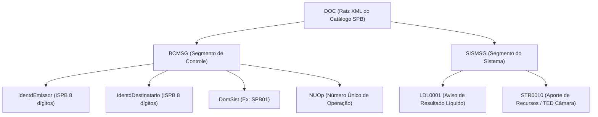
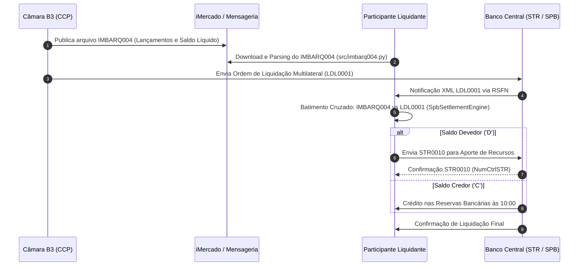

# Integração SPB e Liquidação Multilateral B3 (FL-027)

## 1. Visão Geral da Liquidação Multilateral e do SPB

O **SPB (Sistema de Pagamentos Brasileiro)** é a infraestrutura financeira nacional operada e regulada pelo **Banco Central do Brasil (Bacen)** para processar e liquidar eletronicamente pagamentos, transferências de fundos e operações interbancárias. No coração do SPB opera o **STR (Sistema de Transferência de Reservas)**, que realiza a liquidação bruta em tempo real (*LBTR / RTGS — Real-Time Gross Settlement*) de fundos entre contas mantidas no Banco Central (Contas Reservas Bancárias e Contas de Liquidação).

A **Câmara de Compensação e Liquidação da B3 (B3 Clearing)** atua como Contraparte Central (CCP) para os mercados listados (ações, opções, derivativos financeiros e de commodities, balcão e renda fixa). Ao final de cada ciclo de negociação, a câmara realiza a **compensação multilateral líquida** (*multilateral netting*), calculando um único saldo financeiro credor ou devedor para cada Participante de Liquidação (PL ou PN) ou Membro de Compensação (MC).

A transferência efetiva desses recursos financeiros entre as contas de reservas do participante e da B3 no Banco Central é executada via mensageria padronizada na **RSFN (Rede do Sistema Financeiro Nacional)**, utilizando o **Catálogo de Mensagens do SPB**:
- **`FL-027`**: Integrar liquidação financeira multilateral com o SPB/STR (Mensagens `LDL0001` e `STR0010`, validação de ISPB, batimento com IMBARQ004 e sincronização com a grade horária do Bacen/B3).

---

## 2. Catálogo de Mensagens SPB na Liquidação de Câmaras

As mensagens do SPB são codificadas em arquivos XML estruturados em dois blocos hierárquicos obrigatórios:
1. **`BCMSG` (Banco Central Message / Segmento de Controle)**: Metadados de cabeçalho, roteamento, controle de remetente/destinatário (`IdentdEmissor` e `IdentdDestinatario`), identificação do operador, domínio do sistema (`DomSist`) e Número Único da Operação (`NUOp`).
2. **`SISMSG` (Sistema Message / Segmento de Negócio)**: Carga útil funcional que contém a transação específica do sistema (ex.: `LDL0001` ou `STR0010`).



---

## 3. Mensagens Chave

### 3.1. Mensagem `LDL0001` — Aviso de Débito/Crédito de Liquidação Multilateral

A mensagem **`LDL0001`** é emitida pela Câmara B3 (ou pelo próprio sistema LDL do Bacen) para cada participante liquidante para notificar a apuração do saldo líquido multilateral ao encerramento da sessão ou janela de liquidação.

#### Estrutura de Campos da Mensagem `LDL0001`

| Campo XML | Tipo | Tamanho | Descrição | Regra de Validação |
|---|---|---|---|---|
| `CodMsg` | Alfanumérico | 7 | Código da mensagem no catálogo Bacen. | Fixo `LDL0001`. |
| `NumCtrlLDL` | Alfanumérico | Até 20 | Número de controle único da liquidação gerado pela câmara. | Obrigatório, sequencial diário da câmara. |
| `NumCtrlSTR` | Alfanumérico | Até 20 | Número de rastreabilidade atribuído pelo STR no Bacen. | Obrigatório para liquidação no STR. |
| `ISPBCamara` | Numérico | 8 | Identificador SPB da B3 Clearing no Banco Central. | Deve possuir exatamente 8 dígitos (ex: `00997185`). |
| `ISPBIF` | Numérico | 8 | Identificador SPB do participante liquidante / membro. | Deve possuir exatamente 8 dígitos (ex: `12345678`). |
| `TpDeb_Cred` | Texto | 1 | Indicador do sentido financeiro para o participante. | `C` (Crédito a receber da câmara) ou `D` (Débito a pagar à câmara). |
| `VlrLiqd` | Decimal | Até 17,2 | Montante financeiro líquido multilateral apurado. | Valor monetário estritamente positivo (R$). |
| `DtLiqd` | Data | 10 | Data de liquidação financeira efetiva nas reservas. | Formato ISO `YYYY-MM-DD`. |
| `TpCt` | Alfanumérico | Até 10 | Tipo da conta de liquidação no Banco Central. | `CC` (Conta Corrente), `RESERVAS` ou `LIQUIDACAO`. |
| `NumCt` | Alfanumérico | Até 20 | Número da conta mantida no Banco Central ou liquidante. | Numérico/Alfanumérico válido. |
| `CodCamara` | Alfanumérico | Até 10 | Código mnemônico da câmara de compensação. | `B3` ou `B3-CLEARING`. |

#### Exemplo Canônico de XML `LDL0001` (Crédito de R$ 23.500,00)

```xml
<?xml version="1.0" encoding="UTF-8"?>
<DOC xmlns="http://www.bcb.gov.br/SPB/LDL0001.xsd">
  <BCMSG>
    <IdentdEmissor>00997185</IdentdEmissor>
    <IdentdDestinatario>12345678</IdentdDestinatario>
    <DomSist>SPB01</DomSist>
    <NUOp>20261104000000001234</NUOp>
  </BCMSG>
  <SISMSG>
    <LDL0001>
      <CodMsg>LDL0001</CodMsg>
      <NumCtrlLDL>2026110400000001</NumCtrlLDL>
      <NumCtrlSTR>20261104STR000012345</NumCtrlSTR>
      <ISPBCamara>00997185</ISPBCamara>
      <ISPBIF>12345678</ISPBIF>
      <TpDeb_Cred>C</TpDeb_Cred>
      <VlrLiqd>23500.00</VlrLiqd>
      <DtLiqd>2026-11-04</DtLiqd>
      <TpCt>CC</TpCt>
      <NumCt>0000123456</NumCt>
      <CodCamara>B3</CodCamara>
    </LDL0001>
  </SISMSG>
</DOC>
```

---

### 3.2. Mensagem `STR0010` — Transferência de Fundos para Cobertura de Débitos

A mensagem **`STR0010`** é utilizada pelas instituições financeiras participantes (ou seus agentes de liquidação) para efetuar a **cobertura financeira de débitos multilaterais** antes da janela de liquidação da B3, transferindo fundos da Conta Reservas Bancárias do participante diretamente para a Conta de Liquidação da B3 no Banco Central.

#### Estrutura de Campos da Mensagem `STR0010`

| Campo XML | Tipo | Tamanho | Descrição | Regra de Validação |
|---|---|---|---|---|
| `CodMsg` | Alfanumérico | 7 | Código da mensagem no catálogo Bacen. | Fixo `STR0010`. |
| `NumCtrlIF` | Alfanumérico | Até 20 | Número de controle interno gerado pela IF emissora. | Rastreabilidade interna na tesouraria do participante. |
| `NumCtrlSTR` | Alfanumérico | Até 20 | Identificador retornado pelo STR após confirmação. | Gerado pelo Bacen. |
| `ISPBIFDebtd` | Numérico | 8 | ISPB da instituição debitada (Participante Liquidante). | 8 dígitos estritos. |
| `ISPBIFCredtd` | Numérico | 8 | ISPB da instituição creditada (B3 S.A. / Câmara). | 8 dígitos estritos (`00997185`). |
| `VlrLanc` | Decimal | Até 17,2 | Montante transferido para cobertura da câmara. | Valor monetário estritamente positivo (R$). |
| `DtAgendt` | Data | 10 | Data de agendamento/execução da transferência. | Formato ISO `YYYY-MM-DD`. |
| `TpCtDebtd` | Alfanumérico | Até 10 | Tipo de conta da IF debitada no STR. | `RESERVAS` ou `LIQUIDACAO`. |
| `NumCtDebtd` | Alfanumérico | Até 20 | Número da conta debitada no Bacen. | Numérico/Alfanumérico. |
| `TpCtCredtd` | Alfanumérico | Até 10 | Tipo de conta creditada da B3. | `LIQUIDACAO` ou `RESERVAS`. |
| `NumCtCredtd` | Alfanumérico | Até 20 | Número da conta da B3 no Banco Central. | Conta oficial da B3 Clearing. |
| `Finald` | Alfanumérico | Até 100 | Finalidade da ordem no STR. | Ex: `LIQUIDACAO MULTILATERAL B3 CLEARING`. |

---

## 4. Grade Horária Operacional (Prazos de Liquidação B3 / SPB)

A liquidação financeira da B3 ocorre em perfeita sincronia com as janelas operacionais do STR do Banco Central:

```mermaid
timeline
    title Grade Horária de Liquidação Financeira B3 & SPB
    06:30 : Abertura do STR (Banco Central)
          : Conclusão do ciclo noturno de compensação da B3
          : Geração do arquivo IMBARQ004 e prévias LDL0001
    07:00 às 09:30 : Janela de Aporte e Cobertura de Saldos Devedores
                   : Envio de STR0010 por participantes com saldo devedor
                   : Depósito de garantias adicionais intradiárias
    10:00 : Janela 1 de Liquidação Multilateral (Renda Variável D+2)
          : Liquidação das mensagens LDL0001 no Banco Central (LBTR)
          : Débito e crédito simultâneo nas contas de reservas
    13:00 às 14:00 : Janela 2 de Liquidação Multilateral (Derivativos e Opções D+1)
                   : Ajustes diários de contratos futuros e prêmios de opções
    17:00 : Encerramento das janelas de liquidação da Câmara B3
    18:30 : Fechamento regular da grade horária do STR (Bacen)
```

### Detalhamento das Etapas:
1. **06:30 — Abertura e Fechamento Noturno**:
   - O STR inicia sua operação.
   - O processamento noturno da B3 é concluído, apurando os saldos multilaterais líquidos consolidados e disponibilizando os arquivos IMBARQ004 via API iMercado.
2. **07:00 às 09:30 — Janela de Aporte de Cobertura**:
   - Membros de Compensação devedores devem garantir que suas Contas de Liquidação / Reservas Bancárias possuam saldo suficiente para honrar os débitos apurados.
   - Recursos são aportados via mensagem `STR0010`.
3. **10:00 — Janela 1: Liquidação Multilateral do Mercado À Vista (D+2)**:
   - A B3 submete as mensagens de liquidação multilateral `LDL0001` ao Bacen.
   - O STR executa a liquidação atômica e simultânea: debita participantes com saldo líquido devedor (`TpDeb_Cred = D`) e credita os participantes credores (`TpDeb_Cred = C`).
4. **13:00 às 14:00 — Janela 2: Liquidação de Derivativos e Opções (D+1)**:
   - Segunda rodada de liquidação para liquidação de prêmios de opções, exercício de derivativos e liquidação de ajustes diários de contratos futuros.
5. **17:00 / 18:30 — Encerramento Diário**:
   - Fechamento dos ciclos da câmara e conciliação final com extratos do Banco Central.

---

## 5. Regras de Batimento Determinístico (IMBARQ004 $\leftrightarrow$ SPB LDL0001)

A conciliação entre a apuração interna da câmara e a mensageria interbancária segue uma **lei estrita de conservação financeira**:

$$\text{Saldo Líquido Multilateral (IMBARQ004)} = \sum \text{Créditos} - \sum \text{Débitos}$$

### Matriz de Equivalência:

| Situação no IMBARQ004 | Sinal IMBARQ004 | Sentido no SPB (`TpDeb_Cred`) | Valor no SPB (`VlrLiqd`) | Regra de Reconciliação |
|---|---|---|---|---|
| Total Créditos $>$ Total Débitos | `C` | `C` | $\lvert \text{Créditos} - \text{Débitos} \rvert$ | `MATCHED` (Crédito líquido idêntico) |
| Total Débitos $>$ Total Créditos | `D` | `D` | $\lvert \text{Débitos} - \text{Créditos} \rvert$ | `MATCHED` (Débito líquido idêntico) |
| Total Créditos $=$ Total Débitos | `C` ou `D` | Sem movimentação ou zero | `0.00` | `MATCHED` (Saldo nulo) |
| Valor IMBARQ $\ne$ Valor SPB | - | - | - | `MISMATCH_AMOUNT` (Quebra de valor) |
| Sinal divergente (ex: `C` vs `D`) | - | - | - | `MISMATCH_DIRECTION` (Quebra de sentido) |
| Data de Liquidação divergente | - | - | - | `MISMATCH_DATE` (Quebra de data) |
| Participante ou ISPB não vinculado | - | - | - | `MISMATCH_PARTICIPANT` (Quebra cadastral) |



---

## 6. Identificadores Oficiais no SPB

- **ISPB B3 S.A. (Câmara e Operações)**: `00997185` (Banco B3 / Infraestrutura de Compensação) ou `28719664` (Balcão B3 / Antiga Cetip).
- **Formato Estrito de ISPB**: String alfanumérica de exatamente **8 dígitos decimais** (`^\d{8}$`), preenchida com zeros à esquerda quando aplicável.
- **Códigos de Câmaras de Compensação Bacen**:
  * `01`: Câmara B3 (Segmento Bovespa / Renda Variável)
  * `02`: Câmara B3 (Segmento BM&F / Derivativos e Câmbio)
  * `03`: Câmara B3 (Segmento Balcão NoMe / Cetip)
