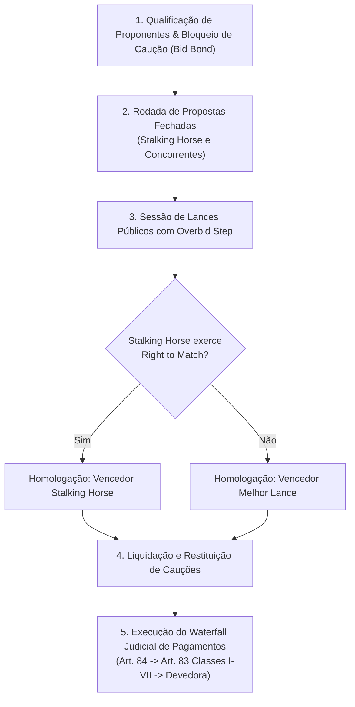

# Especificação Técnica de Leilões Especiais de Desinvestimento e Alienação Judicial de UPIs (FL-081)

## 1. Visão Geral e Arcabouço Regulatório

O fluxo **FL-081** modela os **Leilões Especiais de Desinvestimento, Alienação de Unidades Produtivas Isoladas (UPI) e Liquidação Judicial de Ativos em Recuperação** no PUMA Trading System da B3.

Regulamentação e Legislação aplicável:
- **Lei nº 11.101/2005 (Lei de Falências e Recuperação Judicial)** com alterações da **Lei nº 14.112/2020**:
  - Arts. 60 e 60-A: Venda de UPI sem sucessão trabalhista, tributária ou ambiental;
  - Arts. 141 e 142: Modalidades de processo competitivo público eletrônico em bolsa de valores;
  - Art. 84: Ordem de pagamento extraconcursal prioritária;
  - Art. 83: Ordem legal de classificação dos créditos concursais (Classes I a VII);
- **Manual de Negociação B3 PUMA**: Realização de leilões especiais com rodadas fechadas (*sealed bids*), proponente qualificador (*Stalking Horse*), sessões de viva-voz/eletrônicas com degraus mínimos de overbid e direito de preferência (*Right to Match*).

---

## 2. Dinâmica de Rodadas e Cascata Judicial

---

## 3. Invariantes Formais

- **Conservação de Lotes**: $\text{Lotes Totais} == \text{Lotes Arrematados} + \text{Lotes Desertos}$.
- **Restituição Integral de Cauções**: $\text{Total Caução Retida} == \text{Caução Vencedor}$; não vencedores são integralmente restituídos.
- **Conservação Financeira do Waterfall**: $\text{Arrecadado} == \text{Custas Art. 84} + \text{Pago Credores Art. 83} + \text{Superávit Remanescente}$. Rateio pro-rata via método de Hamilton (sem centavos órfãos).
