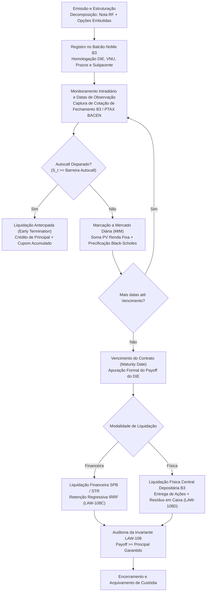

# Especificação Técnica: Certificados de Operações Estruturadas — COE (FL-102)

## 1. Visão Geral e Contexto Regulatório

O fluxo **FL-102** especifica e implementa a infraestrutura completa de emissão, registro, decomposição financeira, marcação a mercado (MtM), monitoramento de barreiras e liquidação (financeira e física) de **Certificados de Operações Estruturadas (COE)** no **Balcão NoMe B3** e na **Câmara B3**.

O COE é um instrumento financeiro híbrido regulamentado pelo ordenamento jurídico brasileiro que combina uma perna de dívida (renda fixa pré ou pós-fixada emitida por instituição financeira) com uma perna de derivativos (estratégias de opções de balcão referenciadas em ativos subjacentes como taxas de câmbio, índices acionários, commodities, juros ou ações individuais).

### 1.1 Normativos Aplicáveis
- **Lei Federal nº 12.249/2010 (arts. 39 a 44)**: Institui o COE no arcabouço brasileiro, estabelecendo a titularidade escritural, o regime de garantias fiduciárias e as modalidades de proteção de capital.
- **Resolução CMN nº 4.263/2013**: Regulamenta a emissão e o registro obrigatório de COE por bancos múltiplos, bancos comerciais, bancos de investimento e caixas econômicas em sistemas autorizados pelo Banco Central (B3 NoMe).
- **Resolução CVM nº 8/2020 (revogando e aprimorando a ICVM 569/2015)**: Disciplina as ofertas públicas de COE, regras de adequação de perfil (*suitability*), dever de transparência e o **Documento de Informações Essenciais (DIE)** obrigatório contendo análise de cenários de estresse, perdas máximas e agentes fiduciários.
- **Lei nº 11.033/2004 e IN RFB nº 1.585/2015**: Regime de tributação exclusiva de IRRF sobre o rendimento bruto do COE pela tabela regressiva de Renda Fixa (22,5% a 15,0% conforme prazo de permanência).

---

## 2. Modalidades de Capital e Estruturas de Payoff

### 2.1 Modalidades de Proteção de Capital (Art. 42 da Lei nº 12.249/2010)
1. **Valor Nominal Protegido (`PROTECTED_CAPITAL`)**:
   - Garante a restituição integral de no mínimo 100% do principal investido na data de vencimento ou encerramento antecipado (Autocall), independentemente de oscilações adversas no ativo subjacente.
   - Amparado pela **Invariante LAW-108**.
2. **Valor Nominal em Risco (`AT_RISK_CAPITAL`)**:
   - O investidor aceita a possibilidade de perda parcial (ex: piso de 80%, perda limitada a 20%) ou total (piso de 0%) do valor nominal investido em troca de maiores taxas de participação, alavancagem ou cupons digitais expressivos.

### 2.2 Decomposição Estrutural e Financiamento
Um COE é estruturado a partir da decomposição analítica:
$$\text{VNU} = PV_{\text{Renda Fixa}} + \text{Orçamento de Derivativos}$$
Onde:
- **Perna de Renda Fixa**: Título de desconto zero-cupom emitido com a taxa pré de captação da instituição emissora ($r_{\text{emissor}}$):
  $$PV_{\text{RF}} = \frac{\text{VNU}}{(1 + r_{\text{emissor}})^{\frac{\text{DU}}{252}}}$$
- **Orçamento de Derivativos (Derivatives Budget)**:
  $$\text{Budget} = \text{VNU} - PV_{\text{RF}}$$
  Esse excedente financia integralmente os prêmios das opções embutidas sem necessidade de desembolso financeiro adicional pelo investidor.

### 2.3 Estruturas de Opções Embutidas
- **Bull Call Spread (Trava de Alta com Ganho Limitado)**: Compra de Call no strike $K_1$ e venda de Call no strike $K_2$.
- **Digital Binary (Retorno Fixo Condicional)**: Pagamento de cupom digital fixo $C_{\text{digital}}$ se o ativo subjacente estiver igual ou acima do nível de disparo no vencimento.
- **Participation Rate com Cap**: Participação alavancada ($\alpha \ge 100\%$) na valorização do ativo, com teto máximo (*Cap*).
- **Barreiras Knock-In / Knock-Out**:
  - *Up-and-Out*: Desativa a estrutura e paga rebate fixo caso o ativo ultrapasse a barreira superior.
  - *Down-and-In*: Ativa a perda de capital ou estrutura apenas se romper barreira inferior.
- **Autocallable**: Encerramento antecipado programado em datas periódicas de observação caso $S_{t_k} \ge B_{\text{autocall}}$, com pagamento imediato de principal mais cupom acumulado.

---

## 3. Ciclo de Vida do COE na B3

---

## 4. Modelagem Quantitativa e Marcação a Mercado (MtM)

A qualquer momento $t \in [0, T]$ ao longo da vida útil do COE, o valor unitário da Marcação a Mercado é dado por:
$$\text{MtM}_{\text{unitário}}(t) = PV_{\text{RF}}(t) + PV_{\text{opções}}(t)$$

### 4.1 Precificação Analítica Black-Scholes-Merton das Opções
Para taxa livre de risco $r$, volatilidade $\sigma$, rendimento de dividendos $q$ e prazo residual $\tau = \frac{T - t}{252}$:
$$d_1 = \frac{\ln(S / K) + (r - q + \frac{1}{2}\sigma^2)\tau}{\sigma \sqrt{\tau}}, \quad d_2 = d_1 - \sigma \sqrt{\tau}$$
- **Call Européia**: $C(S, K, \tau) = S e^{-q \tau} N(d_1) - K e^{-r \tau} N(d_2)$
- **Put Européia**: $P(S, K, \tau) = K e^{-r \tau} N(-d_2) - S e^{-q \tau} N(-d_1)$
- **Digital Cash-or-Nothing Call**: $D_{\text{call}}(S, K, \tau) = \text{Payout} \times e^{-r \tau} N(d_2)$

---

## 5. Leis de Invariantes Formais Auditadas

| Código | Invariante | Definição Formal | Condição Fail-Safe |
|---|---|---|---|
| **LAW-108** | Inviolabilidade do Piso de Capital Protegido | Em COEs com modalidade `PROTECTED_CAPITAL`, o payoff bruto nunca pode ser inferior ao principal garantido. | $\text{Total Gross} \ge \text{Principal} \times \frac{\text{Floor}_{\%}}{100}$ |
| **LAW-108B** | Delimitação Estrita por Teto de Ganho (Cap) | O retorno bruto total não pode exceder o teto contratual estipulado no DIE. | $\text{Total Gross} \le \text{Principal} \times (1 + \text{Cap}_{\%}) + \varepsilon$ |
| **LAW-108C** | Conservação Contábil e Tributária do IRRF | O fechamento financeiro decompõe o valor bruto exatamente em valor líquido e IRRF retido. | $\text{Total Gross} = \text{Total Net} + \text{IRRF}$ |
| **LAW-108D** | Conservação Patrimonial na Entrega Física | Na liquidação com entrega de ações, o valor das ações entregues mais a fração residual em caixa coincide com o valor bruto. | $\text{Total Gross} = (Q_{\text{ações}} \times S_T) + \text{Resíduo}$ |

### 5.1 Tabela Regressiva de IRRF (Lei nº 11.033/2004)
$$\text{Alíquota IRRF} = \begin{cases}
22,5\%, & \text{se } \text{Prazo} \le 180 \text{ dias corridos} \\
20,0\%, & \text{se } 181 \le \text{Prazo} \le 360 \text{ dias corridos} \\
17,5\%, & \text{se } 361 \le \text{Prazo} \le 720 \text{ dias corridos} \\
15,0\%, & \text{se } \text{Prazo} > 720 \text{ dias corridos}
\end{cases}$$

---

## 6. Arquivos e Artefatos do Fluxo

- **Módulo Python**: `src/structured_operations_coe.py`
  - Classes principais: `StructuredOperationsCoeEngine`, `CoeContractSpec`, `FixedIncomeLegSpec`, `EmbeddedOptionLegSpec`, `CoeMarkToMarket`, `CoeSettlementReceipt`, `CoeTaxBreakdown`, `PhysicalDeliveryAllocation`.
  - 100% Python Standard Library (sem dependências externas).
- **Invariante Central**: `assert_coe_protected_capital_floor` em `src/invariants.py` (LAW-108).
- **Suíte de Testes**: `tests/test_structured_operations_coe.py` (20 testes cobrindo todas as estruturas, ciclo de vida, MtM e auditoria de invariantes).
- **Fixture de Mercado**: `fixtures/structured_operations_coe.json` (6 contratos representativos cobrindo IBOVESPA, S&P 500, PTAX USD, PETR4, BOVA11 e VALE3).
