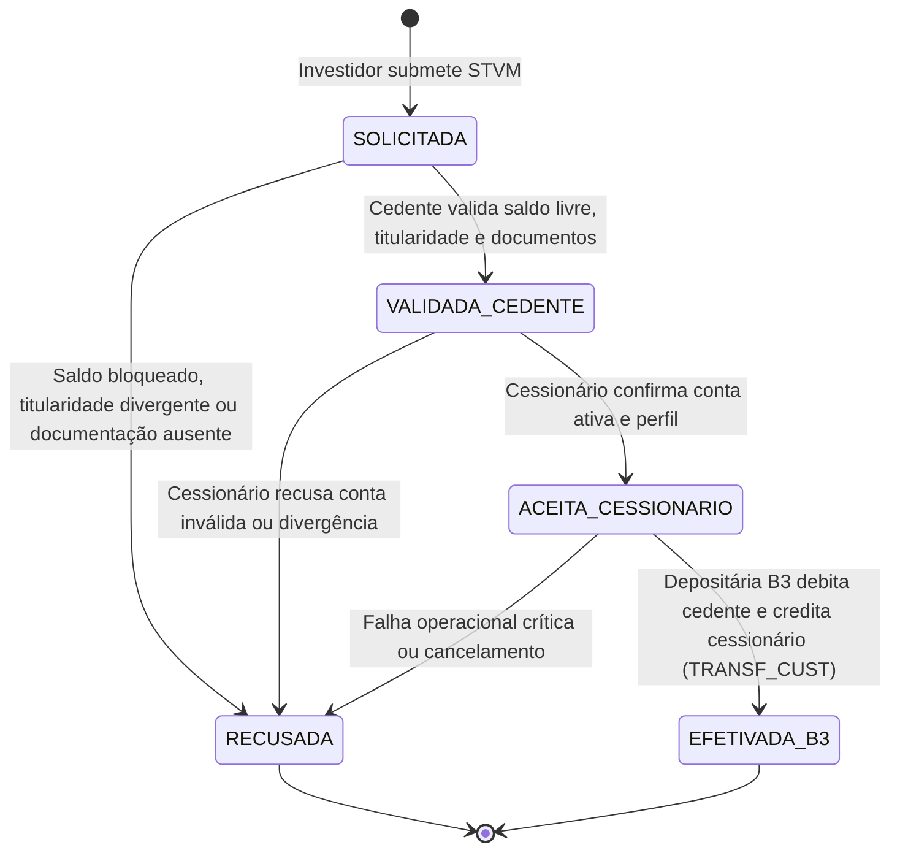
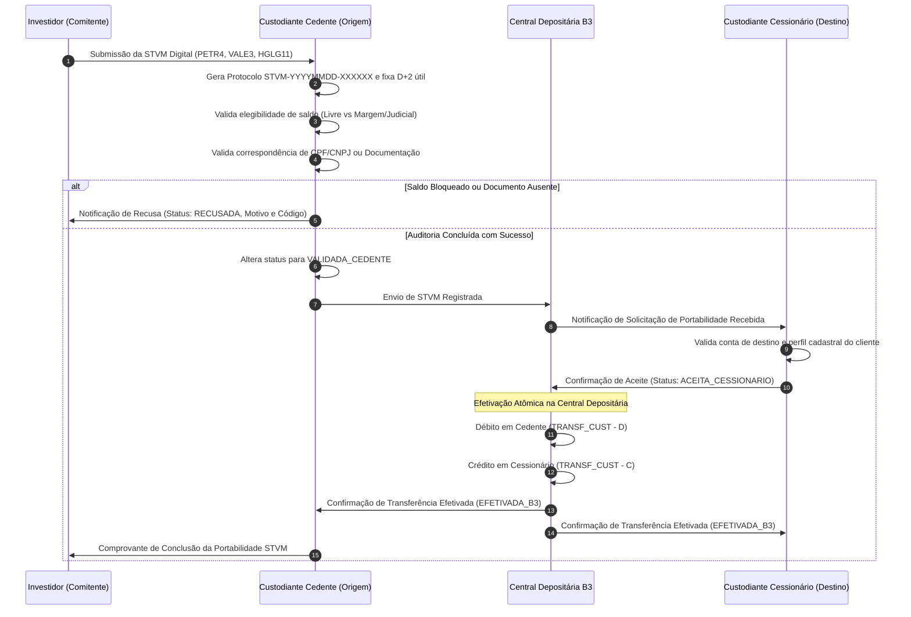

# Especificação Técnica do Fluxo de Portabilidade de Custódia e STVM (FL-024) — B3 Depositária Central

## 1. Visão Geral e Contexto Regulatório

No mercado de capitais brasileiro, a transferência de custódia de ativos negociados em bolsa (ações, cotas de Fundos Imobiliários - FIIs, ETFs, BDRs e certificados corporativos) é disciplinada pela **Instrução CVM nº 505/2011 (artigos 33 a 37)**, pela **Resolução CVM nº 175/2022** (marco regulatório dos fundos de investimento), pela **Resolução CVM nº 32/2021** (regras de prestação de serviços de custódia de valores mobiliários) e pelo **Regulamento de Operações e Manual da Depositária Central da B3**.

A **STVM (Solicitação de Transferência de Valores Mobiliários)** é o instrumento canônico e regulatório pelo qual o investidor (comitente) comanda a transferência de seus ativos depositados na Central Depositária da B3 de um participante de custódia de origem (**Custodiante Cedente**) para um participante de custódia de destino (**Custodiante Cessionário**).

Historicamente realizada via formulários físicos impressos e assinaturas com firma reconhecida (conhecida como OTA - Ordem de Transferência de Ações), a B3 e o regulador estabeleceram a **Portabilidade Digital 100% Eletrônica**. Nesse modelo, as instituições financeiras interconectam-se via mensageria digital e APIs seguras da B3 Depositária, garantindo agilidade, trilha criptográfica de auditoria, conciliação contábil automatizada e estrito cumprimento dos prazos regulatórios.

```
+-----------------------------------------------------------------------------------+
|                        MERCADO DE VALORES MOBILIÁRIOS - B3                       |
|                                                                                   |
|  +---------------------+                       +-------------------------------+  |
|  | Investidor Titular  |                       | Central Depositária da B3     |  |
|  | (Pessoa Física/PJ)  |                       | (Livro Central de Custódia)   |  |
|  +---------------------+                       +-------------------------------+  |
|             |                                                  ^                  |
|             | 1. Solicitação STVM                              |                  |
|             v                                                  |                  |
|  +---------------------+   2. Auditoria de Elegibilidade       |                  |
|  | Participante Cedente|---------------------------------------+                  |
|  | (Custodiante Origem)|   (Saldo livre vs Garantias/Judicial) |                  |
|  +---------------------+                                       | 4. Débito/Crédito|
|             |                                                  |    Atômico       |
|             | 3. Notificação STVM                              |    (TRANSF_CUST) |
|             v                                                  |                  |
|  +-------------------------+                                   |                  |
|  | Participante Cessionário|-----------------------------------+                  |
|  | (Custodiante Destino)   |                                                      |
|  +-------------------------+                                                      |
+-----------------------------------------------------------------------------------+
```

---

## 2. Modalidades de Transferência de Custódia

A B3 classifica as solicitações de transferência de custódia em duas grandes modalidades, dependendo da relação jurídica entre as contas envolvidas:

### 2.1 Transferência de Mesma Titularidade (`MESMA_TITULARIDADE`)
- **Definição**: Movimentação de ativos entre contas registradas sob o **mesmo CPF ou CNPJ** em diferentes corretoras ou custodiantes.
- **Natureza Econômica**: Troca de prestador de serviços de custódia/corretagem por mera conveniência do investidor.
- **Impacto Tributário**: Não há alienação onerosa nem fato gerador do Imposto sobre a Renda (IR). Não há ganho ou perda de capital apurável.
- **Exigências Documentais**: Dispensa documentação legal comprobatória de transferência de propriedade. Exige apenas autenticação segura do investidor e verificação cadastral automatizada de equivalência de identificador fiscal (`source_investor_id == target_investor_id`).

### 2.2 Transferência com Mudança de Titularidade
Movimentação de ativos entre pessoas físicas ou jurídicas distintas (**CPFs ou CNPJs distintos**). Por envolver alteração da propriedade do bem, é admitida apenas nas hipóteses taxativas previstas pela legislação civil, societária e tributária brasileira:

1. **Doação (`DOACAO`)**:
   - Transferência gratuita de titularidade em vida.
   - **Exigência**: Apresentação da guia de recolhimento quitada do ITCMD (Imposto sobre Transmissão Causa Mortis e Doação) do estado competente e Termo/Escritura Pública de Doação.
2. **Herança / Inventário (`HERANCA_INVENTARIO`)**:
   - Transmissão por sucessão legítima ou testamentária decorrente de falecimento do titular.
   - **Exigência**: Formal de Partilha homologado por sentença judicial transitada em julgado ou Escritura Pública Notarial de Inventário e Partilha Extrajudicial (Lei 11.441/2007), acompanhada da certidão de quitação do ITCMD.
3. **Ordem Judicial (`ORDEM_JUDICIAL`)**:
   - Cumprimento de decisão judicial transitada em julgado ou tutela de urgência (execução de dívida, partilha em divórcio litigioso ou dissolução de união estável, adjudicação judicial).
   - **Exigência**: Mandado, Ofício do Juízo ou Carta de Sentença expressa com especificação dos ativos e quantidades.
4. **Dissolução Societária (`DISSOLUCAO_SOCIETARIA`)**:
   - Devolução de ativos do acervo líquido a sócios/acionistas em decorrência de liquidação ou cisão de pessoa jurídica.
   - **Exigência**: Distrato Social ou Ata de Assembleia Geral Extraordinária registrada na Junta Comercial e comprovante de regularidade fiscal.
5. **Integralização de Capital (`INTEGRALIZACAO_CAPITAL`)**:
   - Conferência de títulos e valores mobiliários para subscrição e integralização de capital social em pessoa jurídica.
   - **Exigência**: Contrato Social ou Alteração Contratual devidamente registrada na Junta Comercial, com laudo de avaliação quando exigido pela Lei 6.404/1976.

> [!IMPORTANT]
> Em qualquer hipótese de Mudança de Titularidade, o envio da documentação comprobatória (`supporting_documents`) é obrigatório. Tentativas de submissão sem documentos anexados resultam em recusa sumária (`REJ_DOCUMENTACAO_AUSENTE`).

---

## 3. Prazos Regulatórios e Regra D+2 Útil

De acordo com o **artigo 34 da Instrução CVM nº 505/2011**, o custodiante cedente deve atender a solicitação de transferência no prazo de até **2 (dois) dias úteis**, contados a partir da data de recepção do pedido válido e com documentação integral em ordem.

- **D0 (Recepção)**: Investidor submete a solicitação. A contagem do prazo inicia-se no primeiro dia útil subsequente caso o pedido seja recebido fora do horário comercial (após 17h00).
- **D+1 (Auditoria e Validação)**: O custodiante cedente analisa a elegibilidade de custódia, ausência de gravames e dados cadastrais. Se aprovado, transmite o aceite preliminar à B3.
- **D+2 (Aceite do Cessionário e Efetivação B3)**: O custodiante cessionário valida a conta de destino e a B3 executa atomicamente o lançamento no livro de custódia até as 18h00 do segundo dia útil.

### Calendário Operacional
O cálculo de dias úteis desconsidera sábados, domingos e feriados nacionais brasileiros (conforme calendário divulgado anualmente pela ANBIMA e B3).

---

## 4. Ciclo de Vida e Máquina de Estados da STVM

O ciclo de vida da portabilidade é determinístico e composto por cinco estados principais:



### 4.1 Descrição dos Estados
| Estado | Descrição |
| :--- | :--- |
| `SOLICITADA` | Solicitação registrada no sistema com protocolo único atribuído e prazo regulatório de D+2 útil calculado. |
| `VALIDADA_CEDENTE` | Participante cedente atestou legitimidade da requisição, validou titularidade/documentos e confirmou saldo livre disponível. |
| `ACEITA_CESSIONARIO`| Participante cessionário validou os dados da conta de destino e aceitou recepcionar a custódia. |
| `EFETIVADA_B3` | Central Depositária da B3 realizou os lançamentos contábeis no livro de custódia com sucesso (`TRANSF_CUST`). |
| `RECUSADA` | Processo interrompido por motivo impeditivo justificado, com registro do código oficial de recusa e notificação ao investidor. |

---

## 5. Regras de Validação de Elegibilidade de Custódia

A verificação do custodiante cedente baseia-se na **Equação Fundamental de Conservação de Custódia Depositária da B3** (verificada no IMBARQ012):

$$\text{Quantidade Total} = \text{Quantidade Disponível} + \text{Bloqueado em Margem} + \text{Bloqueado Judicial} + \text{Bloqueado em Aluguel (BTC)} + \text{Outros Bloqueios}$$

### 5.1 Regras de Bloqueio Impeditivo
1. **Saldo Livre Insuficiente**: A quantidade solicitada deve ser menor ou igual à `disponivel`.
2. **Ativos em Garantia / Margem CCP (CORE B3)**: Se parte ou totalidade da posição requerida estiver alocada na câmara de compensação como colateral de posições em derivativos ou garantias de liquidação, a transferência é bloqueada com o código `REJ_SALDO_BLOQUEADO_MARGEM`.
3. **Bloqueio Judicial / SISBAJUD**: Se a posição estiver gravada com penhora, indisponibilidade ou arresto judicial de bens, a transferência é sumariamente rejeitada com o código `REJ_SALDO_BLOQUEADO_JUDICIAL`.
4. **Empréstimo de Ativos (BTC B3)**: Se as ações estiverem doadas em contrato de aluguel em vigor, a transferência não pode ser concluída até a liquidação/devolução antecipada do contrato (`REJ_SALDO_BLOQUEADO_ALUGUEL`).

---

## 6. Códigos Oficiais de Rejeição e Erro

| Código | Significado | Ação Corretiva do Investidor / Instituição |
| :--- | :--- | :--- |
| `REJ_SALDO_INSUFICIENTE` | Saldo disponível de custódia inferior à quantidade solicitada | Ajustar a quantidade solicitada ou aguardar liquidação de operações pendentes. |
| `REJ_SALDO_BLOQUEADO_MARGEM` | Posição depositada em garantia perante a Câmara B3 | Desvincular garantias na plataforma de risco antes de comandar a STVM. |
| `REJ_SALDO_BLOQUEADO_JUDICIAL`| Gravame judicial SISBAJUD incidente sobre o ativo | Regularização processual prévia perante o juízo competente. |
| `REJ_SALDO_BLOQUEADO_ALUGUEL` | Posição comprometida em contrato de doação de BTC | Solicitar recall/devolução antecipada do empréstimo de ações. |
| `REJ_TITULARIDADE_DIVERGENTE` | Inconsistência de CPF/CNPJ em pedido de Mesma Titularidade | Corrigir o pedido para Mudança de Titularidade e anexar documentação. |
| `REJ_DOCUMENTACAO_AUSENTE` | Falta de documentos legais em Mudança de Titularidade | Anexar guia de ITCMD, formal de partilha ou termo de doação legal. |
| `REJ_CONTA_DESTINO_INVALIDA` | Conta no cessionário inativa, bloqueada ou inexistente | Conferir número de conta e agência junto à instituição destinatária. |
| `REJ_CONTA_ORIGEM_INVALIDA` | Conta no cedente encerrada ou não encontrada | Verificar número de conta cadastrado na corretora de origem. |
| `REJ_PARTICIPANTE_INVALIDO` | Código de participante cedente ou cessionário não habilitado | Informar código PN/PL válido registrado na B3. |
| `REJ_ATIVO_INEXISTENTE` | Código de ativo (Ticker/ISIN) não encontrado na custódia | Verificar posição atual do comitente. |
| `REJ_PRAZO_EXPIRADO` | Ausência de manifestação no prazo regulatório de D+2 útil | Cancelamento automático com reabertura de chamado de auditoria. |

---

## 7. Diagrama de Sequência Detalhado da Portabilidade Digital



---

## 8. Integração com Movimentações Físicas (IMBARQ013)

Na data de liquidação e efetivação pela B3 (`EFETIVADA_B3`), os lançamentos contábeis geram registros no arquivo de movimentações de custódia **IMBARQ013**:
- No cedente: Lançamento de movimentação tipo `TRANSF_CUST`, indicador de débito `D`, diminuindo a quantidade em custódia.
- No cessionário: Lançamento de movimentação tipo `TRANSF_CUST`, indicador de crédito `C`, aumentando a quantidade em custódia.

**Invariante de Conservação**:
$$\Delta \text{Custodia}_{\text{Cedente}} + \Delta \text{Custodia}_{\text{Cessionario}} = 0$$

A integridade do sistema garante que nenhum ativo seja criado ou destruído durante a portabilidade.
