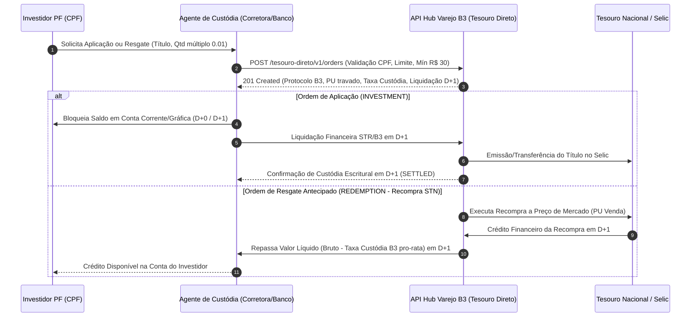

# Plataforma B3 — Integração Tesouro Direto & API Hub de Varejo B3 (FL-031)

## 1. Visão Geral e Arquitetura Operacional

O **Tesouro Direto** é o programa da Secretaria do Tesouro Nacional (STN) desenvolvido em parceria com a **B3 S.A. – Brasil, Bolsa, Balcão** para venda e recompra de Títulos Públicos Federais (TPFs) para pessoas físicas por meio da internet e de canais digitais integrados. Na arquitetura de mercado moderna, a B3 disponibiliza o **Hub de Varejo / API Tesouro Direto B3** para que bancos, corretoras e distribuidoras de títulos e valores mobiliários habilitadas (**Agentes de Custódia / Instituições Financeiras Habilitadas**) embarquem toda a jornada de investimento, consulta de cesta de preços, reserva de aplicação, resgate antecipado (recompra pelo Tesouro Nacional) e conciliação de custódia diretamente em suas plataformas proprietárias.

Na infraestrutura de pós-negociação:
- A **Secretaria do Tesouro Nacional (STN)** atua como emissora primária nas aplicações (vendas ao investidor) e como garantidora de liquidez diária nas recompras (resgates antecipados a preços de mercado).
- A **B3** atua como depositária centralizada individualizada por CPF (conta de custódia do investidor sob um Agente de Custódia), infraestrutura de roteamento de ordens, cálculo e retenção da **Taxa de Custódia B3** e câmara de liquidação financeira junto aos liquidantes no SPB/Selic.
- Os **Agentes de Custódia** atuam na identificação cadastral do investidor (KYC/Suitability), recepção e transmissão de ordens via API Hub Varejo, reserva e débito de recursos financeiros na conta gráfica do investidor e repasse na janela de liquidação $D+0 / D+1$.

Este documento formaliza as especificações técnicas do protocolo da API Hub Varejo para o Tesouro Direto, a matriz de títulos públicos suportados, as regras determinísticas de validação (fração mínima de $0,01$ título, piso financeiro de $\text{R\$ } 30,00$ e teto mensal de aplicação por CPF), o cálculo de **Taxa de Custódia B3 ($0,20\% \text{ a.a.}$ *pro-rata die*)** e a liquidação de aplicações e recompras para a frente **`FL-031`**.

---

## 2. Catálogo de Títulos Públicos Suportados (`TreasuryBondType`)

O programa Tesouro Direto contempla sete modalidades de títulos públicos federais escriturais, distribuídos entre indexadores pós-fixados (Selic), prefixados e híbridos indexados à inflação (IPCA):

| Código / Enum (`TreasuryBondType`) | Sigla STN / Selic | Nome Comercial Tesouro Direto | Indexador | Fluxo de Pagamento de Juros e Principal |
|---|---|---|---|---|
| `TESOURO_SELIC` | `LFT` | Tesouro Selic | Taxa Selic Over diária + ágio/deságio | Principal + rendimento acumulado pagos integralmente no vencimento (*bullet*). |
| `TESOURO_PREFIXADO` | `LTN` | Tesouro Prefixado | Taxa Prefixada (% a.a. base DU/252) | Valor de face nominal de R$ 1.000,00 pago integralmente no vencimento (*bullet*). |
| `TESOURO_PREFIXADO_JUROS_SEMESTRAIS` | `NTN-F` | Tesouro Prefixado com Juros Semestrais | Taxa Prefixada (% a.a. base DU/252) | Cupons semestrais de 10% a.a. (4,88088482% ao semestre) e VNA de R$ 1.000,00 no vencimento. |
| `TESOURO_IPCA` | `NTN-B Principal` | Tesouro IPCA+ | Variação do IPCA + Taxa Real (% a.a.) | Valor Nominal Atualizado (VNA) pelo IPCA pago integralmente no vencimento (*bullet*). |
| `TESOURO_IPCA_JUROS_SEMESTRAIS` | `NTN-B` | Tesouro IPCA+ com Juros Semestrais | Variação do IPCA + Taxa Real (% a.a.) | Cupons semestrais reais de 6% a.a. (2,95630141% ao semestre sobre o VNA) + principal no vencimento. |
| `TESOURO_RENDA_MAIS` | `NTN-B1` | Tesouro Renda+ (Aposentadoria Extra) | Variação do IPCA + Taxa Real (% a.a.) | Período de acumulação sem cupons, seguido de amortização mensal em 240 parcelas (20 anos) corrigidas pelo IPCA. |
| `TESOURO_EDUCA_MAIS` | `NTN-B1 Educa+` | Tesouro Educa+ | Variação do IPCA + Taxa Real (% a.a.) | Período de acumulação sem cupons, seguido de amortização mensal em 60 parcelas (5 anos) corrigidas pelo IPCA. |

### 2.1. Precificação na Cesta do Tesouro Direto

A STN publica e atualiza intradia (com suspensões temporárias em momentos de alta volatilidade de juros futuros no PUMA/B3) a tabela de preços e taxas contendo:
- **Taxa de Compra (Aplicação / `buy_rate_pct`)** e **Preço Unitário de Compra ($PU_{compra}$ / `unit_buy_price`)**: aplicados às ordens de investimento (`INVESTMENT` / `COMPRA`).
- **Taxa de Venda (Resgate / Recompra / `sell_rate_pct`)** e **Preço Unitário de Venda ($PU_{venda}$ / `unit_sell_price`)**: aplicados às ordens de resgate antecipado (`REDEMPTION` / `RESGATE`), nas quais o Tesouro Nacional recompra o título a preço de mercado (*mark-to-market*).

---

## 3. Regras de Negócio e Restrições Operacionais

Toda ordem enviada pelo Agente de Custódia à API Hub Varejo B3 deve satisfazer estritamente as regras de validação pré-negociação abaixo:

### 3.1. Fração Mínima e Múltiplos de Quantidade ($0,01$ Título)
- A quantidade negociada ($Q$) deve ser estritamente positiva ($Q > 0$) e expressa como **múltiplo inteiro de $0,01$ título** (1% de um título público):
  $$Q = k \times 0,01, \quad k \in \mathbb{Z}^+$$
- Qualquer quantidade com fração residual inferior a $0,01$ (ex.: $0,015$ ou $1,002$) é prontamente rejeitada pelo motor de validação da B3 (`INVALID_QUANTITY_FRACTION`).

### 3.2. Valor Financeiro Mínimo por Operação ($\text{R\$ } 30,00$)
- O valor financeiro bruto da operação ($VF_{bruto}$) é calculado pelo produto exato entre a quantidade solicitada ($Q$) e o Preço Unitário vigente na cesta ($PU_{compra}$ para aplicação ou $PU_{venda}$ para resgate), arredondado na segunda casa decimal pelo critério `ROUND_HALF_UP`:
  $$VF_{bruto} = \text{round}\left(Q \times PU,\ 2\right)$$
- **Regra do Piso Mínimo**: Para ordens de aplicação (`INVESTMENT`) — e como regra de piso operacional da plataforma quando aplicável —, o valor financeiro bruto deve ser maior ou igual a **$\text{R\$ } 30,00$**:
  $$VF_{bruto} \ge \text{R\$ } 30,00$$
- No resgate antecipado (`REDEMPTION`), caso o investidor detenha saldo remanescente ou deseje resgatar posição, a plataforma também valida o piso de $\text{R\$ } 30,00$ (salvo liquidação de saldo residual total quando parametrizado, sendo o padrão normativo da ordem $\text{R\$ } 30,00$ e fração mínima de $0,01$ título).

### 3.3. Limite Mensal de Aplicação por Investidor (CPF)
- Cada investidor pessoa física (identificado univocamente pelo seu **CPF**) possui um **limite máximo mensal de compras (aplicações)** no Tesouro Direto de **$\text{R\$ } 1.000.000,00$ (um milhão de reais)** — podendo ser parametrizado conforme norma vigente da STN (ex.: $\text{R\$ } 1.000.000,00$ ou $\text{R\$ } 2.000.000,00$ por mês civil), somando todas as compras realizadas pelo CPF em todos os Agentes de Custódia no mesmo mês de competência (`YYYY-MM`):
  $$\sum_{i \in \text{Mês}} VF_{bruto, i}^{\text{INVESTMENT}}(\text{CPF}) + VF_{bruto, \text{atual}}^{\text{INVESTMENT}}(\text{CPF}) \le L_{\text{mensal}}$$
- **Resgates antecipados (`REDEMPTION`) e vencimentos não possuem limite financeiro máximo** e não abatem o limite mensal de aplicação já consumido no mês.

### 3.4. Taxa de Custódia B3 ($0,20\% \text{ a.a.}$ Provisionada *Pro-Rata Die*)
- A B3 cobra uma **Taxa de Custódia de $0,20\%$ ao ano** sobre o valor dos títulos mantidos sob custódia, calculada e provisionada diariamente (*pro-rata die*) considerando a base anual do Tesouro Direto (convenção linear de $365$ dias corridos ou base $252$ dias úteis parametrizável; o motor suporta a equação padrão *pro-rata die* com taxa anual de $0,20\%$):
  $$\text{Taxa}_{\text{custódia B3}} = \text{round}\left(VF_{bruto} \times \frac{\text{Taxa}_{\text{anual}}}{100} \times \frac{\text{Dias}_{\text{custódia}}}{\text{Base}_{\text{dias}}},\ 2\right)$$
  Onde:
  - $\text{Taxa}_{\text{anual}} = 0,20\%$ ($0,0020$);
  - $\text{Dias}_{\text{custódia}}$ é o número de dias corridos (base $365$) entre a data de liquidação da compra (ou último pagamento semestral de taxa em $01/\text{jan}$ e $01/\text{jul}$) e a data do evento (resgate antecipado, pagamento de juros ou vencimento).
- **Cobrança na Aplicação vs. Resgate**:
  - Na **Aplicação (`INVESTMENT`)**, se a instituição ou modalidade exigir retenção antecipada da taxa no ato ou se for isenta no $D+1$ inicial, ou quando provisionada por período, o motor apura a `CustodyFeeCalculation` detalhada; por padrão operacional no ato da aplicação inicial ($0$ dias decorridos ou isenção de entrada) ou com provisionamento informado, o valor líquido a liquidar pelo investidor na compra soma o valor bruto e eventuais taxas incidentes:
    $$VF_{\text{líquido}}^{\text{INVESTMENT}} = VF_{bruto} + \text{Taxa}_{\text{custódia B3}} + \text{Taxa}_{\text{agente}}$$
  - No **Resgate Antecipado (`REDEMPTION`)**, a Taxa de Custódia B3 *pro-rata die* acumulada desde o último evento de cobrança (ou data de aplicação) até a data de liquidação do resgate é **deduzida** do valor bruto da recompra:
    $$VF_{\text{líquido}}^{\text{REDEMPTION}} = VF_{bruto} - \text{Taxa}_{\text{custódia B3}} - \text{Taxa}_{\text{agente}}$$
- **Regra de Isenção do Tesouro Selic (`TESOURO_SELIC`) até R$ 10.000,00**: A B3 concede isenção da taxa de custódia de $0,20\%$ a.a. para o estoque em Tesouro Selic até o limite de $\text{R\$ } 10.000,00$ por CPF (incidindo $0,20\%$ a.a. apenas sobre o valor que exceder $\text{R\$ } 10.000,00$, quando aplicável a flag de isenção regulamentar, ou sobre a base integral para os demais títulos).

---

## 4. Ciclo de Vida de Liquidação ($D+1$) e Recompra pelo Tesouro Nacional



### 4.1. Prazos de Liquidação ($D+0$ / $D+1$)
1. **Aplicação (`INVESTMENT`)**:
   - **Envio da Ordem ($D+0$)**: O Agente de Custódia reserva o preço unitário da cesta vigente.
   - **Liquidação Financeira e Escritural ($D+1$)**: Os recursos financeiros são liquidados na janela da câmara B3 e as frações de títulos passam a constar na posição custodiada do investidor no primeiro dia útil subsequente (`settlement_date = trade_date + 1 dia útil`).
2. **Resgate Antecipado / Recompra pelo Tesouro Nacional (`REDEMPTION`)**:
   - O Tesouro Nacional garante a recompra diária dos títulos a preços de mercado (`unit_sell_price`).
   - A baixa da posição em custódia e o crédito financeiro líquido (descontada a taxa de custódia B3 provisionada *pro-rata die*) ocorrem até $D+1$ dia útil (ou $D+0$ para solicitações em dias úteis dentro da janela intradia até as 13h, parametrizável via `settlement_date`).

---

## 5. Layout JSON do Lote de Ordens (`fixtures/tesouro_direto_orders.json`)

A comunicação via API Hub de Varejo B3 utiliza payloads JSON estruturados com precisão decimal estrita em strings numéricas para evitar erros de ponto flutuante IEEE 754.

### 5.1. Estrutura do Payload de Lote

```json
{
  "batch_id": "TD-BATCH-20261103-001",
  "system": "B3 Hub Varejo - API Tesouro Direto",
  "reference_date": "2026-11-03",
  "custody_agent_code": "0114",
  "custody_agent_name": "CORRETORA ATLAS DTVM S.A.",
  "monthly_limit_per_cpf": "1000000.00",
  "b3_custody_fee_rate_annual_pct": "0.20",
  "bonds_catalog": [
    {
      "bond_code": "TD-SELIC-2029",
      "isin": "BRSTNCLFT1R8",
      "bond_type": "TESOURO_SELIC",
      "bond_name": "Tesouro Selic 2029",
      "indexer": "SELIC",
      "maturity_date": "2029-03-01",
      "buy_rate_pct": "0.1450",
      "sell_rate_pct": "0.1550",
      "unit_buy_price": "15420.50",
      "unit_sell_price": "15415.20"
    }
  ],
  "orders": [
    {
      "order_id": "TD-ORD-20261103-0001",
      "b3_protocol": "B3TD20261103000189",
      "investor_cpf": "123.456.789-01",
      "investor_name": "ANA CAROLINA MENDES",
      "custody_account": "0114-88901-2",
      "custody_agent_code": "0114",
      "operation_type": "INVESTMENT",
      "bond_code": "TD-SELIC-2029",
      "bond_type": "TESOURO_SELIC",
      "quantity": "0.25",
      "unit_price": "15420.50",
      "trade_date": "2026-11-03",
      "settlement_date": "2026-11-04",
      "holding_days": 0,
      "agent_fee_rate_annual_pct": "0.00",
      "expected_gross_amount": "3855.13",
      "expected_b3_custody_fee": "0.00",
      "expected_net_settlement_amount": "3855.13"
    }
  ]
}
```

### 5.2. Dicionário de Campos da Ordem (`TreasuryDirectOrder`)

| Campo | Tipo Python | Obrigatório | Regra de Domínio / Validação |
|---|---|---|---|
| `order_id` | `str` | Sim | Identificador único da ordem no Agente de Custódia. |
| `b3_protocol` | `str` | Sim | Protocolo único gerado pelo Hub Varejo B3. |
| `investor_cpf` | `str` | Sim | CPF válido do investidor pessoa física (11 dígitos numéricos, com ou sem máscara). |
| `investor_name` | `str` | Sim | Nome civil completo do investidor PF. |
| `custody_account` | `str` | Sim | Conta de custódia individualizada do investidor na B3. |
| `custody_agent_code` | `str` | Sim | Código operacional do Agente de Custódia habilitado na B3. |
| `operation_type` | `OrderOperationType` | Sim | `INVESTMENT` (Aplicação / Compra) ou `REDEMPTION` (Resgate / Recompra pelo Tesouro). |
| `bond_code` | `str` | Sim | Código identificador do título na cesta do Tesouro Direto. |
| `bond_type` | `TreasuryBondType` | Sim | Modalidade do título (`TESOURO_SELIC`, `TESOURO_PREFIXADO`, `TESOURO_PREFIXADO_JUROS_SEMESTRAIS`, `TESOURO_IPCA`, `TESOURO_IPCA_JUROS_SEMESTRAIS`, `TESOURO_RENDA_MAIS`, `TESOURO_EDUCA_MAIS`). |
| `quantity` | `Decimal` | Sim | Quantidade de títulos ($Q > 0$, múltiplo exato de $0,01$). |
| `unit_price` | `Decimal` | Sim | Preço Unitário ($PU > 0$) de compra ou venda na cesta vigente. |
| `trade_date` | `date` | Sim | Data de envio/contratação da operação ($D+0$). |
| `settlement_date` | `date` | Sim | Data de liquidação financeira e escritural ($D+1$, $\ge$ `trade_date`). |
| `holding_days` | `int` | Não | Dias corridos de custódia para cálculo *pro-rata die* da taxa B3 ($\ge 0$, padrão `0` na compra e $>0$ no resgate). |
| `agent_fee_rate_annual_pct` | `Decimal` | Não | Taxa de administração/custódia cobrada pela corretora (% a.a., padrão `0.00`). |

---

## 6. Referência de Implementação no Atlas

- **Módulo de Domínio e Motor**: [`src/tesouro_direto.py`](../src/tesouro_direto.py)
- **Fixture de Lote de Ordens**: [`fixtures/tesouro_direto_orders.json`](../fixtures/tesouro_direto_orders.json)
- **Suíte de Testes Automatizados**: [`tests/test_tesouro_direto.py`](../tests/test_tesouro_direto.py)
