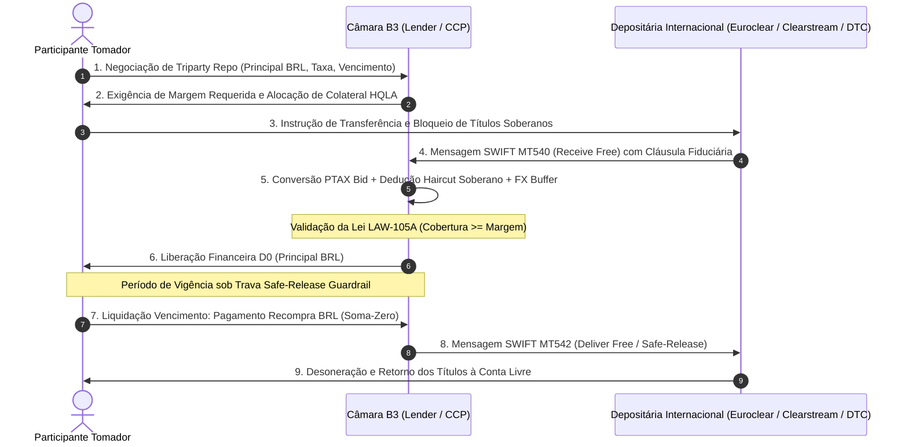

# Especificação Técnica — Custódia Internacional e Gestão de Garantias Triparty Repo — Câmara B3 (FL-099)

---

## 1. Visão Geral e Arcabouço Regulatório

O fluxo **`FL-099` — Custódia Internacional e Gestão de Garantias Triparty Repo** estabelece a arquitetura institucional da Câmara de Compensação e Liquidação B3 para operacionalização de operações compromissadas internacionais (*Triparty Repurchase Agreements*) e aceitação de ativos soberanos e corporativos de alta liquidez (*High Quality Liquid Assets - HQLA*) custodiados nas principais depositárias centrais internacionais:

1. **Euroclear Bank SA/NV** (Bruxelas, Bélgica — BIC: `EACLBBEB`);
2. **Clearstream Banking S.A.** (Luxemburgo — BIC: `MRQCLULL`);
3. **The Depository Trust Company - DTC / DTCC** (Nova York, EUA — BIC: `DTCXPENY`).

### 1.1 Normativos e Enquadramento Legal
- **Lei Federal nº 13.986/2020 e Lei nº 6.385/1976 (Art. 24)**: Regime fiduciário de incomunicabilidade patrimonial sobre ativos vinculados a garantias de câmaras de compensação e liquidação autorizadas pelo BACEN e CVM.
- **Manual de Risco e Salvaguardas da Câmara B3 (CORE Risk System)**: Metodologia de cálculo de margem requerida, haircuts paramétricos multimoeda e monitoramento intradiário de solvência.
- **Princípios CPMI-IOSCO para Infraestruturas de Mercado Financeiro (PFMI - Princípios 4, 5 e 7)**: Gestão de risco de crédito, colateral internacional e risco de liquidez transfronteiriço.
- **Padrões SWIFT ISO 15022 / ISO 20022**: Mensageria de custódia e liquidação de títulos (*Securities Settlement & Collateral Management*).

---

## 2. Estrutura Operacional e Fluxo de Mensageria

O modelo Triparty Repo segrega as funções de concessão de caixa (*Cash Lender* / B3), tomada de caixa (*Cash Borrower* / Participante) e administração de colateral (*Triparty Agent* / ICSD):

---

## 3. Matriz Conservadora de Haircuts e Avaliação PTAX

A avaliação prudencial das garantias internacionais é formulada para imunizar a Câmara B3 contra flutuações simultâneas de taxas de juros externas e volatilidade cambial:

### 3.1 Taxa de Conversão Cambial PTAX BACEN
A conversão monetária adota estritamente a cotação **PTAX de Compra (bid)** do Banco Central do Brasil para a moeda do ativo ($USD, EUR, GBP$):
$$V_{\text{bruto\_brl}} = \text{Quantidade} \times \text{Preço Unitário Ext} \times \text{PTAX}_{\text{bid}}$$
Com a garantia matemática de que:
$$0 < \text{PTAX}_{\text{bid}} \le \text{PTAX}_{\text{ask}}$$

### 3.2 Composição do Haircut Total ($H_{\text{total}}$)
O fator de corte regulatório total é dado pela soma do haircut base do título e do buffer de risco cambial, limitado a um teto prudencial de 50%:
$$H_{\text{total}} = \min(H_{\text{base}} + H_{\text{fx}}, 0.50)$$

1. **Haircut Base por Tenor Residual e Rating Soberano ($H_{\text{base}}$)**:
   - Tenor $\le 1$ ano: $2.0\%$ base
   - Tenor $1 < T \le 3$ anos: $3.5\%$ base
   - Tenor $3 < T \le 5$ anos: $5.0\%$ base
   - Tenor $5 < T \le 10$ anos: $7.5\%$ base
   - Tenor $> 10$ anos: $10.0\%$ base
   - *Spread de Risco Soberano*: AAA ($+0.0\%$), AA ($+1.0\%$ a $+2.0\%$), A ($+3.0\%$ a $+4.0\%$), BBB ($+6.0\%$ a $+8.0\%$). Títulos *Sub-Investment Grade* são sumariamente rejeitados.

2. **Buffer de Volatilidade Cambial ($H_{\text{fx}}$)**:
   - Dólar Norte-Americano ($USD$): $8.00\%$
   - Euro ($EUR$): $10.00\%$
   - Libra Esterlina ($GBP$): $12.00\%$

3. **Valor Elegível Final em BRL**:
   $$V_{\text{elegível\_brl}} = \text{round\_cents}\left(V_{\text{bruto\_brl}} \times (1 - H_{\text{total}})\right)$$

---

## 4. Incomunicabilidade Patrimonial e Safe-Release Guardrail

1. **Incomunicabilidade Patrimonial (Lei 13.986/2020)**:
   - Os títulos bloqueados sob a custódia fiduciária da B3 constituem patrimônio de afetação segregado.
   - Não se comunicam com a massa falida do participante tomador nem respondem por outras dívidas cíveis/fiscais.
   - Todas as mensagens SWIFT MT540 trazem expressamente no campo `:70D::SPCL` a aposição de gravame fiduciário irrevogável em favor da B3.

2. **Trava Safe-Release Guardrail**:
   - Qualquer solicitação de desoneração parcial ou antecipada de colateral deve obedecer à condição estrita:
     $$\sum V_{\text{elegível\_remanescente}} \ge \text{Margem Requerida B3}$$
   - Caso a liberação resulte em déficit de margem, o sistema aborta a operação via `MarginReleaseViolationError` e não emite a instrução SWIFT MT542.

---

## 5. Leis de Invariantes Formais

### LAW-105A: Cobertura Cambial e Haircut Prudencial
$$\forall a \in \text{Allocations}, \quad 0 \le H_{\text{total}}(a) < 1.00 \quad \land \quad V_{\text{elegível\_brl}}(a) \le V_{\text{bruto\_brl}}(a)$$
$$\text{Para contratos em status } LOCKED\_FIDUCIARY: \quad \sum_{a \in \text{Allocations}} V_{\text{elegível\_brl}}(a) \ge \text{Margem Requerida}$$

### LAW-105B: Inviolabilidade do Bloqueio Internacional e Segregação
1. Conservação física de custódia em todas as contas e depositárias internacionais:
   $$Q_{\text{total}} = Q_{\text{disponível}} + Q_{\text{bloqueada\_fiduciária}} \quad (Q \ge 0)$$
2. Segregação estrita entre Contas Próprias (`HOUSE`) e de Clientes (`CLIENT`), proibindo comunhão patrimonial.
3. Inviolabilidade das tags de afetação fiduciária no protocolo SWIFT MT540.

### LAW-105C: Conservação Bilateral Soma-Zero na Liquidação
Tanto na liquidação regular por recompra (*DvP*) quanto na excussão em leilão internacional de *default*:
$$\text{Valor Pago pelo Tomador} = \text{Valor Recebido pelo Doador} + \text{Excedente Restituído ao Tomador}$$
$$\Delta \text{Financeiro Líquido} \equiv 0.00 \quad \text{centavo a centavo}$$
Todas as unidades de títulos desoneradas no vencimento retornam exatamente na quantidade original bloqueada.
