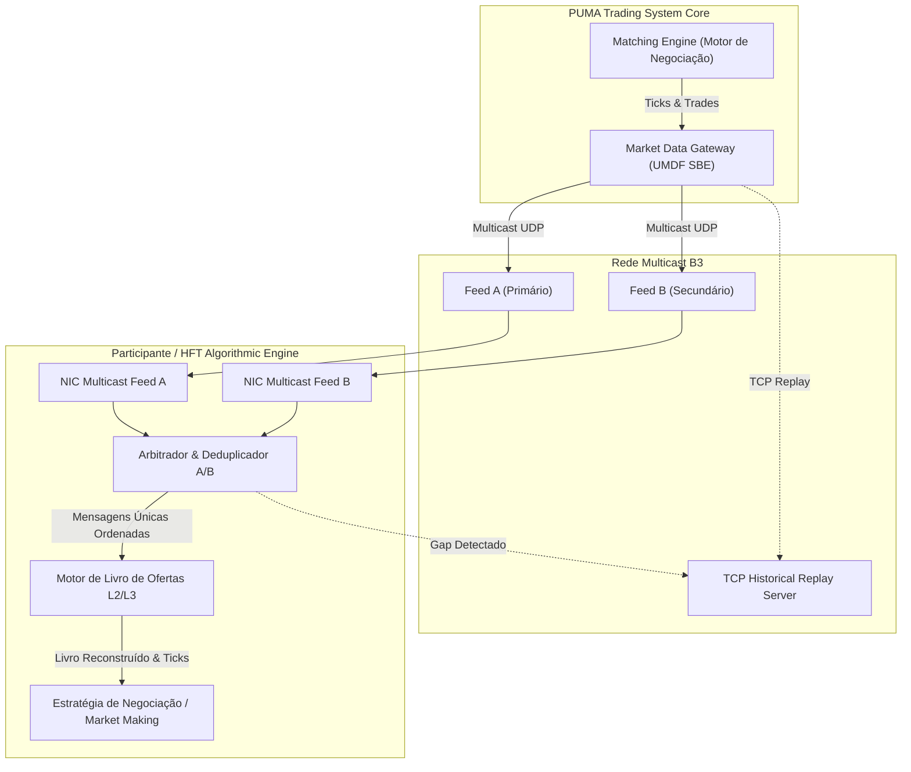
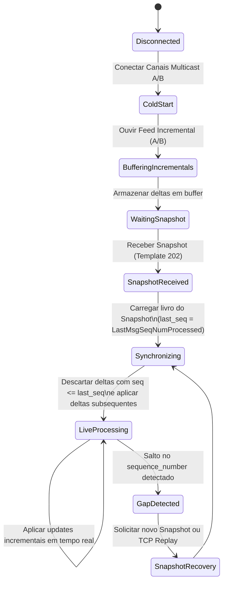

# Especificação Técnica de Market Data Feed em Tempo Real — B3 UMDF / SBE Multicast (FL-021)

## 1. Visão Geral e Arquitetura do Protocolo UMDF

O **Unified Market Data Feed (UMDF)** é a plataforma de difusão de dados de mercado em tempo real de ultra-baixa latência do **PUMA Trading System** da B3. Projetado para suportar infraestruturas de alta performance, fundos quantitativos, formadores de mercado (*Market Makers*) e participantes de **High-Frequency Trading (HFT)**, o UMDF transmite cotações tick-by-tick, profundidade do livro de ofertas e estatísticas de negociação.

O protocolo adota o padrão **Simple Binary Encoding (SBE)** padronizado pela *FIX Trading Community*, encapsulado sobre pacotes **UDP Multicast** em topologia redundante de canais paralelos **Feed A** e **Feed B** (*Active-Active*).

### 1.1 Comparativo Tecnológico: UMDF SBE Multicast vs. FAST vs. FIX Textual

| Dimensão | UMDF SBE Multicast (FL-021) | FAST Protocol (Legado B3) | FIX Market Data (Tag=Value) |
|---|---|---|---|
| **Camada de Transporte** | UDP Multicast redundante (A/B) | UDP Multicast comprimido | TCP unicast ponto a ponto |
| **Codificação** | Binário Little-Endian de offset fixo | Binário comprimido com mapas de bits | Texto ASCII delimitado por SOH (`\x01`) |
| **Parsing Overhead** | Decodificação zero-copy direta em memória | Estado cumulativo de descompressão | Tokenização e conversão de strings |
| **Latência Típica** | Sub-microssegundos (< 1 µs por mensagem) | Baixa (~5-15 µs por mensagem) | Moderada a alta (> 50 µs) |
| **Recuperação de Gaps** | Replay TCP dedicado e Loop de Snapshots | Replay TCP e re-sincronização FAST | ResendRequest FIX (Tag 34) |
| **Representação de Preços** | Inteiro de 64 bits em escala $10^8$ | Inteiro com expoente variável | Ponto flutuante textual (`34.50`) |

### 1.2 Topologia de Rede e Redundância Active-Active (Feeds A/B)

A B3 transmite simultaneamente o mesmo fluxo de dados através de duas redes físicas segregadas:
- **Feed A (Primary Multicast Group)**: Canal multicast de alta velocidade.
- **Feed B (Secondary Multicast Group)**: Canal multicast geograficamente redundante.

Ambos os feeds transmitem mensagens rigorosamente idênticas com o mesmo número de sequência sequencial (`sequence_number`). Os motores de recepção HFT assinam ambos os feeds simultaneamente:
1. O primeiro pacote a chegar (seja via canal A ou B) é imediatamente processado pelo motor de negociação.
2. O pacote redundante correspondente que chega milissegundos/microssegundos depois pelo canal alternativo é descartado deterministicamente sem overhead de processamento.
3. Se um pacote do Feed A for perdido na rede física (queda de pacotes UDP), o pacote correspondente do Feed B preenche a lacuna sem interrupção de serviço.



---

## 2. Estrutura de Cabeçalho Binário SBE (Framing Header)

Toda mensagem do protocolo UMDF é prefixada pelo **SBE Message Header** canônico de **8 bytes**, codificado em **Little-Endian** (`<`). Para mensagens com listas de repetição (como níveis do livro de ofertas), o protocolo emprega o **GroupSizeEncoding** de **4 bytes**.

### 2.1 Especificação dos Campos do Message Header (8 Bytes)

| Offset | Campo | Tipo C | Tipo Python (`struct`) | Tamanho | Descrição |
|---|---|---|---|---|---|
| `0..1` | `BlockLength` | `uint16_t` | `H` | 2 bytes | Tamanho em bytes do bloco raiz da mensagem (*root block*), excluindo o cabeçalho e grupos repetidores. |
| `2..3` | `TemplateId` | `uint16_t` | `H` | 2 bytes | Identificador do modelo de mensagem B3: `201` (SecurityStatus), `202` (Snapshot), `203` (Incremental). |
| `4..5` | `SchemaId` | `uint16_t` | `H` | 2 bytes | Identificador do schema da B3 (default: `1`). |
| `6..7` | `Version` | `uint16_t` | `H` | 2 bytes | Versão da especificação da mensagem (default: `1`). |

**Formato `struct`**: `"<HHHH"` (8 bytes exatos).

```text
 0                   1                   2                   3
 0 1 2 3 4 5 6 7 8 9 0 1 2 3 4 5 6 7 8 9 0 1 2 3 4 5 6 7 8 9 0 1
+-+-+-+-+-+-+-+-+-+-+-+-+-+-+-+-+-+-+-+-+-+-+-+-+-+-+-+-+-+-+-+-+
|          BlockLength          |          TemplateId           |
+-+-+-+-+-+-+-+-+-+-+-+-+-+-+-+-+-+-+-+-+-+-+-+-+-+-+-+-+-+-+-+-+
|           SchemaId            |            Version            |
+-+-+-+-+-+-+-+-+-+-+-+-+-+-+-+-+-+-+-+-+-+-+-+-+-+-+-+-+-+-+-+-+
```

### 2.2 Cabeçalho de Grupos de Repetição — GroupSizeEncoding (4 Bytes)

Quando uma mensagem possui entradas dinâmicas (ex.: níveis de preço de um livro de ofertas ou múltiplos negócios num pacote incremental), o grupo é prefixado pelo cabeçalho `GroupSizeEncoding`:

| Offset Relativo | Campo | Tipo C | Tipo Python (`struct`) | Tamanho | Descrição |
|---|---|---|---|---|---|
| `0..1` | `BlockLength` | `uint16_t` | `H` | 2 bytes | Comprimento em bytes de cada entrada individual no grupo repetidor. |
| `2..3` | `NumInGroup` | `uint16_t` | `H` | 2 bytes | Quantidade total de entradas subsequentes no grupo. |

**Formato `struct`**: `"<HH"` (4 bytes exatos).

---

## 3. Catálogo de Mensagens UMDF Essenciais

### 3.1 Mensagem `SecurityStatus` (TemplateId = 201)

Mensagem transmitida para indicar o estado operacional de um instrumento financeiro ou grupo de negociação (ex.: abertura de mercado, leilão pré-abertura, suspensão/circuit breaker ou encerramento).

- **TemplateId**: `201`
- **BlockLength**: `34 bytes`
- **Tamanho Total com Header**: `42 bytes`
- **Formato Struct (Payload)**: `"<QQ8sBBQ"`

#### Tabela de Layout de Memória (`SecurityStatus`)

| Offset Global | Offset Bloco | Campo | Tipo C | Formato | Tamanho | Regras de Negócio e Domínio |
|---|---|---|---|---|---|---|
| `8..15` | `0..7` | `SequenceNumber` | `uint64_t` | `Q` | 8 bytes | Sequencial contínuo de difusão no feed de market data. |
| `16..23` | `8..15` | `SecurityID` | `uint64_t` | `Q` | 8 bytes | Código numérico unívoco do instrumento (ex.: `2001` para PETR4). |
| `24..31` | `16..23` | `SecurityGroup` | `char[8]` | `8s` | 8 bytes | Código do grupo de instrumentos (ex.: `"EQUITIES"`). |
| `32` | `24` | `SecurityTradingStatus` | `uint8_t` | `B` | 1 byte | Estado de negociação: `2` = Pause/Halt, `17` = Open (Negociação Contínua), `18` = Close, `21` = Auction (Leilão). |
| `33` | `25` | `TradingSessionSubID` | `uint8_t` | `B` | 1 byte | Fase da sessão: `1` = Pre-Open, `2` = Continuous, `3` = Closing Auction, `4` = Post-Trading. |
| `34..41` | `26..33` | `TimestampNs` | `uint64_t` | `Q` | 8 bytes | Timestamp UTC do evento em nanossegundos desde o Unix Epoch. |

---

### 3.2 Mensagem `MarketDataSnapshotFullRefresh` (TemplateId = 202)

Transmitida ciclicamente em canais de snapshot ou sob demanda para permitir a inicialização a frio (*cold start*) de algoritmos ou ressincronização após interrupção de pacotes. Apresenta o estado completo do livro de ofertas até um ponto exato do feed incremental.

- **TemplateId**: `202`
- **BlockLength (Bloco Raiz)**: `36 bytes`
- **Formato Struct (Root Block)**: `"<QQIQQ"`
- **GroupSizeEncoding**: 4 bytes (`"<HH"`)
- **Tamanho de Cada Entrada do Livro**: `31 bytes` (`"<BqQHIQ"`)
- **Tamanho Total do Pacote**: `8 + 36 + 4 + (N * 31) bytes`

#### Bloco Raiz (`MarketDataSnapshotFullRefresh`)

| Offset Global | Offset Bloco | Campo | Tipo C | Formato | Tamanho | Regras de Negócio e Domínio |
|---|---|---|---|---|---|---|
| `8..15` | `0..7` | `SequenceNumber` | `uint64_t` | `Q` | 8 bytes | Sequencial de difusão do canal de snapshots. |
| `16..23` | `8..15` | `SecurityID` | `uint64_t` | `Q` | 8 bytes | Identificador numérico do ativo (ex.: PETR4). |
| `24..27` | `16..19` | `TotNumReports` | `uint32_t` | `I` | 4 bytes | Número total de relatórios de snapshot gerados no ciclo. |
| `28..35` | `20..27` | `LastMsgSeqNumProcessed` | `uint64_t` | `Q` | 8 bytes | **Chave de sincronização**: último número de sequência do canal incremental refletido neste snapshot. |
| `36..43` | `28..35` | `TimestampNs` | `uint64_t` | `Q` | 8 bytes | Timestamp UTC de geração do snapshot em nanossegundos. |

#### Entradas Repetidoras do Livro de Ofertas (`OrderBookEntry`)

| Offset Relativo | Campo | Tipo C | Formato | Tamanho | Descrição |
|---|---|---|---|---|---|
| `0` | `MDEntryType` | `uint8_t` | `B` | 1 byte | Lado ou tipo da entrada: `0` = Bid (Compra), `1` = Offer (Venda), `2` = Trade (Último Negócio). |
| `1..8` | `MDEntryPx` | `int64_t` | `q` | 8 bytes | Preço unitário codificado na escala fixa de $10^8$ ($Preço \times 10^8$). |
| `9..16` | `MDEntrySize` | `uint64_t` | `Q` | 8 bytes | Quantidade total disponível neste nível de preço. |
| `17..18` | `MDPriceLevel` | `uint16_t` | `H` | 2 bytes | Nível de profundidade no livro (1 = Top of Book / Best, 2, 3...). |
| `19..22` | `NumberOfOrders` | `uint32_t` | `I` | 4 bytes | Quantidade agregada de ordens individuais no nível (L2). |
| `23..30` | `OrderID` | `uint64_t` | `Q` | 8 bytes | Identificador da ordem individual (utilizado em modelagem L3; `0` em L2). |

---

### 3.3 Mensagem `MarketDataIncrementalRefresh` (TemplateId = 203)

Transmitida em tempo real via canais Multicast A e B. Informa variações tick-by-tick no livro de ofertas (inserção, alteração e cancelamento de ofertas) bem como a execução imediata de negócios (*trades*).

- **TemplateId**: `203`
- **BlockLength (Bloco Raiz)**: `16 bytes`
- **Formato Struct (Root Block)**: `"<QQ"`
- **GroupSizeEncoding**: 4 bytes (`"<HH"`)
- **Tamanho de Cada Entrada Incremental**: `48 bytes` (`"<BBQqQHIQQ"`)
- **Tamanho Total do Pacote**: `8 + 16 + 4 + (N * 48) bytes`

#### Bloco Raiz (`MarketDataIncrementalRefresh`)

| Offset Global | Offset Bloco | Campo | Tipo C | Formato | Tamanho | Regras de Negócio e Domínio |
|---|---|---|---|---|---|---|
| `8..15` | `0..7` | `SequenceNumber` | `uint64_t` | `Q` | 8 bytes | Sequencial contínuo rigoroso do canal incremental A/B. |
| `16..23` | `8..15` | `TimestampNs` | `uint64_t` | `Q` | 8 bytes | Timestamp UTC da emissão do pacote em nanossegundos. |

#### Entradas Incrementais de Atualização (`IncrementalEntry`)

| Offset Relativo | Campo | Tipo C | Formato | Tamanho | Descrição |
|---|---|---|---|---|---|
| `0` | `MDUpdateAction` | `uint8_t` | `B` | 1 byte | Ação de atualização: `0` = New (Nova oferta), `1` = Change (Modificação), `2` = Delete (Cancelamento), `3` = Overlay (Substituição de nível). |
| `1` | `MDEntryType` | `uint8_t` | `B` | 1 byte | Tipo da entrada: `0` = Bid, `1` = Offer, `2` = Trade. |
| `2..9` | `SecurityID` | `uint64_t` | `Q` | 8 bytes | Identificador numérico do ativo afetado. |
| `10..17` | `MDEntryPx` | `int64_t` | `q` | 8 bytes | Preço da ordem ou trade na escala $10^8$. |
| `18..25` | `MDEntrySize` | `uint64_t` | `Q` | 8 bytes | Quantidade de ações ou contratos do evento. |
| `26..27` | `MDPriceLevel` | `uint16_t` | `H` | 2 bytes | Nível de preço afetado no livro L2 (opcional em trades). |
| `28..31` | `NumberOfOrders` | `uint32_t` | `I` | 4 bytes | Contagem agregada de ordens no nível L2. |
| `32..39` | `OrderID` | `uint64_t` | `Q` | 8 bytes | Identificador da ordem (relevante para livros L3). |
| `40..47` | `TradeID` | `uint64_t` | `Q` | 8 bytes | Identificador unívoco do negócio fechado (quando `MDEntryType = 2`). |

---

## 4. Modelagem do Livro de Ofertas: L2 vs. L3

O UMDF provê granularidade para suportar dois modelos estruturais de livro de ofertas:

### 4.1 Livro L2: Market by Price (MBP)
- As ofertas são agregadas por **nível de preço**.
- O consumidor conhece a profundidade agregada: Preço, Quantidade Total e Quantidade de Ordens (`NumberOfOrders`) em cada faixa.
- Mais econômico em processamento e largura de banda, sendo o modelo padrão para cálculo de spread, *Top of Book* (BBO) e book consolidado de até 5, 10 ou 20 níveis.
- **Estrutura interna**:
  - `Bids`: Dicionário ou árvore balanceada ordenada de forma **decrescente** por preço (maior preço tem prioridade).
  - `Asks`: Dicionário ou árvore balanceada ordenada de forma **crescente** por preço (menor preço tem prioridade).

### 4.2 Livro L3: Market by Order (MBO)
- Cada ordem individual é transmitida e mantida com seu próprio `OrderID` e fila de prioridade temporal (*Price-Time Priority* / FIFO).
- Permite rastrear adições, execuções parciais, modificações de tamanho e cancelamentos ordem a ordem.
- Indispensável para estratégias de *Queue Position Estimation* (estimativa de posição na fila de execução).

### 4.3 Máquina de Estados para Reconstrução Determinística do Livro



### 4.4 Métricas do Livro de Ofertas

A partir do livro mantido, calculam-se métricas instantâneas essenciais para execução:
- **Melhor Compra (*Best Bid*)**: $\max(P_{\text{bid}})$.
- **Melhor Venda (*Best Ask*)**: $\min(P_{\text{ask}})$.
- **Spread Absoluto**: $S = P_{\text{ask}} - P_{\text{bid}}$ (deve ser estritamente $\ge 0$ em mercado normal).
- **Preço Médio (*Mid Price*)**: $P_{\text{mid}} = \frac{P_{\text{bid}} + P_{\text{ask}}}{2}$.
- **Preço Ponderado por Volume (*Micro-Price*)**:
  $$P_{\text{micro}} = \frac{Q_{\text{bid}} \cdot P_{\text{ask}} + Q_{\text{ask}} \cdot P_{\text{bid}}}{Q_{\text{bid}} + Q_{\text{ask}}}$$

---

## 5. Arbitragem e Deduplicação Multicast Active-Active (Feeds A e B)

Para maximizar a resiliência e a velocidade, o consumidor (`UmdfStreamConsumer`) subscreve simultaneamente os sockets multicast dos canais A e B.

### 5.1 Regras de Deduplicação
1. Cada pacote incremental ou de status possui um `SequenceNumber` monótono e estritamente crescente.
2. O consumidor mantém um registro dos números de sequência já processados (via mapa de bits ou conjunto deslizante).
3. Ao receber um pacote no canal A ou B:
   - Se `seq` já consta no conjunto de sequências processadas $\rightarrow$ descarte imediato do pacote como duplicata redundante (`duplicates_discarded += 1`).
   - Se `seq` é novo $\rightarrow$ decodifica o pacote, atualiza o livro de ofertas e marca `seq` como processado.
4. Se `seq > highest_seq + 1`, uma quebra na continuidade é detectada (`gaps_detected += 1`), ativando a rotina de recuperação.

---

## 6. Fator de Escala Numérica de Preço ($10^8$)

Assim como no protocolo de negociação PUMA SBE, todos os preços no UMDF são codificados como inteiros de 64 bits (`int64_t`) com escala fixa de $10^8$ casas decimais.

$$\text{Preço Inteiro SBE} = \text{round}(\text{Preço em Reais} \times 100.000.000)$$

Exemplo para **PETR4**:
- Preço de Compra: **R$ 38,50** $\rightarrow$ `3850000000`
- Preço de Venda: **R$ 38,51** $\rightarrow$ `3851000000`
- Spread: **R$ 0,01** $\rightarrow$ `1000000`

---

## 7. Regras de Validação e Integridade

O parser binário `src/umdf_market_data.py` impõe validações rigorosas em tempo de execução:
1. **Verificação de Buffer Físico**: Garante que o payload contém o tamanho necessário para o cabeçalho (8 bytes), bloco raiz e entradas repetidoras. Payloads incompletos disparam `UmdfTruncatedPayloadError`.
2. **Validação de Template ID**: Aceita exclusivamente templates suportados: `201` (`SecurityStatus`), `202` (`MarketDataSnapshotFullRefresh`) e `203` (`MarketDataIncrementalRefresh`). IDs desconhecidos disparam `UmdfUnknownTemplateError`.
3. **Consistência de Negócio**:
   - Preços de ofertas e negócios devem ser estritamente positivos ($P > 0$).
   - Quantidades devem ser estritamente positivas ($Q > 0$).
   - O tipo de entrada `MDEntryType` deve pertencer ao domínio válido (`BID=0`, `OFFER=1`, `TRADE=2`).
