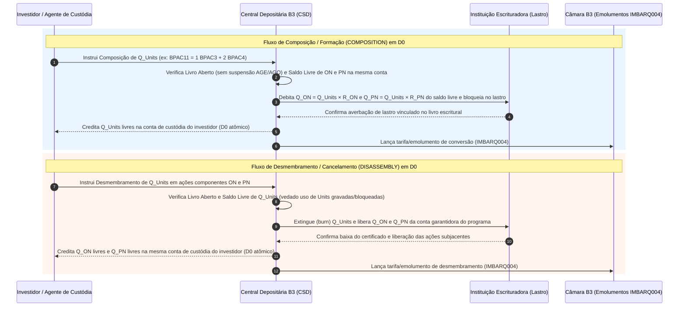
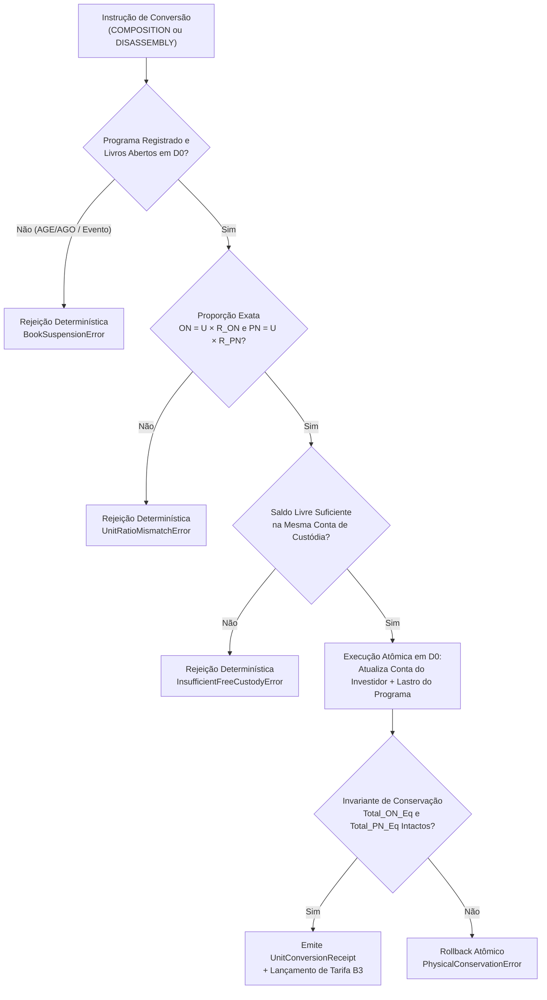

# Especificação Técnica — Composição (Emissão) e Desmembramento (Cancelamento) de Units na Depositária B3 (FL-043)

## 1. Visão Geral e Arcabouço Regulatório

As ***Units*** (**Certificados de Depósito de Ações**, negociadas na B3 sob o sufixo **`11`**) são valores mobiliários constituídos por uma cesta indivisível durante a negociação secundária de mais de uma espécie ou classe de valores mobiliários — tipicamente **Ações Ordinárias (`ON` — final `3`)** e **Ações Preferenciais (`PN` — final `4`, `5` ou `6`)** — de emissão de uma mesma companhia aberta, depositadas em custódia vinculada (bloqueada como lastro) junto à instituição escrituradora e à **Central Depositária da B3 (CSD)**.

A base normativa da emissão, negociação, composição e desmembramento de *Units* no mercado brasileiro compreende:
1. **Lei nº 6.404/1976 (Lei das Sociedades por Ações — Art. 43)**: Regula a emissão de Certificados de Depósito de Ações por instituições financeiras autorizadas pela CVM, exigindo o depósito prévio e o bloqueio fiduciário da totalidade das ações componentes que servem de lastro.
2. **Estatuto Social da Companhia Emissora e Regulamento de Listagem do Nível 2 / Tradicional da B3**: Define a proporção exata e imutável de ações `ON` e `PN` que integram cada *Unit*, bem como as janelas de suspensão operacional (*book closure*) por ocasião de Assembleias Gerais (AGO/AGE) ou eventos corporativos societários.
3. **Manual de Procedimentos Operacionais da Central Depositária da B3**: Estabelece o fluxo eletrônico de instrução pelos Agentes de Custódia, a verificação atômica de saldo livre em $D+0$, o estorno/crédito escritural simultâneo das posições (`IMBARQ012` / `IMBARQ013`) e a cobrança de emolumentos de conversão (`IMBARQ004`).

---

## 2. Catálogo de Programas Reais de Units na B3

Cada programa de *Units* registrado na B3 possui uma regra de formação estática e determinística $(R_{\text{ON}}, R_{\text{PN}})$, onde $1\text{ Unit} \equiv R_{\text{ON}}\text{ Ações ON} + R_{\text{PN}}\text{ Ações PN}$:

| Ticker Unit | ISIN Unit | Companhia Emissora | Componente ON | Componente PN | Proporção por 1 Unit ($R_{\text{ON}} : R_{\text{PN}}$) | Total de Ações por Unit |
|---|---|---|---|---|---|---|
| **`SANB11`** | `BRSANBCDAM13` | Banco Santander (Brasil) S.A. | `SANB3` (`BRSANBACNOR8`) | `SANB4` (`BRSANBACNPR5`) | **`1 SANB3 (ON)` + `1 SANB4 (PN)`** | $2\text{ ações}$ |
| **`BPAC11`** | `BRBPACCDAM13` | Banco BTG Pactual S.A. | `BPAC3` (`BRBPACACNOR7`) | `BPAC4` (`BRBPACACNPA0`) | **`1 BPAC3 (ON)` + `2 BPAC4 (PN)`** | $3\text{ ações}$ |
| **`TAEE11`** | `BRTAEECDAM10` | Transmissora Aliança de Energia Elétrica S.A. (TAESA) | `TAEE3` (`BRTAEEACNOR9`) | `TAEE4` (`BRTAEEACNPR6`) | **`1 TAEE3 (ON)` + `2 TAEE4 (PN)`** | $3\text{ ações}$ |
| **`KLBN11`** | `BRKLBNCDAM18` | Klabin S.A. | `KLBN3` (`BRKLBNACNOR2`) | `KLBN4` (`BRKLBNACNPR9`) | **`1 KLBN3 (ON)` + `4 KLBN4 (PN)`** | $5\text{ ações}$ |
| **`ENGI11`** | `BRENGICDAM16` | Energisa S.A. | `ENGI3` (`BRENGIACNOR3`) | `ENGI4` (`BRENGIACNPR0`) | **`1 ENGI3 (ON)` + `4 ENGI4 (PN)`** | $5\text{ ações}$ |

---

## 3. Regras Operacionais e Validações da Central Depositária

### 3.1 Composição / Formação de Units (`COMPOSITION`)
Na operação de **Composição** (também denominada *Formação* ou *Emissão de Units*), o investidor solicita por meio de seu Agente de Custódia a conversão de ações ordinárias e preferenciais já depositadas em sua conta em certificados `11`:

1. **Proporção Exata por Unit**:
   Para compor uma quantidade inteira estritamente positiva $Q_{\text{units}} \in \mathbb{Z}^+$ de *Units*, o investidor deve entregar exatamente:
   $$Q_{\text{ON}} = Q_{\text{units}} \times R_{\text{ON}}, \qquad Q_{\text{PN}} = Q_{\text{units}} \times R_{\text{PN}}$$
   Qualquer instrução que informe quantidades de `ON` ou `PN` divergentes de $(Q_{\text{units}} \times R_{\text{ON}},\ Q_{\text{units}} \times R_{\text{PN}})$ ou que apresente quantidades fracionárias é **rejeitada deterministicamente** (`UnitRatioMismatchError`).

2. **Mesma Titularidade e Saldo Livre Exclusivo**:
   - Tanto as ações `ON` quanto as ações `PN` devem estar depositadas **na mesma conta de custódia** (`participant_code` + `investor_account`) do investidor final na Central Depositária da B3.
   - Somente o **Saldo Livre (`free_balance`)** pode ser utilizado para composição. Ações bloqueadas em garantia de derivativos (`IMBARQ014`), gravadas por ônus/usufruto (`FL-036`), vinculadas a ofertas públicas ou tomadas/doadas em empréstimo BTC com restrição não podem compor *Units* (`InsufficientFreeCustodyError`):
     $$\text{ON}_{\text{Livre}} \ge Q_{\text{ON}} \quad \land \quad \text{PN}_{\text{Livre}} \ge Q_{\text{PN}}$$

### 3.2 Desmembramento / Cancelamento de Units (`DISASSEMBLY`)
Na operação de **Desmembramento** (também denominada *Cancelamento* ou *Conversão em Ações Subjacentes*), o detentor de *Units* solicita o cancelamento de $Q_{\text{units}} \in \mathbb{Z}^+$ certificados para receber as ações `ON` e `PN` subjacentes:

1. **Verificação de Saldo Livre de Units**:
   - O investidor deve possuir saldo livre suficiente de *Units* na conta de custódia:
     $$\text{Units}_{\text{Livre}} \ge Q_{\text{units}}$$
   - *Units* depositadas em margem de garantia na Câmara B3 ou bloqueadas judicialmente (`units_encumbered`) não podem ser desmembradas até a prévia liberação do gravame (`InsufficientFreeCustodyError`).

2. **Crédito das Ações Subjacentes**:
   - A Depositária extingue (*burn*) $Q_{\text{units}}$ certificados da conta do investidor, desbloqueia o lastro equivalente na conta garantidora do programa e credita simultaneamente na conta livre do investidor:
     $$\Delta \text{ON}_{\text{Livre}} = +\, Q_{\text{units}} \times R_{\text{ON}}, \qquad \Delta \text{PN}_{\text{Livre}} = +\, Q_{\text{units}} \times R_{\text{PN}}$$

### 3.3 Bloqueio em Períodos de Suspensão de Livros (*Book Closure*)
Por determinação estatutária e operacional da B3 e das instituições escrituradoras, os livros de conversão de *Units* ficam **temporariamente suspensos** (`book_suspended = True` ou dentro da janela `[suspension_start_date, suspension_end_date]`) durante:
- Convocação e realização de **Assembleias Gerais Ordinárias ou Extraordinárias (AGO/AGE)**;
- Processamento de eventos corporativos complexos (bonificação em ações, grupamento/desdobramento, cisão, incorporação ou direito de preferência em aumento de capital).

Qualquer solicitação de `COMPOSITION` ou `DISASSEMBLY` submetida enquanto o programa estiver com livros suspensos na data de referência é **rejeitada imediatamente** (`BookSuspensionError`), garantindo que a base acionária votante e o quadro de distribuição de direitos societários não sofram mutação durante a janela de corte (*Record Date*).

---

## 4. Atomicidade Estrita em $D+0$ e Invariante de Conservação Física

### 4.1 Invariante de Conservação Física na Conta do Investidor
A conversão de *Units* é uma **transformação puramente escritural e isomórfica** em $D+0$: nenhuma ação ordinária ou preferencial é criada ou destruída na companhia emissora. Para qualquer conta de custódia $c$ vinculada a um programa de *Unit* com razão $(R_{\text{ON}}, R_{\text{PN}})$, definem-se os **Saldos Físicos Equivalentes Totais**:

$$\text{Total\_ON\_Equivalente}(c) = \text{ON}_{\text{Livre}}(c) + \text{Units}_{\text{Livre}}(c) \times R_{\text{ON}}$$
$$\text{Total\_PN\_Equivalente}(c) = \text{PN}_{\text{Livre}}(c) + \text{Units}_{\text{Livre}}(c) \times R_{\text{PN}}$$

> [!IMPORTANT]
> **Teorema de Conservação Física Estrita**:
> Antes ($t_0$) e depois ($t_1$) de qualquer operação válida de **Composição** ou **Desmembramento** de $Q_{\text{units}}$ certificados:
> $$\text{Total\_ON\_Equivalente}(c, t_1) \equiv \text{Total\_ON\_Equivalente}(c, t_0)$$
> $$\text{Total\_PN\_Equivalente}(c, t_1) \equiv \text{Total\_PN\_Equivalente}(c, t_0)$$

**Demonstração**:
- **Na Composição (`COMPOSITION` de $+Q_{\text{units}}$)**:
  $$\text{ON}_{\text{Livre}}(t_1) = \text{ON}_{\text{Livre}}(t_0) - Q_{\text{units}} R_{\text{ON}}, \qquad \text{Units}_{\text{Livre}}(t_1) = \text{Units}_{\text{Livre}}(t_0) + Q_{\text{units}}$$
  $$\implies \text{ON}_{\text{Livre}}(t_1) + \text{Units}_{\text{Livre}}(t_1) R_{\text{ON}} = \text{ON}_{\text{Livre}}(t_0) - Q_{\text{units}} R_{\text{ON}} + (\text{Units}_{\text{Livre}}(t_0) + Q_{\text{units}}) R_{\text{ON}} = \text{Total\_ON\_Equivalente}(t_0)$$
  (E analogamente para `PN`).

- **No Desmembramento (`DISASSEMBLY` de $-Q_{\text{units}}$)**:
  $$\text{ON}_{\text{Livre}}(t_1) = \text{ON}_{\text{Livre}}(t_0) + Q_{\text{units}} R_{\text{ON}}, \qquad \text{Units}_{\text{Livre}}(t_1) = \text{Units}_{\text{Livre}}(t_0) - Q_{\text{units}}$$
  $$\implies \text{ON}_{\text{Livre}}(t_1) + \text{Units}_{\text{Livre}}(t_1) R_{\text{ON}} = \text{ON}_{\text{Livre}}(t_0) + Q_{\text{units}} R_{\text{ON}} + (\text{Units}_{\text{Livre}}(t_0) - Q_{\text{units}}) R_{\text{ON}} = \text{Total\_ON\_Equivalente}(t_0)$$

### 4.2 Invariante Global da Conta Garantidora do Programa na Depositária B3
Simultaneamente à invariante por conta de investidor, o saldo total de *Units* em circulação no programa ($U_{\text{total}}$) e os saldos de ações bloqueadas na conta garantidora de lastro da Depositária ($L_{\text{ON}}, L_{\text{PN}}$) obedecem em qualquer instante a:

$$L_{\text{ON}} = U_{\text{total}} \times R_{\text{ON}} \quad \land \quad L_{\text{PN}} = U_{\text{total}} \times R_{\text{PN}}$$

### 4.3 Tarifação e Emolumentos de Conversão
Quando aplicável conforme tabela de tarifas da Central Depositária B3 / Instituição Escrituradora, cada instrução liquidada incide em emolumento operacional calculado sobre a quantidade de *Units* convertidas ($Q_{\text{units}}$):

$$\text{Fee}_{\text{raw}} = \text{round}\left(Q_{\text{units}} \times \text{Tarifa\_Unitária},\ 2\right)$$
$$\text{Fee}_{\text{final}} = \min\Big(\text{ Teto}_{\text{BRL}},\ \max\big(\text{Piso}_{\text{BRL}},\ \text{Fee}_{\text{raw}}\big)\Big)$$

Caso a instrução possua isenção contratual (ex: formador de mercado / *market maker* credenciado com `waive_fee = True`), a tarifa apurada é $\text{R\$ } 0,00$.

---

## 5. Exemplo Numérico Completo (`BPAC11` e `KLBN11`)

### Cenário A — Composição de `2.000 BPAC11` (`1 BPAC3 + 2 BPAC4`)
- **Posição Inicial Livre do Investidor (`0114 / 770010-1`)**:
  - $\text{BPAC3}_{\text{Livre}} = 5.000$, $\text{BPAC4}_{\text{Livre}} = 8.000$, $\text{BPAC11}_{\text{Livre}} = 1.000$
  - $\text{Total\_ON\_Equivalente}(t_0) = 5.000 + (1.000 \times 1) = 6.000\text{ BPAC3}$
  - $\text{Total\_PN\_Equivalente}(t_0) = 8.000 + (1.000 \times 2) = 10.000\text{ BPAC4}$
- **Instrução**: `COMPOSITION` de $Q_{\text{units}} = 2.000\text{ BPAC11}$
  - Débito de `BPAC3`: $2.000 \times 1 = 2.000\text{ ações ON}$
  - Débito de `BPAC4`: $2.000 \times 2 = 4.000\text{ ações PN}$
  - Crédito de `BPAC11`: $+2.000\text{ Units}$
- **Posição Final Livre ($t_1$)**:
  - $\text{BPAC3}_{\text{Livre}} = 3.000$, $\text{BPAC4}_{\text{Livre}} = 4.000$, $\text{BPAC11}_{\text{Livre}} = 3.000$
  - $\text{Total\_ON\_Equivalente}(t_1) = 3.000 + (3.000 \times 1) = 6.000\text{ BPAC3}$ (Conservado)
  - $\text{Total\_PN\_Equivalente}(t_1) = 4.000 + (3.000 \times 2) = 10.000\text{ BPAC4}$ (Conservado)

### Cenário B — Desmembramento de `1.500 KLBN11` (`1 KLBN3 + 4 KLBN4`)
- **Posição Inicial Livre do Investidor (`0072 / 880040-9`)**:
  - $\text{KLBN3}_{\text{Livre}} = 1.000$, $\text{KLBN4}_{\text{Livre}} = 2.000$, $\text{KLBN11}_{\text{Livre}} = 4.000$
  - $\text{Total\_ON\_Equivalente}(t_0) = 1.000 + (4.000 \times 1) = 5.000\text{ KLBN3}$
  - $\text{Total\_PN\_Equivalente}(t_0) = 2.000 + (4.000 \times 4) = 18.000\text{ KLBN4}$
- **Instrução**: `DISASSEMBLY` de $Q_{\text{units}} = 1.500\text{ KLBN11}$
  - Débito de `KLBN11`: $-1.500\text{ Units}$
  - Crédito de `KLBN3`: $+1.500 \times 1 = +1.500\text{ ações ON}$
  - Crédito de `KLBN4`: $+1.500 \times 4 = +6.000\text{ ações PN}$
- **Posição Final Livre ($t_1$)**:
  - $\text{KLBN3}_{\text{Livre}} = 2.500$, $\text{KLBN4}_{\text{Livre}} = 8.000$, $\text{KLBN11}_{\text{Livre}} = 2.500$
  - $\text{Total\_ON\_Equivalente}(t_1) = 2.500 + (2.500 \times 1) = 5.000\text{ KLBN3}$ (Conservado)
  - $\text{Total\_PN\_Equivalente}(t_1) = 8.000 + (2.500 \times 4) = 18.000\text{ KLBN4}$ (Conservado)

---

## 6. Especificação do Payload JSON (`fixtures/units_conversion_requests.json`)

O arquivo de fixture estruturado contém:
1. `programs`: Catálogo dos programas de *Units* (`SANB11`, `BPAC11`, `TAEE11`, `KLBN11`, `ENGI11`), contendo códigos ISIN, tickers e proporções exatas de `ON` e `PN`, instituição escrituradora, parâmetros de tarifação, status de suspensão de livro e saldos globais de lastro bloqueado.
2. `custody_accounts`: Posições iniciais de custódia por participante e conta de investidor (`on_free`, `pn_free`, `units_free`, além de saldos bloqueados/gravados `on_encumbered`, `pn_encumbered`, `units_encumbered`).
3. `conversion_instructions`: Lote de solicitações de `COMPOSITION` e `DISASSEMBLY` processadas atomicamente em $D+0$ pelo `UnitsConversionEngine`.
