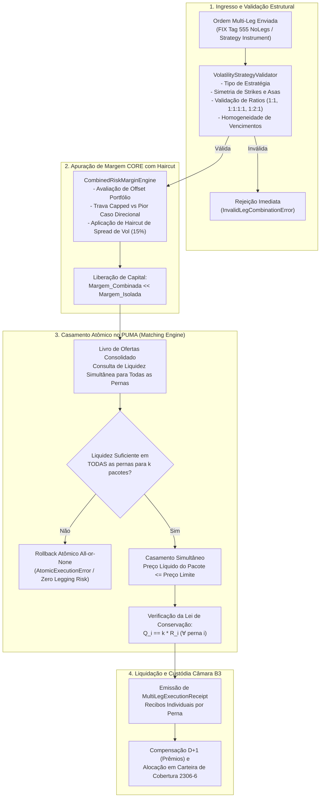

# Especificação Técnica: Operações Estruturadas de Volatilidade e Opções Combinadas no PUMA Trading System — B3 (FL-063)

## 1. Visão Geral e Contexto Operacional (FL-063)

O mercado de **Estratégias Estruturadas de Volatilidade e Opções Combinadas** (*Multi-Leg Strategy Trading*) no **PUMA Trading System** da B3 permite a submissão, validação de compatibilidade estrutural, precificação líquida e **execução atômica simultânea** de cestas contingentes de opções e ações à vista.

Ao contrário de execuções perna a perna (*legged execution*), que expõem o investidor ao risco de execução parcial ou descasada (*legging risk* e *slippage* assimétrico), o motor nativo multi-leg da B3 assegura o princípio **All-or-None** ou **Execução Parcial com Preservação Estrita da Razão de Pernas** (*Leg Ratio Invariant*).

Adicionalmente, a **Câmara B3 (Metodologia CORE)** reconhece a compensação mútua de risco entre as pontas da estratégia (*portfolio effect*), aplicando o **Haircut por Spread de Volatilidade** e limitando a exigência de margem de garantia à perda máxima estrutural em estratégias com risco delimitado (*defined-risk spreads*), liberando capital regulatório e evitando a cobrança punitiva de margens para opções a descoberto (*naked options*).

---

## 2. Estratégias Canônicas Suportadas

O módulo suporta formalmente cinco famílias canônicas de operações estruturadas:

### 2.1 Straddle (Long / Short)
- **Topologia**: 1 CALL + 1 PUT com **mesmo Strike ($K$)**, **mesmo vencimento ($T$)** e **mesmo sentido operacional** (ambas `BUY` ou ambas `SELL`). Proporção **1:1**.
- **Long Straddle**: Operação comprada em volatilidade (*long vega / long gamma*). Payoff:
  $$V(S_T) = \max(S_T - K, 0) + \max(K - S_T, 0) - \text{Débito} = |S_T - K| - \text{Débito}$$
  - **Breakevens**: $S_{\text{down}} = K - \text{Débito}$ e $S_{\text{up}} = K + \text{Débito}$.
  - **Perda Máxima**: Débito Líquido Total. **Lucro Máximo**: Teoricamente ilimitado.
- **Short Straddle**: Operação vendida em volatilidade (*short vega / positive theta*). Payoff:
  $$V(S_T) = \text{Crédito} - |S_T - K|$$
  - **Margem B3 CORE**: Calculada pelo pior cenário direcional com crédito parcial da perna oposta descontado do haircut de spread de volatilidade ($\approx 15\%$).

### 2.2 Strangle (Long / Short)
- **Topologia**: 1 PUT no strike $K_1$ + 1 CALL no strike $K_2$ com $K_1 < K_2$ (normalmente ambos fora do dinheiro — *OTM*), **mesmo vencimento ($T$)** e **mesmo sentido** (`BUY` ou `SELL`). Proporção **1:1**.
- **Long Strangle**: Compra de volatilidade com custo de montagem inferior ao Straddle.
  - **Breakevens**: $S_{\text{down}} = K_1 - \text{Débito}$ e $S_{\text{up}} = K_2 + \text{Débito}$.
  - **Perda Máxima**: Débito Líquido.
- **Short Strangle**: Venda de volatilidade com faixa de lucro estável entre $K_1$ e $K_2$.

### 2.3 Iron Condor (Credit / Debit)
- **Topologia**: Cesta de 4 pernas com 2 PUTs e 2 CALLs no mesmo vencimento $T$, com strikes estritamente ordenados:
  $$K_{\text{p1}} < K_{\text{p2}} \le K_{\text{c1}} < K_{\text{c2}}$$
- **Credit Iron Condor (Padrão de Mercado)**:
  - Perna 1: Long Put $K_{\text{p1}}$ (asa inferior protetora)
  - Perna 2: Short Put $K_{\text{p2}}$ (corpo inferior de crédito)
  - Perna 3: Short Call $K_{\text{c1}}$ (corpo superior de crédito)
  - Perna 4: Long Call $K_{\text{c2}}$ (asa superior protetora)
  - Proporção estrita **1:1:1:1**.
- **Métricas e Margem CORE Capped**:
  - **Crédito Líquido**: $C_{\text{net}} = (P_{\text{p2}} - P_{\text{p1}}) + (C_{\text{c1}} - C_{\text{c2}})$.
  - **Perda Máxima**:
    $$\text{MaxLoss} = \left(\max(K_{\text{p2}} - K_{\text{p1}}, K_{\text{c2}} - K_{\text{c1}}) - C_{\text{net}}\right) \times Q_{\text{pacotes}}$$
  - **Margem de Risco B3**: Capped estritamente em $\text{MaxLoss}$. O investidor não é penalizado com margem a descoberto para as opções vendidas no miolo, pois as pontas compradas nas asas truncam totalmente o risco de cauda.

### 2.4 Collar (Protetor / Financiado / Zero-Cost)
- **Topologia**:
  - Opção A (3 pernas): Compra da Ação à vista (`SPOT` $S_0$) + Compra de Put de Piso ($K_{\text{put}}$) + Venda de Call Financiadora ($K_{\text{call}}$) com $K_{\text{put}} < K_{\text{call}}$.
  - Opção B (2 pernas — Sintético): Compra de Put $K_{\text{put}}$ + Venda de Call $K_{\text{call}}$ contra posição em custódia pré-existente.
  - Proporção **1:1:1** (ou 1:1 nas opções).
- **Enquadramento de Risco**:
  - A CALL vendida é **100% coberta** pelo ativo-objeto (Carteira `2306-6` da B3 Central Depositária).
  - A PUT comprada garante um piso irrevogável de liquidação em $K_{\text{put}}$.
  - **Perda Máxima**: $(S_0 - K_{\text{put}}) + \text{CustoLíquidoOpções}$. Zero exigência de margem para a Call vendida.

### 2.5 Butterfly (Borboleta Simétrica e Iron Butterfly)
- **Topologia Tradicional (3 Strikes / 3 Pernas)**:
  - Perna 1 (Asa Inferior): Long 1 Call/Put no strike $K_1$ (`BUY`, ratio 1)
  - Perna 2 (Corpo Central): Short 2 Calls/Puts no strike $K_2$ (`SELL`, ratio 2)
  - Perna 3 (Asa Superior): Long 1 Call/Put no strike $K_3$ (`BUY`, ratio 1)
  - **Condição Mandatória de Simetria**:
    $$K_2 - K_1 = K_3 - K_2 = \Delta K$$
  - Proporção estrita **1:2:1**.
- **Topologia Iron Butterfly (4 Pernas)**:
  - Long Put $K_1$ (ratio 1) + Short Put $K_2$ (ratio 1) + Short Call $K_2$ (ratio 1) + Long Call $K_3$ (ratio 1) com $K_2 - K_1 = K_3 - K_2$.
- **Métricas**:
  - Lucro máximo atingido no pin $S_T = K_2$: $\Delta K - \text{DébitoLíquido}$.
  - Risco delimitado integralmente ao prêmio pago (Long) ou à largura da asa menos o crédito (Short).

---

## 3. Arquitetura do Fluxo Multi-Leg no PUMA Trading

---

## 4. Leis Formais de Conservação e Invariantes

### Invariante 1: Lei de Conservação de Razão de Pernas (*Leg Ratio Invariant*)
Para qualquer execução de $k$ pacotes estruturados ($k \in \mathbb{N}$), a quantidade executada $Q_i^{\text{exec}}$ de cada perna $i$ obedece com precisão inteira à razão contratual $R_i$:
$$Q_i^{\text{exec}} = k \cdot R_i \quad \Longleftrightarrow \quad \frac{Q_1^{\text{exec}}}{R_1} = \frac{Q_2^{\text{exec}}}{R_2} = \dots = \frac{Q_N^{\text{exec}}}{R_N} = k$$
Nenhuma perna remanescente ou fracionada pode ser executada isoladamente, garantindo a **eliminação total de legging risk**.

### Invariante 2: Conservação Financeira do Preço da Estratégia
O fluxo financeiro líquido total apurado $\Phi_{\text{net}}$ equivale exatamente à soma ponderada dos fluxos de cada perna:
$$\Phi_{\text{net}} = k \cdot \sum_{i=1}^N \left( \text{Sign}_i \cdot R_i \cdot P_i^{\text{fill}} \right)$$
Onde $\text{Sign}_i = -1$ para compra (`BUY`) e $+1$ para venda (`SELL`).

### Invariante 3: Compensação de Risco e Haircut de Margem CORE
$$\text{Margem}_{\text{Combinada}} \le \sum_{i=1}^N \text{Margem}_{\text{Isolada}}^{(i)}$$
Para travas com risco limitado (*defined-risk spreads* como Iron Condor e Borboleta), a exigência de margem é estritamente delimitada pela perda máxima do spread:
$$\text{Margem}_{\text{IronCondor}} = \left( \Delta K_{\text{spread}} - \text{CréditoLíquido} \right) \times Q_{\text{pacotes}}$$

---

## 5. Mapeamento de Tags FIX do PUMA Trading System

| Tag FIX | Nome do Campo | Descrição e Validação |
| :---: | :--- | :--- |
| **`555`** | `NoLegs` | Número total de pernas componentes da estratégia (2, 3 ou 4). |
| **`600`** | `LegSymbol` | Ticker canônico da perna na B3 (ex.: `PETRA380`, `PETRM380`, `PETR4`). |
| **`623`** | `LegRatioQty` | Razão inteira da perna (ex.: 1 para Straddle/Strangle/Condor; 1 e 2 para Butterfly). |
| **`624`** | `LegSide` | Sentido da perna: `1` = BUY (Compra / Titular), `2` = SELL (Venda / Lançador). |
| **`566`** | `LegPrice` | Preço de execução atribuído à perna individual. |
| **`40`** | `OrdType` | Tipo da ordem combinada: `1` = Market, `2` = Limit. |
| **`44`** | `Price` | Preço limite do pacote combinado (débito ou crédito líquido). |

---

## 6. Mapeamento de Módulos e Evidências

- **Módulo Python**: [`src/volatility_strategies.py`](file:///mnt/j/Documents/github/b3-integration-atlas/src/volatility_strategies.py)
- **Fixture Sintética**: [`fixtures/volatility_strategies.json`](file:///mnt/j/Documents/github/b3-integration-atlas/fixtures/volatility_strategies.json)
- **Suíte de Testes Unitários**: [`tests/test_volatility_strategies.py`](file:///mnt/j/Documents/github/b3-integration-atlas/tests/test_volatility_strategies.py)
- **Especificação Técnica**: [`docs/layout-volatility-strategies.md`](file:///mnt/j/Documents/github/b3-integration-atlas/docs/layout-volatility-strategies.md)
