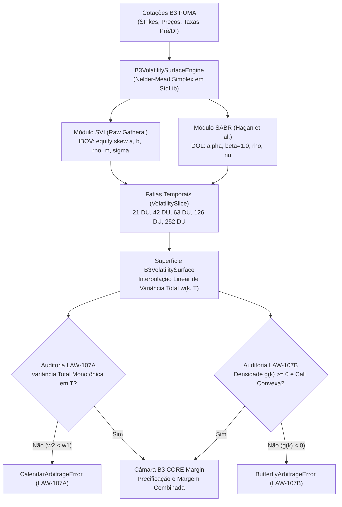

# Especificação Técnica: Superfícies Paramétricas de Volatilidade SVI e SABR B3 (FL-101)

## 1. Visão Geral Institucional e Escopo (FL-101)

O fluxo quantitativo **FL-101** especifica a arquitetura e modelagem matemática de **Superfícies Paramétricas de Volatilidade Implícita** para os mercados derivativos listados e de balcão da **B3 (Brasil, Bolsa, Balcão)**, sob supervisão do **PUMA Trading System** e custódia/risco da **Câmara B3**:

1. **Dólar Comercial Futuro (DOL / WDO)**:
   - Opções sobre Contratos Futuros de Dólar Comercial (DOLFUT).
   - Cotação em BRL por US$ 1.000 (pontos de dólar, com tick de R$ 0,50 no cheio e R$ 0,50 no mini).
   - Convenção de contagem de tempo: dias úteis anuais (padrão DU/252).
   - Modelo primário: **SABR (Hagan et al., 2002)** com $\beta = 1{,}0$ (lognormal) ou $\beta = 0{,}5$, exibindo inclinação (*skew*) frequentemente positiva para calls em regimes de estresse cambial (valorização do dólar associada a pico de volatilidade).

2. **Ibovespa Futuro e À Vista (IBOV / IND / WIN)**:
   - Opções listadas sobre o Índice Bovespa e Futuro de Ibovespa (INDFUT).
   - Cotação em pontos de índice (R$ 1,00 por ponto no índice cheio IND; R$ 0,20 por ponto no mini WIN).
   - Convenção de contagem de tempo: dias úteis anuais (DU/252).
   - Modelo primário: **Raw SVI (Gatheral, 2004)**, modelando o acentuado *equity skew* negativo decorrente do efeito alavancagem estrutural e demanda institucional por *tail hedge* contra quedas de mercado.

---

## 2. Modelo Paramétrico SVI (Stochastic Volatility Inspired - Raw SVI)

Desenvolvido por Jim Gatheral (2004), o modelo SVI parametriza a **variância total implícita** $w(k) = \sigma^2(k) \cdot T$ em função do *log-moneyness* forward $k = \ln(K / F)$:

$$w(k) = a + b \left[ \rho (k - m) + \sqrt{(k - m)^2 + \sigma^2} \right]$$

### 2.1 Significado e Domínio dos Parâmetros

| Parâmetro | Domínio | Significado Financeiro |
|---|---|---|
| $a$ | $\mathbb{R}$ | Nível vertical geral de variância total da fatia |
| $b$ | $b \ge 0$ | Inclinação angular das asas assintóticas (*wings*) |
| $\rho$ | $|\rho| < 1$ | Assimetria / rotação do sorriso (negativo para IBOV, positivo/moderado para DOL) |
| $m$ | $\mathbb{R}$ | Deslocamento horizontal do vértice do sorriso (*ATM shift*) |
| $\sigma$ | $\sigma > 0$ | Suavização / curvatura do sorriso no dinheiro |

### 2.2 Derivadas Analíticas de Variância Total

Definindo $R(k) = \sqrt{(k - m)^2 + \sigma^2}$:

$$\frac{\partial w}{\partial k} = w'(k) = b \left( \rho + \frac{k - m}{R(k)} \right)$$

$$\frac{\partial^2 w}{\partial k^2} = w''(k) = \frac{b \cdot \sigma^2}{R(k)^3}$$

Como $b \ge 0$ e $\sigma > 0$, temos $w''(k) > 0$ para todo $k \in \mathbb{R}$, demonstrando a **estrita convexidade da variância total** na formulação Raw SVI.

### 2.3 Restrições Analíticas de Não-Arbitragem Interna (Lee 2004, Gatheral 2004)

1. **Não-Negatividade Global da Variância**:
   $$w_{\min} = a + b \sigma \sqrt{1 - \rho^2} \ge 0$$
2. **Momento Finito e Comportamento Assintótico das Asas (Fórmula de Lee)**:
   $$b (1 + |\rho|) < 2$$
   Garante que a inclinação assintótica $\lim_{k \to \pm \infty} \frac{w(k)}{|k|}$ permaneça abaixo de 2, impedindo a geração de momentos infinitos no modelo e densidades anômalas nas caudas.

---

## 3. Modelo Paramétrico SABR (Hagan et al., 2002)

O modelo de volatilidade estocástica SABR baseia-se na dinâmica conjunta do preço a termo $F_t$ e da volatilidade $\alpha_t$:

$$dF_t = \alpha_t F_t^\beta dW_t^{(1)}$$
$$d\alpha_t = \nu \alpha_t dW_t^{(2)}$$
$$d\langle W^{(1)}, W^{(2)} \rangle_t = \rho \, dt$$

### 3.1 Fórmula Assintótica de Hagan para Volatilidade Implícita Black-76

Para strike $K \ne F$:

$$\sigma_{\text{SABR}}(F, K, T) = \frac{\alpha}{D(F, K)} \cdot \frac{z}{\chi(z)} \cdot C_{\text{corr}}(F, K, T)$$

Onde:
- $z = \frac{\nu}{\alpha} (FK)^{(1 - \beta)/2} \ln(F / K)$
- $\chi(z) = \ln \left( \frac{\sqrt{1 - 2\rho z + z^2} + z - \rho}{1 - \rho} \right)$
- $D(F, K) = (FK)^{(1 - \beta)/2} \left[ 1 + \frac{(1-\beta)^2}{24} \ln^2(F / K) + \frac{(1-\beta)^4}{1920} \ln^4(F / K) \right]$
- $C_{\text{corr}}(F, K, T) = 1 + \left[ \frac{(1-\beta)^2}{24} \frac{\alpha^2}{(FK)^{1-\beta}} + \frac{1}{4} \frac{\rho \beta \nu \alpha}{(FK)^{(1-\beta)/2}} + \frac{2 - 3\rho^2}{24} \nu^2 \right] T$

### 3.2 Continuidade Suave no Dinheiro ($K = F$)

No caso ATM ($z \to 0$ e $z / \chi(z) \to 1$):

$$\sigma_{\text{ATM}}(F, T) = \frac{\alpha}{F^{1 - \beta}} \left[ 1 + \left( \frac{(1-\beta)^2}{24} \frac{\alpha^2}{F^{2 - 2\beta}} + \frac{1}{4} \frac{\rho \beta \nu \alpha}{F^{1 - \beta}} + \frac{2 - 3\rho^2}{24} \nu^2 \right) T \right]$$

---

## 4. Interpolação de Variância Total e Estrutura a Termo

Para garantir que a superfície contínua $(k, T)$ não gere arbitragem de calendário entre fatias discretas $T_1 < T_2 < \dots < T_n$, adota-se a **interpolação linear em variância total** (Gatheral & Jacquier, 2014):

$$w(k, T) = (1 - \lambda) w(k, T_i) + \lambda w(k, T_{i+1}), \quad \lambda = \frac{T - T_i}{T_{i+1} - T_i}$$

### Propriedades Matemáticas:
1. **Derivada Temporal Não-Negativa**:
   $$\frac{\partial w}{\partial T} = \frac{w(k, T_{i+1}) - w(k, T_i)}{T_{i+1} - T_i} \ge 0$$
   Se cada fatia discreta satisfaz $w(k, T_{i+1}) \ge w(k, T_i)$, a superfície contínua é **isenta de arbitragem de calendário em qualquer $T \in [T_1, T_n]$**.
2. **Volatilidade Implícita Contínua**:
   $$\sigma(k, T) = \sqrt{\frac{w(k, T)}{T}}$$

---

## 5. Invariantes Formais de Não-Arbitragem B3

### Lei 85 / LAW-107A: Invariante de Não-Arbitragem de Calendário
> **Enunciado Formal**: Para qualquer *log-moneyness* $k = \ln(K/F)$ fixo, a variância total $w(k, T)$ deve ser monotonicamente não-decrescente em relação ao prazo até o vencimento $T$:
> $$\forall T_1 < T_2, \quad w(k, T_1) \le w(k, T_2)$$
> **Penalidade de Violação**: Lança `CalendarArbitrageError` (subclasse de `InvariantViolationError` com código `LAW-107A`).
> **Fundamentação Econômica**: A violação desta invariante implica variância forward instantânea negativa ($\sigma_{\text{fwd}}^2 < 0$), permitindo a montagem de um *calendar spread* com lucro certo livre de risco.

### Lei 86 / LAW-107B: Invariante de Não-Arbitragem Butterfly e Convexidade
> **Enunciado Formal**: Em conformidade com o teorema de Breeden-Litzenberger (1978) e a densidade de Jim Gatheral (2004):
> 1. A função de densidade de probabilidade neutra ao risco $g(k)$ deve ser estritamente não-negativa para qualquer $k \in \mathbb{R}$:
>    $$g(k) = \left( 1 - \frac{k w'(k)}{2 w(k)} \right)^2 - \frac{w'(k)^2}{4} \left( \frac{1}{w(k)} + \frac{1}{4} \right) + \frac{w''(k)}{2} \ge 0$$
> 2. A estrutura discreta de preços de opções de compra para quaisquer 3 strikes equidistantes $K_1 < K_2 < K_3$ com $K_2 - K_1 = K_3 - K_2$ deve ser estritamente convexa:
>    $$C(K_1) - 2 C(K_2) + C(K_3) \ge 0$$
> **Penalidade de Violação**: Lança `ButterflyArbitrageError` (subclasse de `InvariantViolationError` com código `LAW-107B`).
> **Fundamentação Econômica**: A negatividade de $g(k)$ ou a violação de convexidade permite a compra de uma trava borboleta (*butterfly spread*) com custo financeiro nulo ou negativo e payoff final estritamente não-negativo.

---

## 6. Diagrama de Arquitetura da Superfície B3



---

## 7. Estrutura das Fixtures JSON (`fixtures/volatility_surface_sabr_svi.json`)

```json
{
  "version": "1.0.0",
  "as_of": "2026-11-04",
  "scope": "B3 PUMA Trading System & Câmara — Superfícies Paramétricas de Volatilidade SVI e SABR (FL-101)",
  "market_context": {
    "trading_system": "PUMA Trading System Derivatives Engine",
    "clearing_house": "Câmara B3 CORE Margin System",
    "underlying_assets": {
      "DOL": {
        "name": "Dólar Comercial Futuro",
        "contract_code": "DOL / WDO",
        "primary_model": "SABR (Hagan et al., 2002)"
      },
      "IBOV": {
        "name": "Ibovespa Futuro / À Vista",
        "contract_code": "IBOV / IND / WIN",
        "primary_model": "Raw SVI (Gatheral, 2004)"
      }
    }
  },
  "surfaces": {
    "SURFACE-B3-DOL-SABR": { ... },
    "SURFACE-B3-IBOV-SVI": { ... }
  }
}
```

---

## 8. Verificação e Testes Unitários

Execução padrão via Python Standard Library:

```bash
python3 -m unittest tests/test_volatility_surface_sabr_svi.py
```

Testes cobertos:
1. `test_svi_total_variance_and_derivatives`: derivadas analíticas vs finitas.
2. `test_svi_gatheral_density_positive`: integridade de $g(k) \ge 0$.
3. `test_svi_parameter_validation_failures`: limites teóricos de Lee e Gathering.
4. `test_sabr_atm_continuity`: transição contínua suave $K \to F$.
5. `test_sabr_smile_curvature`: inclinações realistas para opções de câmbio.
6. `test_put_call_parity_exact`: paridade Black-76 $C - P = e^{-rT}(F - K)$.
7. `test_implied_vol_inverter`: solver de raiz Brent/Bissecção recupera $\sigma$ com precisão $10^{-5}$.
8. `test_law_107a_calendar_arbitrage_violation_detected`: rejeição imediata com `LAW-107A`.
9. `test_law_107b_butterfly_arbitrage_violation_detected`: rejeição imediata com `LAW-107B`.
10. `test_nelder_mead_quadratic_minimum`: convergência do otimizador simplex.
11. `test_svi_slice_calibration_from_market_quotes`: calibração de mercado para SVI.
12. `test_sabr_slice_calibration_from_market_quotes`: calibração de mercado para SABR.
13. `test_load_and_validate_fixture`: validação integral da fixture JSON oficial.
