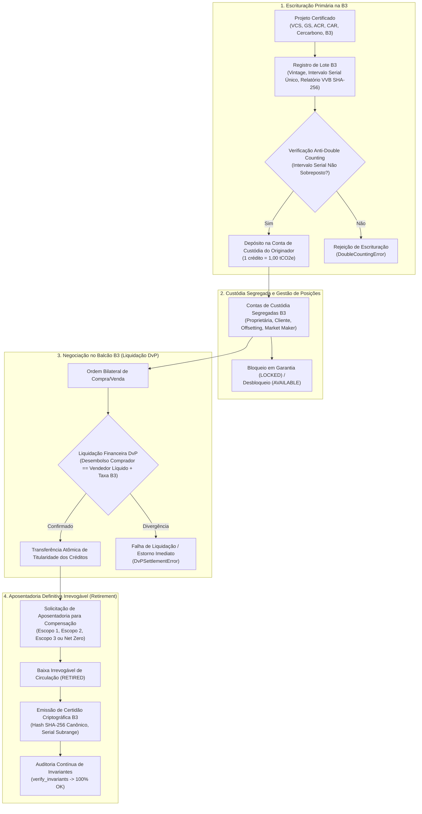

# Especificação Técnica de Registro Escritural, Custódia Segregada, Negociação e Aposentadoria de Créditos de Carbono no Mercado Voluntário (FL-088)

## 1. Visão Geral e Arcabouço Regulatório

O fluxo **FL-088** estabelece a infraestrutura técnica e determinística para o **Mercado Voluntário de Carbono (Voluntary Carbon Market - VCM)** na **Plataforma de Carbono B3** e no ambiente de **Balcão Registrado NoMe**. O sistema suporta a escrituração de lotes originados sob os principais padrões internacionais e nacionais, a custódia segregada por titular, a negociação bilateral com liquidação financeira *Delivery versus Payment* (DvP) e o processo de aposentadoria definitiva (*retirement*) para compensação corporativa alinhada ao **GHG Protocol**.

### Fundamentação Legal e Normativa
- **Lei Federal nº 12.187/2009 (Política Nacional sobre Mudança do Clima - PNMC)**: Princípios gerais de mitigação e contabilidade climática;
- **Lei Federal nº 14.119/2021 (Política Nacional de Pagamento por Serviços Ambientais - PNPSA)**: Reconhecimento dos serviços ecossistêmicos de fixação e redução de emissões;
- **Decreto Federal nº 11.075/2022**: Diretrizes para os Planos Setoriais de Mitigação e procedimentos de registro de créditos de carbono;
- **Padrões de Certificação de Terceira Parte Integrados**:
  - **VCS (Verified Carbon Standard / Verra)**: Metodologias florestais e de conservação;
  - **Gold Standard (GS)**: Metodologias de energia, biomassa e metas de desenvolvimento sustentável (SDGs);
  - **ACR (American Carbon Registry)**: Metodologias de remoção tecnológica e sequestro em escala industrial;
  - **CAR (Climate Action Reserve)**: Protocolos de captura direta e conservação agrícola;
  - **Cercarbono**: Padrão internacional de certificação com ampla adoção na América Latina;
  - **Padrão de Carbono B3**: Metodologias proprietárias registradas na infraestrutura de mercado financeiro brasileira;
- **Padrão Corporativo GHG Protocol (Corporate Accounting and Reporting Standard)**: Classificação de emissões corporativas em Escopo 1, Escopo 2 e Escopo 3 para aposentadoria e neutralização (*Net Zero*).

---

## 2. Padrões de Certificação e Tipologias de Projetos Suportados

| Padrão de Certificação | Código | Organismo / Registry Internacional | Tipologias Principais |
| :--- | :--- | :--- | :--- |
| **Verified Carbon Standard** | `VCS` | Verra Registry | REDD+, ARR, Energia Renovável |
| **Gold Standard** | `GOLD_STANDARD` | Gold Standard Impact Registry | Biomassa, Bioenergia, Eficiência |
| **American Carbon Registry** | `ACR` | Winrock International | Captura Direta (DAC), Sequestro Mineral |
| **Climate Action Reserve** | `CAR` | Climate Action Reserve Registry | Reflorestamento, Manejo de Resíduos |
| **Cercarbono** | `CERCARBONO` | Cercarbono / EcoRegistry | ARR, REDD+, Agrofloresta |
| **Padrão de Carbono B3** | `PADRAO_B3` | B3 Plataforma de Balcão Ambiental | Eólica, Solar, CPR Verde, Biomassa |

### Tipologias Setoriais de Projetos
1. **REDD+ (`REDD_PLUS`)**: Redução de Emissões por Desmatamento Evitado e Degradação Florestal com conservação da biodiversidade;
2. **ARR (`ARR`)**: Aforamento, Reflorestamento e Revegetação com espécies nativas ou regeneração natural assistida;
3. **Bioenergia e Biomassa (`BIOENERGY_BIOMASS`)**: Cogeração de energia limpa a partir de resíduos de biomassa agroindustrial (cana, eucalipto, casca de arroz);
4. **Energia Renovável (`RENEWABLE_ENERGY`)**: Geração elétrica fotovoltaica, eólica e PCHs conectadas ao Sistema Interligado Nacional (SIN);
5. **Captura Direta de Ar (`DAC`)**: Remoção atmosférica tecnológica (*Direct Air Capture & Carbon Dioxide Storage - DACCS*) com mineralização ou armazenamento geológico permanente.

---

## 3. Ciclo Operacional: Da Originação à Aposentadoria Definitiva

---

## 4. Estrutura das Contas de Custódia e Segregação Patrimonial

Cada conta de custódia na B3 é identificada univocamente por seu `account_id`, vinculada ao código de participante do mercado (`participant_code`) e categorizada de acordo com a natureza de atuação:
- **`PROPRIETARY`**: Carteira própria de originadores, incorporadores florestais ou instituições financeiras;
- **`CLIENT`**: Conta individualizada mantida sob a custódia de corretora/PNP para clientes terceiros;
- **`OFFSETTING_CORPORATE`**: Conta corporativa de usuário final destinada ao acúmulo e cancelamento de créditos para cumprimento de metas ESG e neutralização corporativa;
- **`MARKET_MAKER`**: Conta operacional de formador de mercado credenciado para prover liquidez secundária.

### Vetor de Saldos por Lote
Para cada lote de créditos escriturado, a posição de custódia mantém três estados mutuamente exclusivos:
$$\text{Saldo Total da Conta} = \text{Saldo Disponível} + \text{Saldo Bloqueado} + \text{Saldo Aposentado}$$

A invariante de não-negatividade impõe:
$$\text{Saldo Disponível} \ge 0,00 \quad \land \quad \text{Saldo Bloqueado} \ge 0,00 \quad \land \quad \text{Saldo Aposentado} \ge 0,00$$

---

## 5. Liquidação Financeira Delivery versus Payment (DvP)

A negociação no Balcão B3 opera sob o princípio estrito de liquidação simultânea e atômica:
1. **Entrega de Ativo**: O volume de $Q$ tCO2e é debitado da conta de custódia vendedora e creditado na conta compradora;
2. **Liquidação Financeira**: O valor financeiro bruto da transação é calculado centavo a centavo:
   $$\text{Valor Bruto (BRL)} = \text{round\_cents}(Q \times \text{Preço Unitário})$$
3. **Emolumento B3**: Apurado conforme a alíquota cadastrada (ex: 0,10% = 0,0010):
   $$\text{Taxa B3 (BRL)} = \text{round\_cents}(\text{Valor Bruto} \times \text{Taxa de Emolumento})$$
4. **Conservação Financeira Estrita**:
   $$\text{Desembolso Líquido Comprador} = \text{Valor Bruto} + \text{Taxa B3}$$
   $$\text{Recebimento Vendedor} = \text{Valor Bruto}$$
   $$\text{Desembolso Líquido Comprador} == \text{Recebimento Vendedor} + \text{Taxa B3}$$

Nenhum crédito é transferido caso a liquidação financeira não seja consumada.

---

## 6. Aposentadoria Definitiva (*Retirement*) e Certidão Criptográfica

Aposentar um crédito de carbono significa retirá-lo permanentemente de circulação para que uma corporação ou indivíduo possa alegar (*claim*) o benefício climático de neutralização ou compensação.

### Requisitos e Regras Operacionais
- **Irrevogabilidade**: Um crédito aposentado jamais poderá ser estornado, transferido, reativado ou renegociado;
- **Escopos de Compensação (GHG Protocol)**:
  - **Escopo 1 (`SCOPE_1`)**: Emissões diretas de queima de combustível fóssil, fornos, caldeiras e frota corporativa própria;
  - **Escopo 2 (`SCOPE_2`)**: Emissões indiretas associadas à compra de energia elétrica ou térmica da rede;
  - **Escopo 3 (`SCOPE_3`)**: Emissões indiretas ao longo da cadeia de suprimentos (fretes, logística de terceiros, viagens aéreas corporativas, descarte de produtos);
  - **Net Zero Corporativo (`NET_ZERO_CORPORATE`)**: Neutralização abrangente multi-escopo;
- **Rastreabilidade Serial**: A certidão discrimina o sub-intervalo serial internacional cancelado (ex: `VCS-1422-2023-BR-00000001-00002500`);
- **Digest Criptográfico SHA-256**: Gerado a partir da concatenação canônica:
  $$\text{Hash} = \text{SHA256}(\text{ID}_{\text{cert}} \mid \text{ID}_{\text{lote}} \mid \text{ID}_{\text{proj}} \mid \text{Standard} \mid \text{Vintage} \mid \text{Volume} \mid \text{Doc}_{\text{benef}} \mid \text{Escopo} \mid \text{Timestamp})$$

---

## 7. Invariantes Formais Provadas pelo Motor B3

| Identificador da Invariante | Descrição Formal da Lei | Comportamento em Falha |
| :--- | :--- | :--- |
| **`INV-VCM-001_ANTI_DOUBLE_COUNTING`** | $\text{Total Emitido} == \sum \text{Disponível} + \sum \text{Bloqueado} + \sum \text{Aposentado}$ em nível de lote e no consolidado de contas de custódia. Nenhum intervalo serial internacional pode colidir ou sobrepor com lote pré-existente. | Rejeição de emissão (`DoubleCountingError`) ou falha em auditoria (`CarbonInvariantViolationError`). |
| **`INV-VCM-002_NON_NEGATIVE_BALANCES`** | Todos os saldos em todos os lotes e contas são estritamente maiores ou iguais a zero ($\ge 0,00$). | Débitos ou bloqueios que causem saldo negativo são barrados com `InsufficientCarbonBalanceError`. |
| **`INV-VCM-003_DVP_FINANCIAL_SETTLEMENT`** | $\text{Desembolso Comprador} == \text{Vendedor} + \text{Taxa B3}$ e $\text{Valor Bruto} == Q \times P$ centavo a centavo. | Operação rejeitada com `DvPSettlementError`. |
| **`INV-VCM-004_IRREVOCABLE_RETIREMENT`** | $\sum \text{Volume Certidões}(B) == \text{Lote.retired\_tco2e}$ e todo hash de certidão é verificado canonicamente via SHA-256. | Violação detectada na auditoria de invariantes (`CarbonInvariantViolationError`). |
| **`INV-VCM-005_METRIC_PARITY`** | $1 \text{ crédito} = 1,00 \text{ tCO2e}$, vintages válidas no intervalo $[2000, 2100]$, fracionamento com precisão estrita de centésimos. | Bloqueio de registro com `CarbonValidationError`. |
