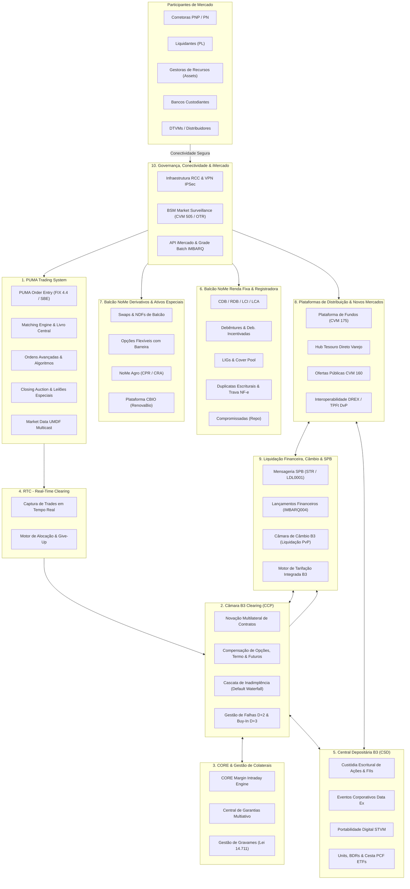
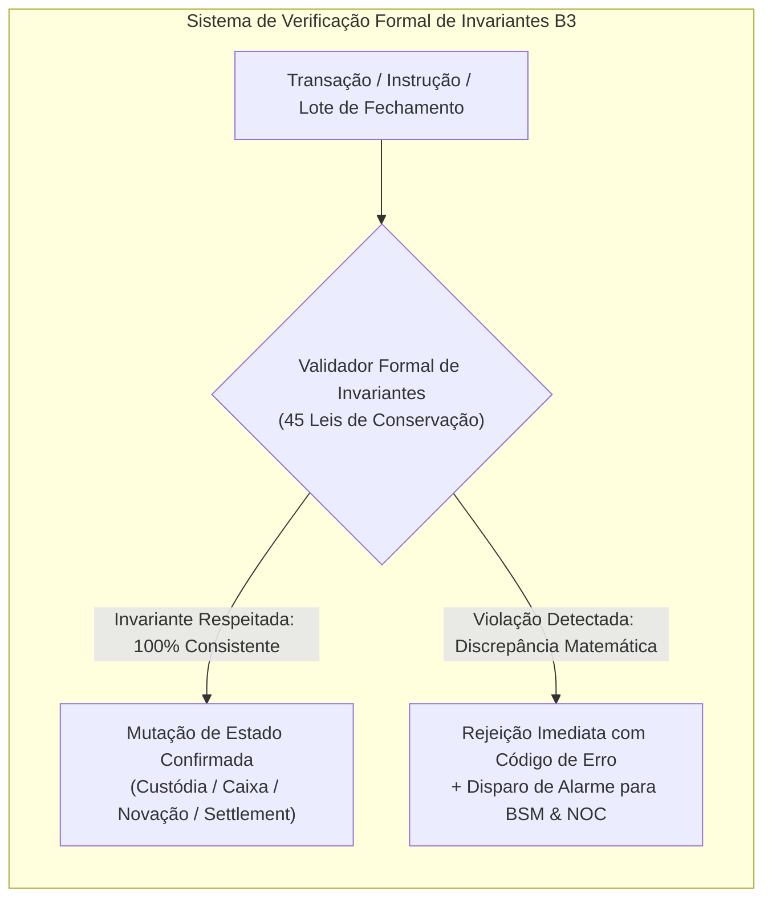
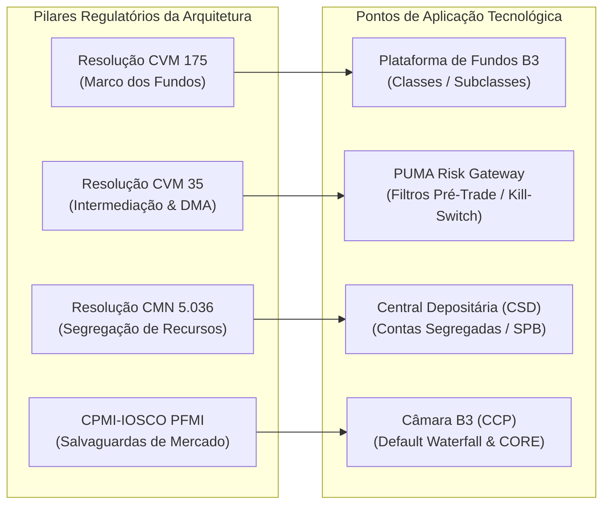
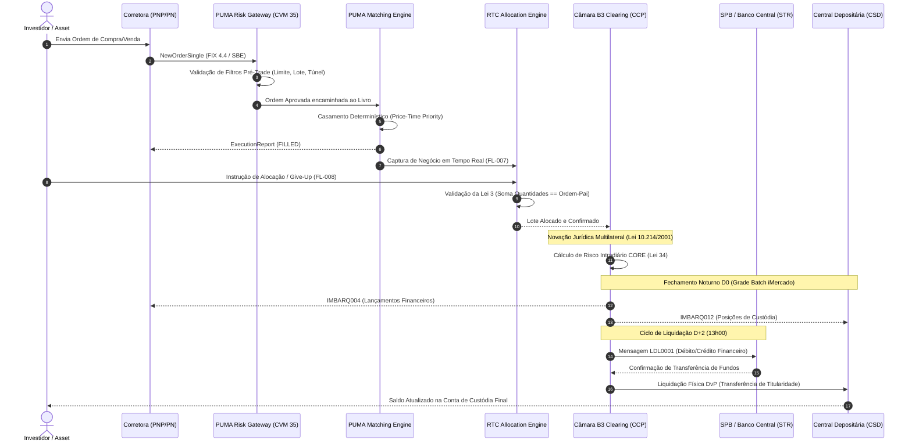
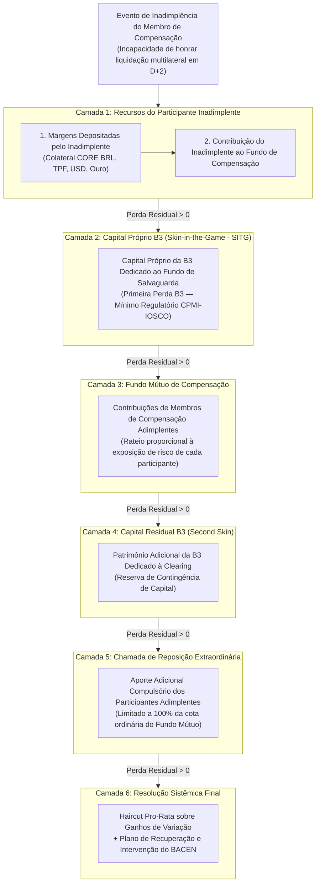
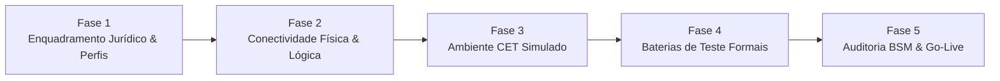

# Arquitetura Master do Ecossistema B3 — Versão 2.0
## Especificação Técnica Global de Integração, Subsistemas, Invariantes Matemáticos e Governança Regulatória

---

## Sumário Executivo e Propósito da Arquitetura

O **Atlas de Integrações B3 — Versão 2.0** consolida o compêndio técnico, matemático e regulatório mais completo e rigoroso para a conexão de instituições financeiras à **B3 S.A. – Brasil, Bolsa, Balcão**. 

A B3 opera como o epicentro da infraestrutura do mercado financeiro brasileiro (FMI — *Financial Market Infrastructure*), acumulando simultaneamente quatro funções sistêmicas vitais:
1. **Contraparte Central (CCP — *Central Counterparty*)**: Atua como compradora para todo vendedor e vendedora para todo comprador por intermédio da **novação jurídica multilateral** (Lei Federal nº 10.214/2001), eliminando o risco de crédito bilateral e absorvendo o risco sistêmico de liquidação.
2. **Depositária Central (CSD — *Central Securities Depository*)**: Exerce a custódia fiduciária escritural, controle de titularidade e processamento de eventos corporativos de todos os ativos listados e cotas de fundos (Lei Federal nº 6.404/1976, Resolução CVM nº 31).
3. **Registradora e Repositório de Transações (TR — *Trade Repository*)**: Provê infraestrutura para registro, validação de lastro, publicidade e unicidade de títulos de dívida privada bancária e corporativa, derivativos customizados de balcão, duplicatas mercantis e contratos do agronegócio (Lei Federal nº 12.810/2013, Resolução BCB nº 3.972 e Marco Legal das Garantias — Lei nº 14.711/2023).
4. **Motor de Correspondência Eletrônica (*Match Engine*)**: Opera plataformas de negociação contínua multi-ativo de alta frequência e baixa latência (*PUMA Trading System*), conectando ordens do mercado à vista, derivativos e aluguel de ativos.

Esta Especificação Arquitetural Master estabelece:
- A decomposição funcional e modular dos **10 Subsistemas Centrais da B3**.
- O inventário exaustivo e descritivo dos **61 Fluxos de Integração (FL-001 a FL-061)**.
- O tratado formal das **45 Leis de Conservação Matemática e Invariantes Financeiros** que regem o ecossistema, garantindo integridade estrita e fechamento contábil determinístico.
- A **Matriz Comparativa Regulatória** consolidando as exigências da **Resolução CVM 175**, **Resolução CVM 35**, **Resolução CMN 5.036** e dos princípios internacionais **CPMI-IOSCO PFMI**.
- O **Guia de Contingência e Alta Disponibilidade** para comutação e failover resiliente em enlaces **RCC (Rede de Comunicação de Centros)**, protocolos BGP e recuperação de sessões transacionais.
- A **Jornada de Homologação Institucional End-to-End** para Corretoras (PN/PNP), Liquidantes (PL), DTVMs e Gestoras de Recursos (Buy-side).

---

## 1. Topologia Arquitetural Global: Os 10 Subsistemas B3

O ecossistema computacional e de negócios da B3 é estruturado em **10 subsistemas autônomos e interconectados**, segregados por domínio de responsabilidade, latência operacional e exigências regulatórias.



### Detalhamento dos 10 Subsistemas

#### Subsistema 1: PUMA Trading System (Negociação Multi-Ativo e Matching Engine)
- **Escopo e Missão**: Plataforma de negociação eletrônica de alta frequência (*high-frequency trading*) e ultra-baixa latência (< 80 microssegundos para Order Entry binário). Processa todos os instrumentos negociados em bolsa: ações, BDRs, ETFs, opções listadas, contratos futuros BM&F (DI1, DOL, IND, commodities) e aluguel de ações em tela (PUMA BTC).
- **Componentes Centrais**:
  - *Order Entry (OE)*: Gateways de recepção nos protocolos FIX 4.4, FIX 5.0 SP2 e Binary SBE (Simple Binary Encoding).
  - *Matching Engine*: Motor determinístico de correspondência de ordens regido pelo princípio de estrita prioridade Preço-Tempo (*Price-Time Priority*).
  - *Motor de Ordens Avançadas*: Processamento em memória de ordens Iceberg (reserva oculta com recarregamento automático), ordens Stop-Loss/Stop-Limit e Trailing-Stop.
  - *Mecanismos de Leilão*: Algoritmo de Preço Teórico de Fechamento (PTF) para *Closing Auction*, casamento de ordens Market-On-Close (MOC) e Limit-On-Close (LOC), além de leilões especiais (Ofertas Públicas de Aquisição - OPA e Leilão de Frações e Sobras).
  - *Market Data UMDF*: Disseminação de dados de mercado em tempo real via canais UDP Multicast com arquitetura de redundância dual feed A/B.

#### Subsistema 2: Câmara B3 Clearing (Compensação e Contraparte Central - CCP)
- **Escopo e Missão**: Infraestrutura sistêmica de liquidação e mitigação de risco de crédito de contraparte. Pela novação multilateral, a B3 desonera os participantes de riscos bilaterais, consolidando débitos e créditos financeiros e físicos em saldos líquidos finais.
- **Componentes Centrais**:
  - *Motor de Novação e Compensação Multilateral*: Conversão de contratos bilaterais originados em bolsa em obrigações exclusivas perante a Clearing.
  - *Ciclo de Liquidação Física e Financeira*: Liquidação física de ações e derivativos no modelo DvP (*Delivery versus Payment*) em D+2; liquidação de ajuste diário de futuros e prêmios de opções em D+1.
  - *Tratamento de Falhas e Buy-In*: Protocolo regulamentar de gestão de falhas de entrega de ativos em D+2 (reversão compulsória via empréstimo BTC) e execução mandatória de recompra em pregão (*Buy-In*) em D+3.
  - *Estrutura de Salvaguardas (Default Waterfall)*: Algoritmo determinístico de seis camadas para contenção e absorção de perdas em caso de quebra de participantes, em estrita conformidade com o Princípio 13 da CPMI-IOSCO.

#### Subsistema 3: CORE & Central de Garantias (Risk Management & Collaterals)
- **Escopo e Missão**: Avaliação de risco de portfólio em tempo real e administração do colchão de garantias exigido de todos os membros de compensação e investidores finais.
- **Componentes Centrais**:
  - *Motor CORE (Closeout Risk Evaluation)*: Motor estocástico e determinístico de risco que estressa portfólios multi-ativo sob cenários de choque não-lineares, capturando correlações cruzadas e efeito diversificação com janelas de liquidação de 2 a 5 dias úteis.
  - *Central de Garantias Multiativo*: Aceitação, custódia e precificação com *haircuts* dinâmicos de múltiplos ativos: BRL (recursos em espécie), Títulos Públicos Federais (LFT, LTN, NTN-B via SELIC), ações do índice IBrX-100, Ouro físico custodiado e moeda estrangeira (Dólar dos EUA custodiado em conta da B3 no Federal Reserve Bank of New York).
  - *Gestão de Gravames e Ônus Reais (Marco Legal das Garantias — Lei nº 14.711/2023)*: Controle de cessão fiduciária, penhor mercantil e prelazia multi-grau em pools de garantias.

#### Subsistema 4: RTC — Real-Time Clearing (Pós-Negociação em Tempo Real)
- **Escopo e Missão**: Plataforma de mensageria de alta velocidade voltada à captura imediata de negócios executados no PUMA e sua respectiva decomposição (*give-up*) e alocação pelas corretoras executoras às contas de investimento e carteiras de fundos.
- **Componentes Centrais**:
  - *Módulo de Captura em Tempo Real (FL-007)*: Ingestão de trades ordinários e blocos negociados (*block trades*), transmitindo dados econômicos sem latência aos sistemas de back-office.
  - *Motor de Alocação e Repasse (FL-008)*: Validação de fatiamento de ordens-mãe em parcelas filhas, garantindo a conservação integral da quantidade executada e a preservação do preço médio ponderado centavo a centavo.

#### Subsistema 5: Central Depositária B3 / CSD (Custódia Escritural e Portabilidade)
- **Escopo e Missão**: Guarda central e controle definitivo de propriedade jurídica e econômica de valores mobiliários listados, direitos societários e certificados.
- **Componentes Centrais**:
  - *Livro de Registro Escritural (Book-entry System)*: Segregação absoluta de contas proprietárias, contas de clientes finais e subcontas de custódia fiduciária de fundos de investimento.
  - *Motor de Eventos Corporativos Data Ex (FL-006 / IMBARQ018)*: Processamento automatizado de proventos em dinheiro (Dividendos, Juros sobre Capital Próprio) e em ativos (Bonificações, Desdobramentos/Splits, Agrupamentos/Inplits e Subscrições).
  - *STVM Digital (FL-024)*: Infraestrutura de portabilidade de custódia automatizada, viabilizando transferências de custódia entre diferentes intermediários sem quebra de titularidade.
  - *Mecanismos de Certificados Estruturados*: Composição e desmembramento de *Units* (FL-043), emissão e cancelamento internacional de lastro de BDRs via DTC/Euroclear (FL-034), e motor primário de criação e resgate *in-kind* de ETFs com reconciliação da Cesta PCF (FL-035).

#### Subsistema 6: Balcão NoMe Renda Fixa e Registradora (Fixed Income & Registries)
- **Escopo e Missão**: Plataforma de registro, depósito centralizado, negociação bilateral e liquidação de instrumentos de captação bancária e dívida corporativa privada.
- **Componentes Centrais**:
  - *Títulos de Captação Bancária (FL-014 / FL-054)*: Registro escritural de CDBs, RDBs, LCIs, LCAs e Letras Financeiras com atualização diária de PU na curva do indexador e retenção fiscal regressiva de IOF e IRRF.
  - *Crédito Privado Corporativo e Securitização (FL-015 / FL-057)*: Escrituração de Debêntures tradicionais e Debêntures Incentivadas (Leis Federais nº 12.431/2011 e 14.801/2024), CRIs e CRAs com cronogramas dinâmicos de amortização e juros.
  - *Letras Imobiliárias Garantidas (LIG / Covered Bonds — FL-049)*: Monitoramento do patrimônio de afetação (*Cover Pool*), verificação do índice de sobrecolateralização regulamentar (mínimo de 105%) e teste de estresse de liquidez de 180 dias.
  - *Duplicatas Escriturais Eletrônicas (FL-051)*: Motor de registro e endosso com trava criptográfica de unicidade da chave de acesso NF-e (44 dígitos), impedindo duplicidade de lastro comercial no sistema financeiro nacional.
  - *Operações Compromissadas (Repo — FL-023)*: Gestão de recompra e revenda compromissada com custódia de colateral.

#### Subsistema 7: Balcão NoMe Derivativos & Ativos Especiais (OTC Derivatives & Commodities)
- **Escopo e Missão**: Registro, validação jurídica e liquidação de derivativos customizados de balcão e ativos vinculados à economia real e descarbonização.
- **Componentes Centrais**:
  - *Derivativos Financeiros de Balcão (FL-016 / FL-040)*: Contratos de Swap (CDI x Pré, Moedas x CDI, Índices de Inflação) e Termo de Moeda NDF (*Non-Deliverable Forward*) com liquidação financeira pela variação cambial da PTAX.
  - *Opções Flexíveis de Balcão (FL-017 / FL-042)*: Contratos com estruturas não-padronizadas contendo barreiras ativadoras (*Knock-In*), desativadoras (*Knock-Out*), opções de compra/venda com *Cap* (teto de remuneração) e *Rebate*.
  - *NoMe Agro (FL-026)*: Registro e escrituração eletrônica de Cédulas de Produto Rural (CPR Física e Financeira) com averbação do Cadastro Ambiental Rural (CAR SICAR) e georreferenciamento de safras.
  - *Plataforma CBIO (RenovaBio — FL-036)*: Emissão, circulação e processo de aposentadoria definitiva de Créditos de Descarbonização (CBIO) perante as metas compulsórias de distribuidoras de combustíveis auditadas pela Agência Nacional do Petróleo (ANP).

#### Subsistema 8: Plataformas de Distribuição & Novos Mercados (Funds, Tesouro & DREX)
- **Escopo e Missão**: Soluções estruturais para canais de distribuição de varejo, novos produtos tokenizados e estruturação patrimonial moderna.
- **Componentes Centrais**:
  - *Plataforma de Fundos B3 (FL-029)*: Acomodação plena ao marco da Resolução CVM 175, processando o registro e a custódia segregada de cotas em classes e subclasses independentes com regimes de responsabilidade limitada.
  - *Hub de Varejo / Tesouro Direto (FL-031)*: Canal de integração direta para aplicação, recompra e custódia de Títulos Públicos Federais pelo investidor pessoa física com validação de frações mínimas (0,01 título e aporte mínimo de R$ 30,00).
  - *Ofertas Públicas e Bookbuilding CVM 160 (FL-033)*: Motor eletrônico de reserva, apuração holandesa de preço de corte e rateio proporcional com salvaguardas de *lock-up* para investidores institucionais e de varejo.
  - *Interoperabilidade DREX / TPFt DvP (FL-061)*: Módulo de custódia e liquidação de Títulos Públicos Federais tokenizados (TPFt) na rede DREX (Hyperledger Besu / EVM), executando liquidação atômica DvP (*Delivery versus Payment*) via *smart contracts* sincronizada com a Central Depositária da B3.

#### Subsistema 9: Liquidação Financeira, Câmbio & Conectividade SPB
- **Escopo e Missão**: Ponte de liquidação em moeda fiduciária soberana (Real) com o Banco Central do Brasil e plataforma de câmbio interbancário.
- **Componentes Centrais**:
  - *Gateway SPB/STR (FL-027)*: Mensageria integrada ao Sistema de Pagamentos Brasileiro via mensagens LDL0001 (Liquidação de Saldo Devedor/Credor) e STR0008, conectando as Contas de Liquidação da B3 e dos Participantes de Liquidação no Banco Central.
  - *Lançamentos Financeiros de Liquidação (FL-004 / IMBARQ004)*: Consolidação contábil e batimento diário das obrigações líquidas multilaterais apuradas pela Clearing.
  - *Câmara de Câmbio B3 (FL-060)*: Mecanismo de liquidação multimoeda no modelo PvP (*Payment versus Payment*), liquidando a perna em Reais via SPB/STR e a perna em Dólares via agentes correspondentes no exterior em perfeita simultaneidade atômica, eliminando o Risco Herstatt.
  - *Motor de Tarifação Integrada B3 (FL-053)*: Apuração automatizada e faturamento de emolumentos, taxas de liquidação e registro com base na escadinha regressiva por volume médio diário de negociação (ADTV - *Average Daily Traded Value*) em 7 tiers e desoneração específica de operações de Day-Trade.

#### Subsistema 10: Governança, Supervisão, Conectividade & Ingestão iMercado
- **Escopo e Missão**: Camada transversal de segurança, compliance regulatório, monitoramento em tempo real e distribuição massiva de dados.
- **Componentes Centrais**:
  - *BSM Supervisão de Mercados (FL-030 / FL-047)*: Trilha de auditoria mandatória sob a Instrução CVM 505 e diretrizes da BSM, realizando fiscalização algorítmica de comportamentos abusivos (*Spoofing*, *Layering*, *Front-running*, *Wash Trades*) e aplicando tarifação punitiva de *Order-to-Trade Ratio* (OTR) sobre participantes de alta frequência.
  - *Conectividade de Rede e Acesso Seguro (FL-018)*: Redes privadas de alta disponibilidade (RCC — Rede de Comunicação de Centros), túneis redundantes IPSec VPN e canais de internet segura com autenticação mTLS baseada em certificados digitais ICP-Brasil (A1/A3).
  - *Matriz de Perfis de Participantes (FL-020)*: Controle de acesso e segregação de privilégios para perfis PNP, PN, PL, Gestora e Custodiante.
  - *API iMercado & Grade Noturna Batch (FL-001 a FL-006, FL-009, FL-010)*: Barramento corporativo para emissão de SAS Tokens temporários e transferência massiva de arquivos estruturados da família IMBARQ.

---

## 2. Catálogo Exaustivo dos 61 Fluxos de Integração (FL-001 a FL-061)

A tabela a seguir inventaria a totalidade dos 61 fluxos implementados, documentados e verificados formalmente no Atlas de Integrações B3:

| ID | Nome do Fluxo | Subsistema | Protocolo / Interface | Cadência / SLA | Entidades Envolvidas | Invariante Associado |
|---|---|---|---|---|---|---|
| **FL-001** | Obter Arquivos IMBARQ Automaticamente | 10. Conectividade & iMercado | REST API (mTLS / OAuth / SAS) | Noturno (D0 20h-04h) | Corretoras, Assets, Custodiantes | Lei 9 |
| **FL-002** | Consultar Posições da Câmara (IMBARQ006) | 10. Conectividade & iMercado | Flat-file posicional (218 bytes) | Noturno (D0) | Corretoras, Liquidantes | Lei 4 |
| **FL-003** | Consultar Posições da Depositária (IMBARQ012) | 10. Conectividade & iMercado | Flat-file posicional (230 bytes) | Noturno (D0) | Custodiantes, Assets | Lei 1 |
| **FL-004** | Consultar Lançamentos Financeiros (IMBARQ004) | 09. Liquidação & SPB | Flat-file posicional (195 bytes) | Noturno (D0) | Liquidantes (PL), Corretoras | Lei 2 |
| **FL-005** | Consultar Garantias e Margem CORE (IMBARQ014) | 03. CORE & Garantias | Flat-file posicional (210 bytes) | Noturno / Intradiário | Membros de Compensação | Lei 6 |
| **FL-006** | Consultar Eventos Corporativos Data Ex (IMBARQ018) | 05. Central Depositária (CSD) | Flat-file posicional (240 bytes) | Noturno (D0) | Custodiantes, Gestoras | Lei 7 |
| **FL-007** | Capturar Operações em Bloco (RTC Capture) | 04. RTC - Real-Time Clearing | JSON / REST / WebSocket | Tempo Real (< 50ms) | Corretoras, Assets | Lei 3 |
| **FL-008** | Alocar e Repassar Operações (RTC Allocation) | 04. RTC - Real-Time Clearing | FIX Allocation / REST JSON | Intradiário (até D0 19h) | Corretoras, Gestoras, Custodiantes | Lei 3 |
| **FL-009** | Consultar Posições de Empréstimo BTC (IMBARQ011) | 05. Central Depositária (CSD) | Flat-file posicional (225 bytes) | Noturno (D0) | Doadores, Tomadores, Custodiantes | Lei 5 |
| **FL-010** | Consultar Movimentações de Custódia (IMBARQ013) | 05. Central Depositária (CSD) | Flat-file posicional (235 bytes) | Noturno (D0) | Custodiantes, Liquidantes | Lei 8 |
| **FL-011** | Enviar e Gerenciar Ordens (Order Entry) | 01. PUMA Trading System | FIX 4.4 / FIX 5.0 SP2 | Tempo Real (< 1ms) | Corretoras PNP / PN | Lei 29 |
| **FL-012** | Capturar Execuções Passivamente (Drop Copy) | 01. PUMA Trading System | FIX Drop Copy (MsgType=8/9) | Tempo Real (< 5ms) | Corretoras, Gestoras, Risco | Lei 29 |
| **FL-013** | Enviar Ordens em Mensageria Binária | 01. PUMA Trading System | PUMA SBE (Simple Binary Enc.) | Baixa Latência (< 80µs) | HFT, Market Makers (PMM) | Lei 29 |
| **FL-014** | Registrar Renda Fixa Privada Bancária | 06. Balcão NoMe Renda Fixa | XML NoMe / API REST Balcão | Intradiário (D0) | Bancos Emissores, DTVMs | Lei 38 |
| **FL-015** | Registrar Debêntures e Securitização | 06. Balcão NoMe Renda Fixa | XML NoMe / API REST Balcão | Intradiário (D0) | Securitizadoras, Agentes Fiduciários | Lei 41 |
| **FL-016** | Registrar Derivativos de Balcão (Swaps/NDFs) | 07. Balcão NoMe Derivativos | XML NoMe / API REST Derivativos | Intradiário (D0) | Bancos, Tesourarias, Assets | Lei 24 |
| **FL-017** | Registrar Opções Flexíveis de Balcão | 07. Balcão NoMe Derivativos | XML NoMe / API Balcão | Intradiário (D0) | Bancos, Investidores Qualificados | Lei 26 |
| **FL-018** | Autenticar Rede com mTLS, IPSec e RCC | 10. Conectividade & iMercado | RCC / IPSec VPN / ICP-Brasil | Contínuo (24/7) | Todos os Participantes B3 | — |
| **FL-019** | Conciliar Posições e Ativos de Balcão | 06. Balcão NoMe Renda Fixa | Arquivo Posicional / API NoMe | D+1 (06h00) | Custodiantes, Gestoras | Lei 38 |
| **FL-020** | Rotear Operações por Perfil de Participante | 10. Conectividade & iMercado | Matriz de Roteamento Lógico | Contínuo | PNP, PN, PL, Custódia, Asset | — |
| **FL-021** | Consumir Market Data em Tempo Real | 01. PUMA Trading System | UMDF SBE Multicast UDP (A/B) | Sub-milissegundo | Desks de Trading, Algoritmos | — |
| **FL-022** | Depositar e Gerenciar Garantias Multiativo | 03. CORE & Garantias | API / Mensageria de Colateral | Intradiário (até 18h) | Membros de Compensação | Lei 6 |
| **FL-023** | Registrar Compromissadas (Repo / Repasse) | 06. Balcão NoMe Renda Fixa | XML NoMe / API REST | Intradiário (D0) | Dealers de Tesouraria, Bancos | Lei 38 |
| **FL-024** | Processar Portabilidade de Custódia STVM | 05. Central Depositária (CSD) | API STVM / Mensageria Digital | D0 a D+2 | Corretora Cedente e Cessionária | Lei 10 |
| **FL-025** | Negociar Empréstimo em Tela (PUMA BTC) | 01. PUMA Trading System | FIX 4.4 BTC (Order Matching) | Tempo Real contínuo | Doadores e Tomadores de Ativos | Lei 11 |
| **FL-026** | Escriturar e Registrar Títulos Agro (CPR/CRA) | 07. Balcão NoMe Derivativos | XML NoMe Agro / API REST | Intradiário (D0) | Produtores, Tradings, Agtechs | Lei 14 |
| **FL-027** | Liquidar Financeiramente no SPB/STR | 09. Liquidação & SPB | Mensageria SPB (LDL0001 / STR) | Janela SPB (D+2 13h) | Liquidantes (PL), Banco Central | Lei 13 |
| **FL-028** | Validar Limites e Risco Pré-Trade | 01. PUMA Trading System | PUMA Risk Gateway (CVM 35) | Sub-milissegundo (< 100µs) | Corretoras PNP, Gestoras | Lei 29 |
| **FL-029** | Registrar e Custodiar Cotas de Fundos (CVM 175) | 08. Distribuição & Fundos | API / Arquivos de Fundos B3 | D0 / D+1 | Administradores, Custodiantes | Lei 12 |
| **FL-030** | Gerar Trilha de Auditoria BSM | 10. Conectividade & iMercado | Relatórios BSM & Dump FIX | D+1 (08h00) | Compliance e Risco Institucional | Lei 31 |
| **FL-031** | Integrar Ordens no Tesouro Direto | 08. Distribuição & Fundos | REST API Hub de Varejo B3 | Intradiário (09h-18h) | Corretoras de Varejo, Bancos | Lei 15 |
| **FL-032** | Ajuste Diário de Futuros BM&F (DI1, DOL) | 02. Câmara B3 Clearing | Flat-file / Mensageria de Derivados | D+1 (Ajuste 08h30) | Membros de Compensação, Fundos | Lei 16 |
| **FL-033** | Bookbuilding e Rateio de Ofertas (CVM 160) | 08. Distribuição & Fundos | Sistema de Reserva Eletrônica | Período de Oferta Pública | Coordenadores Líderes, Corretoras | Lei 17 |
| **FL-034** | Emissão, Cancelamento e Dividendos de BDRs | 05. Central Depositária (CSD) | Swift ISO 15022 / Mensageria B3 | D+2 / D+3 | Banco Depositário, DTC, Euroclear | Lei 18 |
| **FL-035** | Criação e Resgate In-Kind de ETFs (PCF) | 05. Central Depositária (CSD) | Arquivo PCF / API Mercado Primário | D0 (Corte 16h30) | Agentes Autorizados (AP), Market Makers | Lei 19 |
| **FL-036** | Escriturar e Aposentar CBIOs (RenovaBio) | 07. Balcão NoMe Derivativos | Mensageria Balcão / ANP | Intradiário / Periódico | Emissores de Biocombustível, Distribuidoras | Lei 20 |
| **FL-037** | Averbar Prelazia e Excutir Garantias | 03. CORE & Garantias | Central de Gravames (Lei 14.711) | D0 (Execução em D+1) | Credores Fiduciários, Custodiantes | Lei 21 |
| **FL-038** | Gestão de Falhas D+2 e Buy-In D+3 | 02. Câmara B3 Clearing | Sistema de Gestão de Falhas | D+2 18h e D+3 10h | Corretoras Inadimplentes, Clearing | Lei 22 |
| **FL-039** | Exercício e Atribuição de Opções Listadas | 02. Câmara B3 Clearing | Motor de Exercício de Opções | D0 no Vencimento | Lançadores e Titulares de Opções | Lei 23 |
| **FL-040** | Registrar e Liquidar Swaps e NDFs de Balcão | 07. Balcão NoMe Derivativos | Mensageria Balcão NoMe | D0 e no Vencimento | Bancos, Fundos Multimercado | Lei 24 |
| **FL-041** | Operar Mercado a Termo de Ações | 02. Câmara B3 Clearing | PUMA FIX / Clearing Termo | Contínuo / Vencimento | Investidores a Termo, Corretoras | Lei 25 |
| **FL-042** | Registrar Opções Flexíveis com Barreira | 07. Balcão NoMe Derivativos | Mensageria Balcão NoMe | D0 e no Vencimento | Tesourarias, Bancos Privados | Lei 26 |
| **FL-043** | Compor e Desmembrar Units | 05. Central Depositária (CSD) | Módulo de Instruções Units | D0 (Liquidação D+1) | Investidores, Agentes Escrituradores | Lei 27 |
| **FL-044** | Processar Leilões Especiais de OPA | 01. PUMA Trading System | PUMA Leilões Especiais | Data do Leilão de OPA | Ofertante, Acionistas Aderentes | Lei 28 |
| **FL-045** | Governança DMA 1-4 e Filtros Pré-Trade | 01. PUMA Trading System | PUMA Risk Gateway (CVM 35) | Sub-milissegundo | Corretoras, Clientes DMA | Lei 29 |
| **FL-046** | Operar Formador de Mercado (PMM) | 01. PUMA Trading System | PUMA Auditing Engine | Contínuo no Pregão | Formadores de Mercado Credenciados | Lei 30 |
| **FL-047** | Auditoria de HFT, RTS 25 e Penalidade OTR | 10. Conectividade & iMercado | Motor de Vigilância BSM | Intradiário / Fim do Dia | Participantes HFT, Desks Algorítmicos | Lei 31 |
| **FL-048** | Repasse de Proventos em Aluguel BTC | 05. Central Depositária (CSD) | IMBARQ018 x IMBARQ011 | Data de Pagamento do Provento | Doadores e Tomadores de Ações | Lei 32 |
| **FL-049** | Monitorar Cover Pool e Liquidar LIGs | 06. Balcão NoMe Renda Fixa | Sistema de Registro de LIG | Contínuo / Vencimento | Bancos Emissores de LIG, Investidores | Lei 33 |
| **FL-050** | Calcular Margem Intradiária CORE | 03. CORE & Garantias | Motor CORE Intraday | Tempo Real (< 10s) | Membros de Compensação, Risco B3 | Lei 34 |
| **FL-051** | Escriturar e Travar NF-e em Duplicatas | 06. Balcão NoMe Renda Fixa | API de Registro de Duplicatas | Tempo Real | Empresas, FinTechs de Crédito, Fundos | Lei 35 |
| **FL-052** | Leilão de Frações e Sobras Pós-Grupamento | 01. PUMA Trading System | Motor de Leilões PUMA | Data do Leilão de Frações | Emissoras, Acionistas Minoritários | Lei 36 |
| **FL-053** | Calcular Tarifação Integrada B3 (ADTV) | 09. Liquidação & SPB | Motor de Tarifação B3 | Fim do Dia (D0 22h) | Todos os Negociadores e Liquidantes | Lei 37 |
| **FL-054** | Registrar e Atualizar PU de CDB/RDB | 06. Balcão NoMe Renda Fixa | NoMe Títulos Bancários | Diário (D0) | Bancos Emissores, Depositantes | Lei 38 |
| **FL-055** | Executar Cascata de Inadimplência | 02. Câmara B3 Clearing | Default Management System | Evento de Inadimplemento | Clearing B3, Membros de Compensação | Lei 39 |
| **FL-056** | Gerenciar Ordens Avançadas no PUMA | 01. PUMA Trading System | PUMA Engine FIX 4.4 | Sub-milissegundo | Desks Eletrônicos de Roteamento | Lei 40 |
| **FL-057** | Escriturar Debêntures Incentivadas | 06. Balcão NoMe Renda Fixa | Sistema NoMe Debêntures | Emissão e Eventos Financeiros | Concessionárias, Investidores Isentos | Lei 41 |
| **FL-058** | Registrar e Liquidar Payoff em COE | 06. Balcão NoMe Renda Fixa | Sistema NoMe Estruturados | Vencimento do COE | Emissores de COE, Distribuidores | Lei 42 |
| **FL-059** | Apurar PTF no Leilão de Fechamento | 01. PUMA Trading System | PUMA Closing Auction | Final do Pregão (16h55-17h00) | Todos os Participantes do Livro | Lei 43 |
| **FL-060** | Liquidar Câmbio Multimoeda PvP | 09. Liquidação & SPB | Câmara de Câmbio B3 | Janela de Liquidação Cambial | Bancos de Câmbio, Banco Central | Lei 44 |
| **FL-061** | Custódia e DvP em TPFt / DREX | 08. Distribuição & Fundos | Smart Contracts Besu / API CSD | Tempo Real Atômico | Banco Central, Custodiantes DREX | Lei 45 |

---

## 3. Tratado Formal das 45 Leis de Conservação Matemática e Invariantes da B3

A estabilidade da infraestrutura financeira repousa em **leis invariantes estritas**, análogas aos teoremas de conservação na física e nas ciências da computação formais (sistemas de provas matemáticas e linguagens puramente funcionais). 

Qualquer transação, batimento ou instrução que viole uma das 45 Leis de Conservação é **rejeitada sumariamente antes da mutação de estado**, protegendo o mercado contra duplicação fantasma de moeda, colateralização fictícia ou desbalanço patrimonial.



### Tabela Analítica Completa das 45 Leis de Conservação

| Lei | Título Formal | Subsistema / Fluxo | Expressão Algébrica / Invariante Formal | Consequência em Caso de Violação |
|:---:|---|---|---|---|
| **Lei 1** | Conservação de Custódia Depositária | 05. CSD / FL-003 | $\forall c, a: Q_{\text{total}} = Q_{\text{disp}} + Q_{\text{garantia}} + Q_{\text{judicial}}$ | Rejeição do extrato IMBARQ012; bloqueio de liquidação física. |
| **Lei 2** | Conservação Financeira Multilateral | 09. SPB / FL-004 | $\sum_{\text{participantes}} SaldoL\acute{\imath}quido = \left\| \sum Cr\acute{e}ditos - \sum D\acute{e}bitos \right\| = 0$ | Desbalanceamento contábil; retenção do lote no SPB. |
| **Lei 3** | Conservação de Alocação RTC | 04. RTC / FL-008 | $\sum_{i=1}^n q_i = Q_{\text{pai}} \quad \text{e} \quad \frac{\sum_{i=1}^n (q_i \cdot p_i)}{Q_{\text{pai}}} = P_{\text{pai}}$ | Rejeição sumária da alocação; a ordem-mãe permanece na conta da corretora. |
| **Lei 4** | Integridade Posicional da Câmara | 02. CCP / FL-002 | $Q_{\text{total}} = Q_{\text{bloq}} + Q_{\text{disp}} \quad \text{e} \quad \sum Lançamentos = TotalTrailler$ | Rejeição do IMBARQ006; quebra de reconciliação com o participante. |
| **Lei 5** | Consistência Temporal de Aluguel BTC | 05. CSD / FL-009 | $D_{\text{liquidação}} \le D_{\text{vencimento}} \quad \text{e} \quad Taxa_{\text{tomador}} \ge Taxa_{\text{doador}}$ | Rejeição do registro do contrato BTC no NoMe/Clearing. |
| **Lei 6** | Elegibilidade de Colaterais CORE | 03. CORE / FL-005 | $V_{\text{colateral\_efetivo}} = \sum (Q_j \cdot P_j \cdot (1 - Haircut_j)) \ge MargemRequerida$ | Chamada intradiária de margem adicional; bloqueio operacional. |
| **Lei 7** | Cronologia de Eventos Corporativos | 05. CSD / FL-006 | $DataCom \le DataEx \le DataPagamento \quad \text{e} \quad ValorProvento > 0$ | Rejeição do provento; cancelamento da liquidação pelo custodiante. |
| **Lei 8** | Balanço de Movimentações de Custódia | 05. CSD / FL-010 | $SaldoFinal = SaldoInicial + \sum Dep\acute{o}sitos - \sum Retiradas$ | Divergência de custódia no IMBARQ013; auditoria imediata. |
| **Lei 9** | Fechamento Multilateral Unificado | Pipeline Central | $\Delta_{\text{custódia}} = 0 \quad \text{e} \quad \sum SaldoFinanceiro_{\text{Clearing}} = 0$ | Paralisação do fechamento noturno; auditoria mandatória B3. |
| **Lei 10** | Conservação em Portabilidade STVM | 05. CSD / FL-024 | $S_{\text{cedente}}^{\text{pós}} + S_{\text{cessionário}}^{\text{pós}} = S_{\text{cedente}}^{\text{pré}} + S_{\text{cessionário}}^{\text{pré}}$ | Falha atômica na portabilidade; ativo retornado à conta cedente. |
| **Lei 11** | Conservação Quantitativa em Matching BTC | 01. PUMA / FL-025 | $Q_{\text{original}} = CumQty + LeavesQty \quad \text{e} \quad Taxa_{\text{fechada}} = Taxa_{\text{passiva}}$ | Rejeição de execução no livro de aluguel; desbalanceamento de posições. |
| **Lei 12** | Integridade Patrimonial de Cotas CVM 175 | 08. Fundos / FL-029 | $Q_{\text{total\_subclasse}} = Q_{\text{disp}} + Q_{\text{bloq}} \quad \text{e} \quad PL_{\text{classe}} = \sum PL_{\text{subclasses}}$ | Rejeição de registro de cotas; descumprimento formal da CVM 175. |
| **Lei 13** | Conciliação Multilateral SPB LDL0001 | 09. SPB / FL-027 | $\sum_{i} ValorL\acute{\imath}quido_i^{\text{IMBARQ004}} = \sum_{k} ValorL\acute{\imath}quido_k^{\text{LDL0001}}$ | Bloqueio de liquidação no STR do BACEN; risco de liquidez. |
| **Lei 14** | Conservação Escritural em CPR Agro | 07. Agro / FL-026 | $Q_{\text{física}} > 0 \quad \text{e} \quad SaldoDevedor = ValorOriginal - \sum Amortiza\c{c}\tilde{o}es$ | Nulidade do registro de CPR no NoMe Agro. |
| **Lei 15** | Fracionamento e Mínimo Tesouro Direto | 08. Tesouro / FL-031 | $Q \equiv 0 \pmod{0,01} \quad \text{e} \quad ValorBruto \ge R\$\ 30,00$ | Rejeição sumária da ordem no Hub de Varejo B3. |
| **Lei 16** | Conservação de Ajuste Diário BM&F | 02. CCP / FL-032 | $\sum SaldoL\acute{\imath}quido_{\text{Ajuste D+1}} = \sum Cr\acute{e}ditos + \sum D\acute{e}bitos = 0$ | Falha de compensação em futuros; acionamento de garantias. |
| **Lei 17** | Conservação de Ofertas Públicas CVM 160 | 08. CVM 160 / FL-033 | $\sum Q_{\text{alocada}} \le Q_{\text{ofertada}} \quad \text{e} \quad P_{\text{corte}} = P_{\text{holandês\_uniforme}}$ | Nulidade do bookbuilding; exigência de retificação pública. |
| **Lei 18** | Paridade Internacional de Lastro BDR | 05. CSD / FL-034 | $Q_{\text{ações\_lastro}} \cdot Paridade = Q_{\text{BDRs\_emitidos}} \cdot BlocoLastro$ | Quebra de paridade internacional; denúncia perante a CVM. |
| **Lei 19** | Identidade Contábil do PCF de ETFs | 05. CSD / FL-035 | $\sum_{j=1}^m (Q_j \cdot P_j) + CashComponent = CreationUnitSize \cdot NAV$ | Rejeição de criação/resgate in-kind de cotas de ETF. |
| **Lei 20** | Conservação e Prevenção de Dupla Contagem CBIO | 07. CBIO / FL-036 | $Q_{\text{emitidos}} = Q_{\text{circulação}} + Q_{\text{aposentados}} \quad (\text{com bloqueio irreversível})$ | Rejeição de metas perante a ANP; penalidade ambiental severa. |
| **Lei 21** | Prelazia Multi-Grau e Excussão de Gravames | 03. CORE / FL-037 | $\sum GravamesAtivos \le ValorL\acute{\imath}quidoAvalia\c{c}\tilde{a}o \quad (\text{Lei 14.711/2023})$ | Nulidade de penhor; insegurança jurídica para o credor. |
| **Lei 22** | Identidade de Shortfall D+2 e Buy-In D+3 | 02. CCP / FL-038 | $Shortfall = Q_{\text{vendida}} - Q_{\text{custódia}} \quad \text{e} \quad Diferencial = \max(0, P_{\text{buyin}} - P_{\text{original}})$ | Cobrança coercitiva da corretora inadimplente com multa B3. |
| **Lei 23** | Conservação em Exercício de Opções Listadas | 02. CCP / FL-039 | $\sum Q_{\text{exercida\_titulares}} = \sum Q_{\text{atribuída\_lançadores}} \quad (\text{Entrega física D+2})$ | Desbalanceamento físico na câmara; quebra do pool de opções. |
| **Lei 24** | Conservação Soma-Zero em Swaps e NDFs | 07. Balcão / FL-040 | $Fluxo_{\text{PontaA}} + Fluxo_{\text{PontaB}} = 0 \quad (\text{antes de IRRF})$ | Divergência contábil de balcão; não-liquidação do contrato NoMe. |
| **Lei 25** | Cobertura 100% no Mercado a Termo | 02. CCP / FL-041 | $Q_{\text{custódia}} \ge Q_{\text{termo}} \quad \text{ou} \quad MargemCORE \ge Haircut(Termo)$ | Bloqueio imediato da operação a termo por falta de cobertura. |
| **Lei 26** | Conservação Soma-Zero em Opções Flexíveis | 07. Balcão / FL-042 | $Payoff_{\text{titular}} + Payoff_{\text{lançador}} = 0 \quad (\text{com respeito a Barreiras/Cap})$ | Rejeição do cálculo financeiro D+1 de opções flexíveis. |
| **Lei 27** | Conservação de Ações Equivalentes em Units | 05. CSD / FL-043 | $Q_{\text{ON}}^{\text{equivalente}} = \text{constante} \quad \text{e} \quad Q_{\text{PN}}^{\text{equivalente}} = \text{constante}$ | Quebra societária; desbalanceamento de capital social na CSD. |
| **Lei 28** | Quórum de 2/3 e Conservação em Leilão de OPA | 01. PUMA / FL-044 | $Q_{\text{aceitas}} + Q_{\text{devolvidas}} = Q_{\text{habilitadas}} \quad \text{e} \quad Aderência \ge \frac{2}{3} \cdot Lote$ | Fracasso da OPA de fechamento de capital; cancelamento do leilão. |
| **Lei 29** | Governança DMA e Filtros Pré-Trade CVM 35 | 01. PUMA / FL-045 | $ValorOrdem \le Limite \quad \text{e} \quad Preço \in [T\acute{u}nelMin, T\acute{u}nelMax]$ | Rejeição imediata da ordem no PUMA Gateway (< 100µs). |
| **Lei 30** | Conservação Tarifária e Presença PMM | 01. PUMA / FL-046 | $TarifasBrutas = DescontoPMM + TarifasL\acute{\imath}quidasDevidas$ | Glosa de incentivo de formador de mercado por falta de presença. |
| **Lei 31** | Identificação Algorítmica e Penalidade OTR | 10. BSM / FL-047 | $Tag1031 \ne \emptyset \quad \text{e} \quad OTR = \frac{Ordens + Altera\c{c}\tilde{o}es}{Execu\c{c}\tilde{o}es} \le TetoRegulat\acute{o}rio$ | Aplicação de multas diárias da BSM e descredenciamento HFT. |
| **Lei 32** | Conservação Econômica em Proventos BTC | 05. CSD / FL-048 | $ValorEcon\hat{o}mico_{\text{pós-split}} = ValorEcon\hat{o}mico_{\text{pré-split}} \quad \text{e} \quad Reembolso = Dividendos$ | Apropriação indevida; transferência coercitiva de proventos. |
| **Lei 33** | Sobrecolateralização Mínima de 105% em LIG | 06. Balcão / FL-049 | $CoverRatio = \frac{\sum AtivosEleg\acute{\imath}veis_{\text{CoverPool}}}{SaldoDevedorLIG} \ge 1,05$ | Vencimento antecipado compulsório da LIG e bloqueio do emissor. |
| **Lei 34** | Pior Cenário de Estresse na Margem CORE | 03. CORE / FL-050 | $MargemRequerida = \max_{s \in \text{Cenários}} (\Delta PortfolioLoss_s) - Benef\acute{\imath}cioPortf\acute{o}lio$ | Reenquadramento mandatório de margem no intraday. |
| **Lei 35** | Unicidade de Lastro NF-e em Duplicatas | 06. Balcão / FL-051 | $\forall nfe, parcela: Count(RegistrosAtivos(nfe, parcela)) \equiv 1$ | Rejeição de registro por duplicidade de lastro mercantil. |
| **Lei 36** | Fechamento Centavo a Centavo em Frações | 01. PUMA / FL-052 | $\sum Cr\acute{e}ditoL\acute{\imath}quido_{\text{acionistas}} = MontanteL\acute{\imath}quidoLeil\tilde{a}o$ | Discrepância de liquidação societária; ajuste pelo resto maior. |
| **Lei 37** | Monotonicidade e Fechamento de Tarifação B3 | 09. SPB / FL-053 | $TarifaTotal = Emolumentos + Liquida\c{c}\tilde{a}o + Registro \quad \text{com alíquotas decrescentes}$ | Reclamação de faturamento; estorno com recálculo retroativo. |
| **Lei 38** | Rendimento e Retenção Regressiva CDB/RDB | 06. Balcão / FL-054 | $L\acute{\imath}quido = Bruto - IOF_{\text{tabela}}(dias) - IRRF_{\text{tabela}}(dias)$ | Crime tributário / fiscal; desenquadramento bancário do título. |
| **Lei 39** | Absorção Ordenada na Cascata CPMI-IOSCO | 02. CCP / FL-055 | $PerdaTotal = \sum_{k=1}^5 RecursosConsumidos_k + D\acute{e}ficitResidual$ | Violação de salvaguardas sistêmicas; acionamento do Banco Central. |
| **Lei 40** | Conservação de Lotes em Ordens Iceberg | 01. PUMA / FL-056 | $Q_{\text{executada}} + Q_{\text{oculta}} + Q_{\text{visível}} = Q_{\text{total}}$ | Rejeição no motor de matching PUMA; congelamento do livro. |
| **Lei 41** | Saldo Devedor Global de Debêntures | 06. Balcão / FL-057 | $VNE_{\text{global}} = Q_{\text{circulação}} \cdot VNE_{\text{unitário}} \quad (\text{Leis 12.431 e 14.801})$ | Divergência de passivo societário; suspensão de negociação. |
| **Lei 42** | Capital Protegido e Teto de Payoff em COE | 06. Balcão / FL-058 | $ValorResgate \ge Principal \quad (\text{se Capital Protegido}) \quad \text{e} \quad Payoff \le Teto$ | Vício de emissão; anulação do contrato perante a CVM. |
| **Lei 43** | Maximização do PTF no Closing Auction | 01. PUMA / FL-059 | $PTF = \arg\max_{P} \min(Demand(P), Supply(P)) \quad \text{e} \quad P_{\text{execução}} = PTF$ | Falha no uncross de fechamento; prorrogação do call de fechamento. |
| **Lei 44** | Liquidação Atômica PvP em Câmbio | 09. SPB / FL-060 | $Status(Liquida\c{c}\tilde{a}o_{\text{BRL}}) \equiv Status(Liquida\c{c}\tilde{a}o_{\text{USD}}) \in \{OK, ROLLBACK\}$ | Risco Herstatt materializado; intervenção cambial do BACEN. |
| **Lei 45** | Conservação Absoluta CSD + DREX | 08. DREX / FL-061 | $Q_{\text{CSD\_Bloqueada\_DREX}} = \sum TokenSupply_{\text{OnChain\_DREX}}$ | Assimetria de lastro soberano; desligamento do nó validador DREX. |

---

## 4. Matriz Regulatória Comparativa e Compliance Sistêmico

A arquitetura de pós-negociação e custódia da B3 opera sob rigoroso arcabouço normativo estabelecido pela **Comissão de Valores Mobiliários (CVM)**, pelo **Banco Central do Brasil / Conselho Monetário Nacional (CMN)** e por organismos globais (**CPMI-IOSCO**).

A conformidade com essas normas é garantida no código por verificações estritas nos pontos de ingestão, pré-negociação e fechamento noturno:



### Matriz Comparativa Detalhada de Normativos

| Parâmetro de Comparação | Resolução CVM 175 | Resolução CVM 35 | Resolução CMN 5.036 | CPMI-IOSCO (PFMI) |
|---|---|---|---|---|
| **Âmbito Central** | Estruturação, administração, gestão e prestação de serviços a Fundos de Investimento. | Intermediação de operações, governança de plataformas de negociação e acesso DMA 1 a 4. | Segregação patrimonial e custódia de recursos e ativos de clientes em instituições financeiras. | Princípios internacionais para Infraestruturas do Mercado Financeiro (CCPs, CSDs, TRs e SSS). |
| **Segregação Patrimonial Exigida** | Segregação patrimonial entre classes e subclasses do mesmo fundo. Incomunicabilidade de patrimônio e passivos. | Segregação lógica e operacional entre ordens proprietárias da corretora e ordens de clientes. | Segregação fiduciária e física estrita entre recursos próprios da corretora/DTVM e de seus clientes. | Segregação de margens de clientes e contas proprietárias de Membros Compensadores (Princípio 14). |
| **Limitação de Responsabilidade** | Limitação de responsabilidade dos cotistas ao valor subscrito, desde que previsto no regulamento. | Responsabilidade objetiva da corretora intermediadora pelo controle e limites operacionais de seus clientes. | Vedação a penhor, retenção ou vinculação de ativos de clientes para honrar dívidas da instituição. | Preservação de participantes adimplentes durante inadimplência de membros de compensação (Princípio 13). |
| **Exigências Pré-Trading** | Verificação de enquadramento da carteira e limites de exposição por subclasse de cotas. | Filtros pré-trading obrigatórios: valor financeiro, tamanho de lote, limites de crédito e preço (túnel). | Não se aplica diretamente a pré-trading; foco em disponibilidades financeiras. | Monitoramento de limites de crédito e liquidez intradiários em tempo real (Princípios 4 e 7). |
| **Kill-Switch e Contingência** | Dever de suspensão de resgates e encerramento ordenado em caso de insolvência de subclasse. | Kill-Switch eletrônico mandatória com capacidade de congelar ordens em menos de 100ms. | Não especificado diretamente; plano de contingência contábil e de liquidação de saldos. | Procedimentos formais e testados periodicamente para contenção de inadimplemento (Princípio 13). |
| **Ponto de Execução Técnica** | Plataforma de Fundos B3 (FL-029) e CSD Depositária (Subcontas segregadas). | PUMA Risk Gateway (FL-011, FL-028, FL-045) e BSM Surveillance (FL-047). | Central Depositária B3 (IMBARQ012) e Contas de Liquidação SPB/STR (FL-027). | Câmara B3 Clearing (Default Waterfall FL-055 e Margem Intradiária CORE FL-050). |
| **Penalidades por Infração** | Responsabilidade civil/administrativa de administradores e gestores perante a CVM. | Multas cominatórias, descredenciamento de conexões DMA e penalidade de OTR pela BSM. | Inquérito administrativo do BACEN, intervenção e regime de liquidação extrajudicial. | Rebaixamento de classificação internacional de risco da Clearing; perda de elegibilidade QCCP. |

---

## 5. Diagramas de Engenharia e Sequenciamento Operacional

### Diagrama 1: Ciclo de Vida da Negociação à Liquidação Física e Financeira (DvP)



---

### Diagrama 2: Cascata de Inadimplência da Câmara B3 (Default Waterfall CPMI-IOSCO)

A Câmara B3 implementa uma estrutura de salvaguardas em **6 camadas estanques e ordenadas** (Lei 39 / FL-055), garantindo que os recursos dos participantes adimplentes jamais sejam tocados antes da completa exaustão das garantias do inadimplente e do capital próprio da B3:



---

### Diagrama 3: Liquidação Atômica em Câmbio (PvP) vs Tokenização DREX (DvP On-Chain)

```mermaid
flowchart TD
    subgraph FxPvPArchitecture ["Câmara de Câmbio B3: Liquidação PvP (FL-060)"]
        direction TB
        FxTrade["Negócio Cambial Spot / NDF<br/>(Banco A Comprador USD / Banco B Vendedor USD)"]
        AtomicRouter{"Roteador Atômico PvP B3"}
        
        SPB_Leg["Perna BRL: Transferência via SPB/STR<br/>(Conta Liquidação Banco Central)"]
        Fed_Leg["Perna USD: Transferência via Fedwire / CHIPS<br/>(Contas B3 em Nova York / Fed NY)"]
        
        FxTrade --> AtomicRouter
        AtomicRouter --> SPB_Leg
        AtomicRouter --> Fed_Leg
        
        SPB_Leg & Fed_Leg -->|Ambas Confirmadas em D0| FxSuccess["Liquidação Concluída com Sucesso<br/>(Risco Herstatt = 0)"]
        SPB_Leg -.->|Falha em uma das pernas| FxRollback["Rollback Imediato das Duas Pernas<br/>(Nenhum recurso é entregue isoladamente)"]
        Fed_Leg -.->|Falha em uma das pernas| FxRollback
    end

    subgraph DrexDvpArchitecture ["Interoperabilidade CSD & DREX: DvP On-Chain (FL-061)"]
        direction TB
        CSD_Custody["Central Depositária B3 (CSD)<br/>Títulos Públicos Federais (TPFt)"]
        Bridge["Gateway de Tokenização & Bridge B3"]
        Drex_Besu["Rede DREX (Hyperledger Besu / EVM)<br/>Banco Central do Brasil"]
        
        CSD_Custody -->|Bloqueio Escritural Seguro (Lei 45)| Bridge
        Bridge -->|Mint de Token TPFt (ERC-1155)| Drex_Besu
        
        Drex_Besu --> DvPContract["Smart Contract de Troca Atômica (DvP)<br/>(TPFt versus Real Digital / CBDC)"]
        DvPContract -->|Transferência Simultânea On-Chain| SettledDrex["Liquidação Instantânea 24/7 Finalizada"]
    end
```

---

## 6. Jornada de Homologação Institucional End-to-End

O ingresso de uma instituição financeira ou gestora de recursos no ecossistema de negociação, pós-negociação e custódia da B3 exige a conclusão com sucesso de **5 Fases Formais de Homologação**:



### Fase 1: Enquadramento Jurídico e Matriz de Perfis (FL-020)
1. **Definição de Perfil de Participante**:
   - **Participante Negociador Pleno (PNP)**: Negocia, liquida suas próprias operações e de terceiros, e mantém relacionamento direto de custódia com a B3. Exige patrimônio líquido substancial e adesão integral às regras de mitigação de risco CORE.
   - **Participante Negociador (PN)**: Habilitado à negociação de ordens no PUMA, mas transfere integralmente a liquidação e o aporte de margens a um Participante de Liquidação (PL) contratado.
   - **Participante de Liquidação (PL)**: Instituição bancária ou corretora que assume responsabilidade financeira e colateral ilimitada perante a Clearing da B3 pelos negócios de seus PNs afiliados.
   - **Distribuidora de Títulos e Valores Mobiliários (DTVM)**: Focada em distribuição de cotas de fundos, crédito privado bancário (NoMe) e intermediação autorizada.
   - **Gestora de Recursos (Asset Manager / Buy-side)**: Opera via corretoras executoras (PN/PNP), realizando captura e alocação de blocos (*give-up*) via RTC e conciliação de carteiras de fundos de investimento.
   - **Custodiante Qualificado**: Responsável fiduciário pela guarda física e escritural de cotas, debêntures e ações na CSD.
2. **Designação de Responsáveis Legais e Técnicos**:
   - *Diretor Estatutário Responsável (Regulatório)*: Responde formalmente perante CVM, BACEN e BSM.
   - *Administrador de Segurança Institucional (ASI)*: Gestor exclusivo de certificados digitais e privilégios de acesso aos sistemas da bolsa.
   - *Ponto de Contato de Engenharia / Operações*: Canal 24/7 com o Centro de Operações de Rede (NOC) e B3 Help Desk.

### Fase 2: Provisionamento de Conectividade e Segurança (FL-018)
1. **Canais Físicos e Lógicos**:
   - Ativação de circuitos MPLS dedicados **RCC (Rede de Comunicação de Centros)** interligando o datacenter do participante aos datacenters da B3 (Santana de Parnaíba e Cotia).
   - Estabelecimento de túneis redundantes **IPSec VPN (IKEv2 / AES-256-GCM)** com gateways redundantes para participantes remotos ou contingência sobre internet.
2. **Criptografia ICP-Brasil**:
   - Emissão de certificados digitais e-CNPJ padrão ICP-Brasil (A1 ou A3 / HSM), cadastrados no repositório de segurança da B3 para validação mTLS em todas as conexões HTTP/2 e WebSocket.

### Fase 3: Provisionamento no Ambiente CET (Centro de Eficácia e Testes)
1. Configuração de sessão lógica FIX / SBE no ambiente CET:
   - Atribuição de *SenderCompID*, *TargetCompID*, faixas de IP autorizadas (*allowlist*) e portas dedicadas.
2. Carga inicial de base de dados sintética no CET:
   - Cadastro de contas de teste de clientes, contas proprietárias e subcontas segregadas de fundos (Resolução CVM 175).

### Fase 4: Execução do Roteiro Formal de Testes de Certificação
A equipe de homologação da B3 submete o sistema do participante a **4 Baterias de Testes Críticas**:

| Bateria de Testes | Cenários Obrigatórios de Validação | Critério de Aceite B3 |
|---|---|---|
| **Bateria A: PUMA Order Entry & Drop Copy** | 1. Envio de ordens NewOrderSingle com tags RTS 25 / CVM 505.<br/>2. Modificação e cancelamento rápido de ordens.<br/>3. Rejeição forçada por violação de filtros pré-trade (CVM 35).<br/>4. Reconciliação passiva via Drop Copy (MsgType=8/9).<br/>5. Acionamento do Kill-Switch sub-100ms. | 100% das ordens com numeração sequencial sem perda de mensagens; tempo de resposta do Kill-Switch validado em telemetria. |
| **Bateria B: RTC Captura & Alocação Give-Up** | 1. Captura de negócio ordinário e de bloco (FL-007).<br/>2. Alocação fracionada de ordem-mãe em 10 contas filhas (FL-008).<br/>3. Validação da Lei 3: $\sum q_i = Q_{\text{pai}}$ e preservação de preço médio centavo a centavo.<br/>4. Cenário de rejeição por divergência de quantidade e estorno de alocação. | Fechamento exato sem saldo residual na ordem-mãe; recibo de alocação processado com sucesso. |
| **Bateria C: Grade Batch iMercado & Reconciliação** | 1. Autenticação via mTLS e obtenção de SAS URL temporária (FL-001).<br/>2. Download assíncrono e parsing de IMBARQ004, 006, 011, 012, 014 e 018.<br/>3. Execução do pipeline de conciliação diária contra livros internos.<br/>4. Identificação e tratamento de quebras artificiais de custódia e garantias. | Divergência tolerada: zero. Todas as 45 leis de conservação validadas nos arquivos gerados. |
| **Bateria D: Resiliência de Rede & Failover RCC** | 1. Queda intencional do circuito primário Santana de Parnaíba.<br/>2. Comutação BGP automática para o circuito secundário Cotia.<br/>3. Reconexão de sessão FIX com tratamento de *Sequence Reset* e *Gap Fill*.<br/>4. Continuidade de processamento em modo de contingência. | Reconexão de sessão em menos de 10 segundos sem perda de estado transacional. |

### Fase 5: Parecer de Homologação, BSM e Entrada em Produção
- Emissão do Parecer Técnico Formal pela Gerência de Certificação da B3 (*Certification Report: APPROVED*).
- Validação final de controles de mercado perante a BSM Supervisão de Mercados (auditoria de logs e identificação de operadores autorizados).
- Migração de credenciais de produção, liberação de faixas de IP nos firewalls de borda da B3 e início de operação assistida (*Go-Live*).

---

## 7. Guia de Contingência Operacional e Failover de Link RCC

A comunicação entre a B3 e os participantes é classificada como infraestrutura crítica nacional. Falhas de conectividade durante o pregão acarretam severos prejuízos operacionais e potenciais riscos sistêmicos de liquidação.

Esta seção detalha a **arquitetura de contingência, protocolos BGP e playbooks operacionais** para comutação e failover automático de enlaces de telecomunicação.

```mermaid
flowchart TB
    subgraph ParticipantDC ["Datacenter do Participante"]
        CoreSystems["Sistemas Centrais<br/>(Trading, RTC, iMercado)"]
        BorderRouter["Roteadores de Borda Redundantes<br/>(BGP Dual-Homed)"]
        CoreSystems --> BorderRouter
    end

    subgraph Carriers ["Operadoras de Telecomunicações Homologadas"]
        LinkPrimary["Circuito Primário RCC: Operadora 1<br/>(Fibra Óptica Dedicada / MPLS)"]
        LinkSecondary["Circuito Secundário RCC: Operadora 2<br/>(Caminho Físico e Operadora Distintos)"]
        InternetVPN["Túneis IPsec VPN Redundantes<br/>(Internet Pública Segura / mTLS)"]
    end

    subgraph B3DataCenters ["Datacenters B3"]
        subgraph PrimaryDC ["Datacenter Primário: Santana de Parnaíba"]
            B3Edge1["Edge B3 Santana"]
            PUMA_PRD["PUMA Trading & Clearing PRD"]
            B3Edge1 --> PUMA_PRD
        end
        subgraph SecondaryDC ["Datacenter Secundário: Cotia / Tamboré"]
            B3Edge2["Edge B3 Cotia"]
            PUMA_DR["PUMA Trading & Clearing DR"]
            B3Edge2 --> PUMA_DR
        end
    end

    BorderRouter -->|BGP Rota Principal (Sem Prepend)| LinkPrimary
    BorderRouter -->|BGP Rota Backup (AS-Path Prepend x2)| LinkSecondary
    BorderRouter -->|Fallback de Emergência| InternetVPN

    LinkPrimary --> B3Edge1
    LinkSecondary --> B3Edge2
    InternetVPN --> B3Edge1
    InternetVPN --> B3Edge2
```

### 7.1 Topologia e Arquitetura BGP

1. **Roteamento Dinâmico BGP (Border Gateway Protocol)**:
   - Todo participante com link RCC dedicado opera seu próprio número de sistema autônomo (ASN) ou utiliza ASN privado fornecido pela B3.
   - As sessões eBGP são configuradas simultaneamente com o **Datacenter Santana de Parnaíba (DC1 - Primário)** e o **Datacenter Cotia (DC2 - Secundário)**.
2. **Engenharia de Tráfego de Entrada e Saída**:
   - **Tráfego Saída (Participante -> B3)**: Configuração de *Local Preference* superior (ex.: 200) no roteador conectado ao DC1 e inferior (ex.: 100) no roteador conectado ao DC2.
   - **Tráfego Entrada (B3 -> Participante)**: O participante anuncia seus blocos IP no circuito secundário com aplicação de **AS-Path Prepending (2 a 3 prepends)** e métrica MED (*Multi-Exit Discriminator*) mais alta, garantindo que o tráfego da B3 priorize sempre o circuito primário em condições nominais.
3. **Detecção Ultra-Rápida de Falhas via BFD (Bidirectional Forwarding Detection)**:
   - A B3 exige a habilitação de BFD sobre as sessões BGP, com temporizadores agressivos (*interval 50ms, multiplier 3*). A queda de enlace físico é detectada em menos de **150 milissegundos**, disparando a convergência imediata de rotas BGP antes do encerramento de conexões TCP.

---

### 7.2 Protocolo de Failover Transacional e Recuperação de Estado

A queda de um enlace físico não pode corromper o estado das ordens em trânsito. A engenharia de sistemas deve implementar recuperação de mensagens para cada protocolo:

#### Protocolo PUMA FIX (Order Entry & Drop Copy)
1. **Comutação de Sessão**: O cliente detecta o encerramento do socket TCP ou expiração de *HeartBtInt* (30 segundos).
2. **Reconexão**: O motor FIX conecta no endereço IP do Gateway do Datacenter Secundário (Cotia).
3. **Logon com Manutenção de Sequencial**:
   - O cliente envia mensagem `Logon` (`MsgType=A`) com `ResetSeqNumFlag(141)=N`.
   - `MsgSeqNum(34)` deve conter o próximo número sequencial esperado.
4. **Resolução de Lacunas (Gap Fill)**:
   - Se o PUMA indicar que recebeu mensagens fora de ordem, o participante envia `ResendRequest` (`MsgType=2`).
   - Mensagens administrativas são reenviadas com `SequenceReset` (`MsgType=4`, `GapFillFlag=Y`).
   - Mensagens de negócio reenviadas devem conter a tag `PossDupFlag(43)=Y`, informando ao PUMA Matching Engine que o negócio pode ser uma duplicata em trânsito e deve ser verificado contra o livro em memória.

#### Protocolo PUMA Binary SBE
1. O canal binário SBE utiliza canais UDP para Market Data e sessões TCP multiplexadas para Order Entry.
2. Em caso de failover, o cliente reexecuta o *Handshake* binário no endpoint secundário, sincronizando a variável `NextExpectedMsgSeqNo` via mensagem binária `Negotiate` / `Establish`.

#### Protocolo RTC (Alocação em Tempo Real)
1. O motor RTC opera via sessões WebSocket / REST seguras sobre mTLS.
2. O cliente deve armazenar localmente o identificador unívoco de transação (`ClientAllocationID`).
3. Ao reconectar no gateway alternativo, o cliente envia uma consulta de status (`GetAllocationStatus`) antes de retentar envios pendentes, garantindo que nenhuma instrução de alocação seja duplicada na Clearing.

---

### 7.3 Playbook Operacional de Resposta a Incidentes (NOC / Backoffice)

| Nível de Severidade | Critério de Disparo | Tempo de Resposta (SLA) | Ações Operacionais Imediatas |
|---|---|---|---|
| **SEV-1 (Crítico)** | Blackout total de negociação: queda simultânea dos dois links RCC ou impossibilidade de enviar ordens ao PUMA. | < 5 minutos | 1. O NOC abre ponte de emergência imediata via telefonia dedicada com o B3 Tech Control Center.<br/>2. Comutar tráfego de contingência para os túneis redundantes de VPN IPSec sobre internet.<br/>3. Ativar procedimento de emergência de cancelamento em massa de ordens (*Cancel-On-Disconnect* ou acionamento de Kill-Switch pelo portal web de emergência B3). |
| **SEV-2 (Alto)** | Degradação de link primário RCC (perda de pacotes > 1% ou jitter elevado); comutação para link secundário realizada com sucesso. | < 15 minutos | 1. Notificar a operadora de telecomunicações do circuito primário para abertura de chamado prioritário.<br/>2. Monitorar estabilidade de sessões BGP no link secundário.<br/>3. Notificar as mesas de negociação e a área de risco sobre a operação em contingência. |
| **SEV-3 (Médio)** | Falha no download noturno da grade IMBARQ via API iMercado; expiração de SAS Token ou erro de rede. | < 30 minutos | 1. Executar o cliente alternativo com retry exponencial e validação SHA-256.<br/>2. Caso a API iMercado esteja inacessível, efetuar login no Portal de Clientes B3 Web e realizar o download manual dos arquivos da grade noturna.<br/>3. Injetar arquivos manualmente no diretório de entrada do motor de conciliação. |

---

## 8. Conclusão e Diretrizes de Governança para Engenharia

A arquitetura master do **Atlas de Integrações B3 (Versão 2.0)** demonstra que a integração com o mercado financeiro brasileiro ultrapassa a mera troca de mensagens eletrônicas: trata-se de um **sistema formal distribuído de altíssima fidelidade e missão crítica**.

### Diretrizes Mandatórias para Equipes de Tecnologia:
1. **Tolerância Zero a Divergências Matemáticas**: Os sistemas internos devem executar localmente os algoritmos das **45 Leis de Conservação** antes de submeter qualquer instrução de custódia, alocação ou liquidação à B3.
2. **Defesa em Profundidade na Conectividade**: Roteadores e firewalls devem manter rotas BGP redundantes ativas, BFD habilitado e certificados digitais ICP-Brasil válidos com renovação antecipada em 60 dias.
3. **Auditoria e Observabilidade Completa**: Cada mensagem enviada e recebida (FIX, SBE, JSON RTC ou arquivo IMBARQ) deve ser persistida com carimbo de data/hora sincronizado via NTP PTP (IEEE 1588) e hash SHA-256 para subsidiar fiscalizações da BSM e do Banco Central.
4. **Autonomia Operacional**: Os componentes de software devem operar de forma desacoplada e independente de dependências proprietárias externas, assegurando soberania tecnológica e máxima eficiência de execução para a instituição participante.
